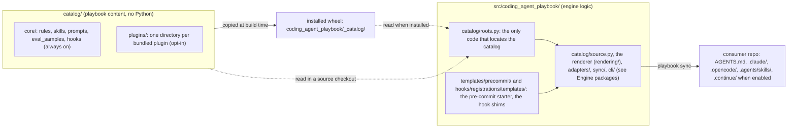

# coding-agent-playbook
Multi-harness playbook engine

## Why coding-agent-playbook?

- **One source, every assistant.** Author your rules, prompts, and skills once
  as markdown + YAML frontmatter. The engine renders them into whatever each
  tool expects — `.claude/`, `.opencode/`, `.continue/` (when enabled), the
  universal `AGENTS.md`, and the shared skill root `.agents/skills/` that Codex
  and OpenCode read — so you stop
  hand-maintaining the same guidance in five formats.
- **Generated output stays out of git.** Rendered files carry an
  `AUTOGENERATED` header and are **local-only** by default: `playbook sync`
  gitignores them through a managed `.gitignore` block, a `post-checkout` /
  `post-merge` hook re-renders them on every machine, and a pre-commit guard
  refuses commits that stage them. The context your assistants read is always
  rendered from the source of truth — never a stale committed copy. (Prefer
  committing it? Set `[output] commit = true` for the legacy drift-check flow.)
- **Context-aware, not noise.** A detector inspects the repo (dependencies,
  frameworks, ML stack, project kind) and each artifact's `applies_if` predicate
  decides what ships — a FastAPI rule only reaches FastAPI repos, the ML
  serialization-security rule only ML repos. Assistants get the rules that
  actually apply. Only a short always-loaded core rides every turn; scoped rules
  load on demand, as references inside skills the assistant picks by
  description.
- **Built for organizations.** Three layers compose by artifact `id`: engine
  generic content → pip-installable org overlay packages → repo-local
  `playbook/` overrides. Central teams distribute standards as versioned
  dependencies; individual repos extend or override locally — no forking, no
  copy-paste.
- **Enterprise-friendly.** Copies, not symlinks (cross-platform,
  banking-safe). No telemetry, ever. No outbound network by default — even the
  pre-commit hooks run locally, so it works fully offline. Distribute via
  internal PyPI / git.
- **Mistakes caught before they ship.** `playbook validate` cross-checks the
  canonical source (prompt↔rule inclusion symmetry, eval-sample back-references,
  typo'd predicate keys), and a local lockfile records the engine version and
  content hash of every artifact it produced, so regenerations are reproducible
  (and, with `[output] commit = true`, reviewable in a diff).
- **Guardrails inside the session (opt-in).** Lifecycle hooks, rendered
  natively for Claude Code and OpenCode, stop an assistant from hand-editing
  generated files, persisting a secret, skipping your pre-commit hooks or
  ending a turn on a red tree. Every other assistant gets the same guidance as
  text: one line per guardrail in `AGENTS.md`, the full text in a skill.
  Nothing changes until a repo opts in.
- **Self-contained artifacts.** Every markdown link in every artifact must
  resolve inside the shipped bundle; external links pass only through the
  `[links] allowed_domains` allowlist (default: none). Deterministic — no
  network — and enforced on CI for the engine's own artifacts (SPEC §12.6).
- **Quality is measurable.** Prompts can declare paired eval samples (positive +
  false-positive guards), so prompt behavior is testable rather than vibes —
  authored as `[gate]` / `[rubric]` layers and run end-to-end with
  `playbook eval --run`.

## Status

Engine and CLI are implemented: detector, renderer, six adapters
(Continue, Claude Code, OpenCode, AGENTS.md, the `shared_skills` adapter, which
writes the shared skill root `.agents/skills/` read by Codex and OpenCode, and the opt-in
[Agent Harness](https://agentharnesses.io/specification)), the `playbook`
commands (`init` / `sync` / `check` / `validate` / `render` / `eval` /
`metrics` / `import-harness` / `validate-harness`), the off-workstation checks
(`ci` / `gate-scan` / `scan-secrets` / `scan-sinks` / `check-deps` /
`check-commit-trailers` / `check-notebooks`), the Tier 0 eval schema
plus the v1.1 eval runner (`playbook eval --run`, deterministic layers live;
judged rubric scoring live via `--judge`), and the code-quality metrics gate.
v0.20 adds the opt-in [assistant lifecycle hooks](#assistant-lifecycle-hooks):
a shipped pack of guards that Claude Code and OpenCode enforce natively and every
other assistant reads as advice, all run by one dispatcher, the `playbook-hook`
runtime (`dispatch` for the harnesses; `simulate` and `doctor` for you). v0.21
delivers scoped rules as references inside skills ([Rules inside
skills](#rules-inside-skills)). See `SPEC.md` for the full design, and
`CONTEXT.md` for the vocabulary these docs use (always rule, scoped rule,
member rule, skill, reference, layer, bundled plugin, adapter): it is the
project's only glossary.

Working on the engine itself:

```bash
uv sync --extra dev   # install engine + dev tools
uv run pytest         # run the test suite
uv run playbook --version  # smoke-test the CLI
```

## Architecture

`playbook sync` composes the three source layers, keeps what applies to the
repo, renders it once, and hands every artifact to every enabled adapter. With
hooks on, one dispatcher answers every harness event at run time:

```text
 sources (later layer wins by id)    resolve                               render
 engine catalog/core/  ─┐            OverlayResolver: one winner per id    sandboxed Jinja,
 overlays, plugins     ─┼──────────► (hooks: overlays only add)  ────────► StrictUndefined
 repo-local playbook/  ─┘            detector facts + applies_if                 │
 rules, prompts, skills, hooks       scoped rules join the skill they name       │
                                     resolve_effective_hooks ([hooks])           │
                                                                                 ▼
 adapters: each writes what its harness reads
   continue       .continue/rules/ (one file per rule) + .continue/prompts/ (opt-in)
   claude_code    .claude/ (always rules + "Where guidance lives" in
                           .claude/rules/coding-agent-playbook.md,
                           a rule-free .claude/CLAUDE.md stub,
                           skills with their rule references in .claude/skills/<id>/)
                           + managed hook entries in .claude/settings.json
                           + .claude/hooks/playbook/launch.sh
   opencode       .opencode/ + .opencode/plugins/playbook-hooks.js
   agents_md      AGENTS.md (always; always rules + "Where guidance lives";
                           one ## Guardrails line per hook when hooks are on)
   shared_skills  .agents/skills/ (the shared skill root: Codex, OpenCode)
   agent_harness  HARNESS.md tree + .playbook/ sidecar (opt-in)
 sync-level       .coding-agent-playbook.lock
                  .coding-agent-playbook/hooks/guard_config.json (+ copied hook scripts)

 run time (hooks on): every harness event reaches one dispatcher
   Claude Code ── sh .claude/hooks/playbook/launch.sh ──┐
   OpenCode ───── .opencode/plugins/playbook-hooks.js ──┴──► <pinned python> -I -m
                                                             coding_agent_playbook.hook_runtime
                                                             dispatch <event>
   the playbook-hook dispatcher reads guard_config.json, runs every on hook in-process,
   answers deny | ask | context | none and exits 0, or 10 for a deny; the interpreter
   pin lives under <git-dir>/playbook-hooks/, never in the repository
```

Generated output is local-only by default (`[output] commit = false`): the
adapters' files, the launcher, the OpenCode plugin and `guard_config.json` are
gitignored and re-rendered in each clone by the post-checkout `playbook sync`.
`.claude/settings.json` is co-owned with you: sync manages only its own entries
there (hook groups and the native deny rows of the guards that are on),
recognised by their lockfile hash, and never touches your keys or
`.claude/settings.local.json`. The launcher and the OpenCode plugin are
written whole, so a file of yours at either path (one whose first line is not
the `AUTOGENERATED` marker), a hard link at it (the engine would rewrite the
other name too), or a symlink on the way to it, stops `playbook sync` with
exit 1 naming the file, and nothing is written: rename yours, then re-run. Guards on a developer machine are speed bumps;
the authoritative checks run off the workstation, as the
[pre-commit hooks](#pre-commit-hooks) and [`playbook ci`](#playbook-ci).

### Engine packages

`src/coding_agent_playbook/` is a flat set of top-level packages and a few root
modules, each named after a `CONTEXT.md` term where one exists
([ADR 0002](docs/adr/0002-flat-concept-packages-with-an-enforced-dependency-direction.md)).
A package imports only the packages below it, siblings joined by `|` never
import each other, and an underscore module is imported only from inside its
own package. A package's interface is its non-underscore modules; every
package `__init__.py` holds only a docstring (the root's lazy `__version__`
and `cli/`'s `main` are the two exceptions).

```text
 highest first; a package may import any package below it
 cli                the `playbook` entry point: main, the parser, `python -m`
  └ commands        one module per subcommand; twins/ (the guard twins: ci, gate-scan, scan-*, check-*)
   └ sync           the sync pipeline: plan, write, check modes, machine-local hook pins
    └ validation    the validation rule set and its findings (`playbook validate`, sync's gate)
     └ agent_harness | evals | precommit
                    the Agent Harness tree round trip | eval samples: load, compile, run | the pre-commit template
      └ adapters    one adapter per harness (base.py is the out-of-tree interface); claude_code/
       └ rendering  the Renderer: sandboxed Jinja, output formats, RenderSession
        └ hooks     the sync-time half of a hook: resolution/, contract/, registrations/, guard_config/
         └ skills   skill documents, member rules, references
          └ metrics_gate  `playbook metrics` and the Stop-stage metrics call
           └ config       the two consumer config files and their tables
            └ catalog     the catalog: layer roots, the artifact source, overlay resolution
             └ detector | lockfile   detector facts and predicates | the lockfile and its drift
              └ grading            the grading kernel: metrics, checks, rubrics, scheduler
               └ generated_output  sentinel, atomic writes, symlinks, gitignore, write guard
                └ artifacts        the artifact types: rule, prompt, skill, hook, path globs
                 └ security | toml_writer | exit_two
                                   stdlib-only secret, PII and path judges + the trust store
                                   | the TOML writer | ExitTwoError, the CLI's exit-2 error

 hook_runtime  a separate stack outside the order: it imports only itself, the stdlib and the
               stdlib leaves (artifacts.path_classes, artifacts.path_globs, catalog.roots,
               detector.pep503, detector.pyproject_deps, generated_output.atomic_io,
               generated_output.sentinel, lockfile, security), so every hook event stays cheap;
               its deferred branches are named ignore_imports lines of hook-runtime-stack.
               Root modules cli (`playbook-hook`), __main__ and ruff (the post-edit ruff seam);
               config/ shell/ git/ state/ diagnostics/ harness/ judges/ dispatch/ stop/ and
               handlers/ (one subpackage per hook pack: safety, protect, verify, feedback,
               audit, plus _shared). Only commands (the twins), sync and hooks import it,
               and only its public modules.
 templates/precommit/  data: the air-gapped pre-commit starter
```

The external contract never moves with the packages: committed launchers run
`python -I -m coding_agent_playbook.hook_runtime`, the console scripts point at
`coding_agent_playbook.cli:main` and `coding_agent_playbook.hook_runtime.cli:main`,
out-of-tree adapters import `coding_agent_playbook.adapters.base`, child processes
run `python -m coding_agent_playbook.cli`, and the entry-point group names
(`coding_agent_playbook.adapters`, `.overlays`, `.runners`, `.metrics`, `.checks`,
`.hook_handlers` and the rest) stay as they are.

Seven import-linter contracts in `pyproject.toml` (`[tool.importlinter]`)
enforce this: `engine-layers` (the order above), `stdlib-leaves`,
`hook-runtime-stack`, `grading-kernel` (the kernel imports only the stdlib
leaves), `command-independence` (no command imports another), `private-modules`
and `twins-use-judges` (a guard twin reaches its guard's judge through
`hook_runtime.judges`, never a handler). They run from pytest
(`tests/architecture/test_import_contracts.py`), so the CI gate keeps its four
commands. Section 6 of `specs/prT-package-layout.md` designs each contract.

## Editing content

Everything the playbook ships as content lives in `catalog/`, outside the
Python package; `src/coding_agent_playbook/` is engine logic only. Writing a
rule, prompt, eval sample, skill or hook never means touching Python:

- `catalog/core/` holds the engine's built-ins: `rules/`, `skills/`,
  `prompts/`, `eval_samples/` and the lifecycle `hooks/`, always on (a hook still
  runs only where `[hooks]` turns it on, and a core skill is written only where
  one of its rules applies).
- `catalog/plugins/<name>/` holds one **bundled plugin** per directory
  (today `superpowers` and `mattpocock_skills`), off until a consumer lists
  `coding_agent_playbook.plugins.<name>` in `overlays_enabled`. A new
  directory there is a new plugin, with no code change. A plugin may ship
  any kind `core/` does, `eval_samples/` included: its samples use its own
  `prompts/` and are listed only where the plugin is enabled.

`catalog/README.md` is the contributor guide: where each kind lives, how to
add a rule, prompt, eval sample, skill or bundled plugin, and the four commands
CI runs. There is still one wheel: the build copies `catalog/` into it, so
`pip install coding-agent-playbook` ships everything. Build releases from the
sdist (`uv build` or `python -m build`, never `--wheel`).



## Using the playbook in an external repo

Add the playbook to any repo that should get generated assistant context
(`.claude/`, `.opencode/`, `AGENTS.md`, `.agents/skills/`, and `.continue/` when
enabled) from the
canonical rules, prompts, and skills.

### 1. Install

Install the engine as a dev dependency, plus any organization overlay packages
that ship your team's rules and prompts:

```bash
uv add --dev coding-agent-playbook            # the engine (generic content)
uv add --dev playbook-rules-<org>             # optional: your org's overlay
```

`pip` works too: `pip install coding-agent-playbook`.

### 2. Initialize

```bash
playbook init
```

`playbook init` detects your stack, asks whether to enable the
[assistant lifecycle hooks](#assistant-lifecycle-hooks) (`--no-hooks` skips
them), then writes:

- `.coding-agent-playbook.toml` — the committed project config (below),
  including `[output] commit = false` and your `[hooks] enabled` answer;
- `.coding-agent-playbook.local.toml` — personal per-engineer overrides
  (gitignored automatically);
- a merged `.pre-commit-config.yaml`;
- and runs `playbook sync` once to generate the initial artifacts (and the
  managed `.gitignore` block that keeps them out of git).

Without `--adapters`, `init` enables `claude_code`, `opencode` and
`shared_skills` (`AGENTS.md` is always written). Continue is opt-in since
v0.21: its upstream is in maintenance, and its IDE already reads `AGENTS.md`
and `.claude/skills/`. To enable it as well:

```bash
playbook init --adapters claude_code,opencode,shared_skills,continue
```

Codex needs no adapter: it reads `AGENTS.md` and `.agents/skills/`.

Then install the git hooks — all three hook types, so the auto-sync runs after
checkouts and pulls:

```bash
pre-commit install --hook-type pre-commit --hook-type post-checkout --hook-type post-merge
```

Commit `.coding-agent-playbook.toml`, `.pre-commit-config.yaml`, and
`.gitignore` — **not** the generated files.

### 3. Generate

```bash
playbook sync     # regenerate .claude/, .opencode/, AGENTS.md, .agents/skills/ (+ .continue/)
```

`playbook sync` is the workhorse. The generated output is **local-only**: it is
not in the repository, so **run `playbook sync` once right after cloning** (then
install the hooks as above). Output an earlier sync left behind — a skill you
removed, an adapter you disabled — is deleted when untouched, and otherwise kept
gitignored, so it can never slip into a commit. (`playbook sync --check` is for
the legacy committed-output flow and CI there; under the default it is only
meaningful in a working copy that has already been synced.) From then on the `post-checkout` / `post-merge`
hook re-runs it after every checkout and pull; run it by hand whenever you
change `playbook/` or the config. `AGENTS.md` is always generated regardless of
which adapters are enabled (as long as at least one always rule, Where line (a skill with member
rules and a `playbook.files` phrase, while an enabled adapter writes a skills root) or hook advisory applies). A scoped rule that names a skill (`skill:`) is not in it: it
arrives as a reference inside that skill, and a generated `## Where guidance lives`
section maps file kinds to those skills (core ships four, "Rules inside skills" below).
Claude Code gets the same always-rule sections and the same map in `.claude/rules/coding-agent-playbook.md`,
which it loads natively; the generated `.claude/CLAUDE.md` is a rule-free stub, so
OpenCode v1 (which attaches that file when it reads under `.claude/`) never loads
the rules twice (SPEC §10.3.1). Any other `.claude/rules/` file is yours, and
`sync` exits 1 rather than overwrite a file of yours already named
`coding-agent-playbook.md` there, write over a hard link at it, or write through
a symlink on the way to it (a symlinked `.claude` or `.claude/rules`, or a link
at the file itself); a symlinked or hard-linked `.claude/CLAUDE.md` (such as a
link to `../AGENTS.md`) stops it the same way.

What `sync` does with git, by `[output] commit` in `.coding-agent-playbook.toml`:

- **`commit = false` (default)** — `sync` writes every generated path into a
  managed block of `.gitignore` (between
  `# >>> coding-agent-playbook (managed — do not edit) >>>` and
  `# <<< coding-agent-playbook <<<`; everything outside the block is left
  byte-for-byte alone). If git still tracks generated files — e.g. a repo
  migrating from committed output — `sync` warns and prints the exact
  `git rm -r --cached -- …` to run (it never touches git state itself).
  `playbook sync --check-staged` fails when a commit stages generated output.
- **`commit = true`** (legacy) — output is committed, `sync` removes the managed
  block, and `playbook sync --check` fails a commit on drift.

### 4. Define which resources apply

Three layers compose, later overriding earlier **by artifact `id`** (SPEC §11):

1. **Engine generic content** — ships with `coding-agent-playbook` (kept in
   the engine repository's `catalog/core/`).
2. **Overlay packages** — installed org packages, enabled (and ordered) in config.
   They're auto-discovered through Python entry points; you just list them:

   ```toml
   # .coding-agent-playbook.toml
   schema_version = 1
   # top-level keys: TOML puts anything after a [table] header inside that table
   overlays_enabled = ["playbook_rules_bnp"]     # ordered; later wins on id collision
   adapters_enabled = ["claude_code", "opencode", "shared_skills"]   # the init default
   # AGENTS.md is always emitted
   # add "continue" to opt in; drop "shared_skills" to skip .agents/skills/
   # add "agent_harness" to also emit an Agent Harness tree (opt-in)

   [project]
   name = "risk-models"
   kind = "python-application"          # python-library | ml-research | notebook
   description = "Counterparty risk scoring service"

   [engine]
   version = "0.1.0a0"                  # engine version the config was written for (required)

   [output]
   commit = false     # default: generated output is gitignored (local-only)
   ```

   (`playbook init` writes this file for you, plus `[storage]` and
   `[detector_cache]` tables; keep its `[engine]` table. Re-running
   `playbook init`, or `playbook check --refresh` after adding a dependency,
   rewrites it from the committed file alone: init's answers and the fresh
   `[detector_cache]` replace their keys, every other value is kept (tables
   the engine does not manage, such as `[hooks]`, `[links]` and `[metrics]`,
   included), but comments and layout are not.)

   The enabled lists are top-level keys only, so they go **above the first
   `[table]` header**. Every command that loads the config (`sync`, `check`,
   `validate`, `render`, `eval`, `init`) stops with an `error:` (exit 2),
   naming the file and the exact line to write instead, before anything is
   written, when it finds: an `[overlays]` / `[adapters]` table (or
   `overlays.enabled = …`); an `overlays_enabled` / `adapters_enabled` key
   written after a `[table]` header, which TOML nests in that table (say,
   appended to the end of the file); a misspelled key such as
   `overlay_enabled`; or a value that is not a list of non-empty strings. A
   personal `.coding-agent-playbook.local.toml` can set `adapters_enabled` too,
   above its `[user_choices]` header; its list replaces the committed one for
   your checkout only — no command writes the local file into the committed
   config.

3. **Repo-local `playbook/`** — drop in per-repo rules, prompts, skills, or eval
   samples; anything here wins on `id` collision:

   ```text
   playbook/
   ├── rules/         # add a new rule, or override one by reusing its id
   │                  # (a scoped rule names its skill with `skill:`)
   ├── prompts/
   ├── skills/        # <id>/SKILL.md (+ scripts/, references/)
   └── eval_samples/
   ```

Not every resource renders everywhere: the detector inspects the repo and each
artifact's `applies_if` predicate gates it (a FastAPI rule won't ship to a
non-FastAPI repo; the ML serialization-security rule ships only to repos with an
ML stack; the uv workflow reference ships only to repos the detector sees as uv
projects, that is with a `uv.lock`). A skill that owns rules follows them: it is
written only when at least one of its rules applies. Run `playbook check` to see
the detected facts and exactly which rules/prompts are active — the fastest way
to debug *"why isn't my rule appearing?"*

## Skills: one source, every Agent-Skills root

A canonical skill (`playbook/skills/<dir>/SKILL.md` + optional `scripts/` and
`references/`, one shipped by an overlay, or one shipped by core) is written
**natively** by three
adapters that share one `SkillWriter`, so every copy is byte-identical:

```text
playbook/skills/<dir>/  ──►  SkillWriter  ──┬──►  .claude/skills/<id>/     (claude_code)
  SKILL.md (id: <id>)                       ├──►  .opencode/skills/<id>/   (opencode)
  scripts/ references/                      └──►  .agents/skills/<id>/     (shared_skills: Codex, OpenCode)
                                     Continue: degraded to a prompt (.continue/prompts/<id>.md)
                                     AGENTS.md: skills are not emitted (a skill with rules gets a "Where guidance lives" line)
```

- **Every skill must declare `id:` in its `SKILL.md` frontmatter.** That `id` —
  not the source folder name — is the output directory name, the overlay merge
  key, and the emitted `name` (an authored `name` is overwritten). A skill
  without `id:` falls back to `skill`, so several id-less skills collapse into
  one; `playbook validate` reports each of them.
- `.agents/skills/` is the shared skill root, written by the `shared_skills`
  adapter: Codex reads it natively and OpenCode as a compatibility root
  (Claude Code and Continue read `.claude/skills/`). It is on by default, but
  not force-enabled — drop `shared_skills` from `adapters_enabled` to opt out.
  OpenCode v2 keeps one copy per skill (`.opencode` over `.agents` over
  `.claude`); v1 logs one duplicate-skill warning per extra copy, which
  `OPENCODE_DISABLE_EXTERNAL_SKILLS` or `OPENCODE_DISABLE_CLAUDE_CODE_SKILLS`
  silence. Engines before v0.21 wrote these copies to `shared_skills/`: the
  next `playbook sync` deletes the unchanged ones and keeps anything you edited
  or git tracks. It reports a tracked file on stderr, and under `commit = true`
  every kept file; an edited, untracked copy stays owned and gitignored without
  a notice (MIGRATION.md, v0.21).
- No engine file sits directly in a skill root: every write is
  `<root>/<id>/…`, because OpenCode v2 loads any root-level `*.md` in a skill
  root as a skill.
- `scripts/` and `references/` are copied whole, except Python bytecode caches
  (any `__pycache__/` directory and `*.pyc`/`*.pyo` files), which are never
  synced into a skills root or listed in the lockfile. Dot-files are copied.
- Emitted `SKILL.md` follows the Agent Skills standard: frontmatter `name` is
  the skill `id` (= directory name). `playbook validate` flags ids that don't
  match `^[a-z0-9]+(-[a-z0-9]+)*$` (max 64 chars) and skills without a
  `description` — OpenCode silently skips such skills otherwise.
- Every generated `SKILL.md` carries the `AUTOGENERATED` sentinel as its first
  body line, marking the directory as engine-owned; skill directories you author
  by hand (no sentinel) are never touched. If a hand-written `<root>/<id>/`
  collides with a canonical skill id, sync leaves it alone and prints a warning
  instead of overwriting it — rename one of them. `playbook sync --check` and
  the staged-output guard make the same call, so such a dir is neither drift nor
  "generated output".
- When you remove a skill (or a script from one), `playbook sync` deletes only
  the files it wrote that you have not touched since (and git does not track),
  then prunes the emptied directories in all roots — never above a skills root,
  and never the target of a symlinked one (`.claude/skills -> ../.agents/skills`).
  An edited copy, a tracked file, or a file you added to a generated skill
  directory is never deleted: edited/tracked leftovers stay owned (and gitignored
  under the default) until you remove them, and your own added files stay yours.
  The same single rule (`commit = true` included) covers a script or reference
  that turns from a file into a folder (or back): an edited or tracked copy in
  the way is left alone with a warning, and `playbook sync --check` names it
  until you move it. A path you re-point through a symlink, or a skill dir whose
  `SKILL.md` you rewrote, is yours from then on.
- Output written through a link out of the repo (`.claude/skills ->
  /shared/skills`) gets no lockfile entry, so the leftover policy never deletes
  it: a removed skill's files there stay until you delete them (a stale
  sentinel-tagged command or rule file there is still removed, and
  `playbook sync --check` reports it). Anywhere else (the rules above cover
  skill directories, and a skills root that is a dangling link or a file is
  skipped with a warning), something in the way of output stops
  `playbook sync` with exit 1 naming it, and is never deleted: a dangling link
  (`.claude/commands -> ../tools/cc` with no `tools/cc`; create the target, or
  re-point or remove the link), a file where an output directory goes (a file
  at `.claude/commands`), or a directory, FIFO or socket where an output file
  goes (an `AGENTS.md/` directory, `mkfifo AGENTS.md`). Move or fix it, then
  re-run. Inside a skill directory a link that leads out of it is never written
  through: the files under it are skipped with a warning, and
  `playbook sync --check` names the link until you remove or re-point it.

### Rules inside skills

Core ships four skills, and every scoped rule in core names the one that owns
its topic (`skill:` in its frontmatter):

| Skill | Its rules | Written when |
| --- | --- | --- |
| `python-coding` | dependency injection, pure core, data shapes, typing, performance idioms, asyncio (Python 3.11+), classes and protocols, error handling, context managers, docstrings, timeouts and retries, idioms | always (most of its rules are ungated) |
| `python-testing` | `pytest` conventions, test doubles, fixtures | pytest is detected |
| `python-tooling` | static checks (ruff and mypy), pytest configuration (with pytest), uv workflow (uv projects), `fastapi-app-wiring` and `fastapi-error-boundaries` (FastAPI), Pydantic boundaries (Pydantic declared) | always (static checks are ungated) |
| `ml-data` | `ml-serialization-security` (torch, TensorFlow, JAX, transformers, scikit-learn, XGBoost or LightGBM); vectorization, data transforms, dtypes and typing, reproducibility and numeric tests (NumPy, pandas or polars, with a section per library) | the ML stack includes one of those libraries |

Core also ships `playbook-guardrails`, which takes no rules. With hooks on, sync
fills it with the full text of every enabled hook's guardrail, one section per
hook, and writes it to `.opencode/skills/` and `.agents/skills/`. Claude Code
runs the hooks itself, so `.claude/skills/` gets it only for a hook Claude Code
cannot run; Continue keeps its `30-guardrail-<id>.md` rule files. `AGENTS.md`
keeps one line per guardrail, the hook's `summary`, and names the skill.

Sync renders each rule that applies as `<skills root>/<skill>/references/<rule-id>.md`
and appends a `## References` index to the skill's `SKILL.md`, one line per
rule with its description. The skill's description gains a generated "Covers
..." clause naming those rules (`Library-agnostic Python conventions. Covers
Dependency injection, Pure core, ... Use when writing, changing or reviewing
Python code.`). The engine keeps it within 300 characters by listing the
highest-priority rules and ending with "and N more" when not all names fit.
`AGENTS.md` and
`.claude/rules/coding-agent-playbook.md` then carry only the always rules and a
generated `## Where guidance lives` map from file kinds to these skills; the map
is left out when no enabled adapter writes a skills root.

- **Add a rule to a core skill** by naming it: `skill: python-coding` in
  `playbook/rules/<file>.md` (or in an overlay) is enough, because membership is
  resolved after every layer is merged. Every scoped rule must name one:
  `playbook validate` fails on a scoped rule without `skill:` and lists the
  skills it may name, and `playbook sync` writes nothing until it is fixed.
- **Override a core skill** with `playbook/skills/python-coding/SKILL.md`. The
  core rules still attach to it, so keep its `playbook:` block (`use_when`,
  `files`); a skill without that block, such as a bundled plugin skill, takes no
  rules.
- **Continue** reads no skills: when enabled it still gets one
  `.continue/rules/` file per rule, and a skill with rules is never turned into
  a Continue prompt.

## Bundled plugins: superpowers, mattpocock_skills

The engine wheel bundles **opt-in bundled plugins** (called *packs* before
v0.19). They layer exactly like an overlay package but need no extra install,
and they stay **off** until you list them. Each one is a plain content
directory, `catalog/plugins/<name>/` in the engine repository, enabled as
`coding_agent_playbook.plugins.<name>`. The first is `superpowers`: a
near-verbatim, self-contained port of the Superpowers skills library (v7.0.0,
MIT, by Jesse Vincent) with 15 skills:
brainstorming, writing-plans, executing-plans, subagent-driven-development,
test-driven-development, systematic-debugging, verification-before-completion,
requesting/receiving-code-review, using-git-worktrees,
finishing-a-development-branch, dispatching-parallel-agents, writing-skills,
using-superpowers, and diagnosing-superpowers.

```toml
# .coding-agent-playbook.toml (top-level keys, above the first [table] header)
overlays_enabled = ["coding_agent_playbook.plugins.superpowers"]
adapters_enabled = ["claude_code", "opencode", "shared_skills"]   # the init default
```

Use these top-level keys: they are the only ones the engine reads. Put them
at the top of the file, above the first `[table]` header: the file
`playbook init` writes ends with a `[detector_cache.frameworks]` table, so a
line appended to the end lands in that table. Every command that loads the
config (`sync`, `check`, `validate`, `render`, `eval`, `init`) refuses such a
nested key, the `[overlays] enabled` / `[adapters] enabled` table form and a
misspelled key: it exits 2 with an `error:` that names the file and shows the
top-level line to write, and writes nothing, so a repo you already synced
keeps its skills, lockfile and `.gitignore` untouched. A misspelled
bundled-plugin name is caught everywhere: `playbook sync` (write mode,
`--check`, and `--check-staged` under the default `commit = false`; under
`commit = true` that last one is a no-op) exits 1 naming it and writes
nothing, `playbook validate` fails on it, `playbook check` flags it under
`Overlays:`, and `playbook init` refuses it before writing (from `--overlays`,
or from a local file's `overlays_enabled`, which replaces it). A
bundled-plugin name is checked against `catalog/plugins/<name>/` and never
imported. An unknown one reads `no such bundled plugin`, and a name that looks
like a plugin typo also lists the bundled plugins:
`coding_agent_playbook.plugins.superpower: no such bundled plugin (bundled plugins: coding_agent_playbook.plugins.mattpocock_skills, coding_agent_playbook.plugins.superpowers)`.
The bare namespace (`coding_agent_playbook.plugins`, or the old
`coding_agent_playbook.packs`) is refused as
`the bundled plugin namespace, not a plugin`. Any other name is an overlay
package and is still imported: one that imports but ships no `resources/`
directory is refused, and so is one whose import raises (the reason then quotes
the error).
Or let `playbook init --non-interactive --name … --kind … --overlays coding_agent_playbook.plugins.superpowers`
write the config for you.

`playbook sync` then writes each skill, like any canonical skill (see above),
to `.claude/skills/<id>/`, `.opencode/skills/<id>/` and `.agents/skills/<id>/`:
byte-identical copies of `SKILL.md` (with the `AUTOGENERATED` sentinel as its
first body line) plus its `references/` and executable `scripts/`. Continue,
when enabled, gets each skill degraded to a prompt (body only), and the opt-in
`agent_harness` adapter (enable it by adding `agent_harness` to the top-level
`adapters_enabled`) writes `skills/<id>/`. Like all generated output the
copies are gitignored by default. Nothing reaches out to the upstream plugin,
its marketplace, or the network: cross-skill references use plain skill names,
and the bundled plugin contains no external URLs. The brainstorming visual
companion (a Node.js server) and the upstream plugin's SessionStart hook are
not included. The license and the list of changes are in
`catalog/plugins/superpowers/LICENSE` and `ATTRIBUTIONS.md`.
Every skill also carries the license as `references/LICENSE`, so it lands in
each synced skill directory. If you render the plugin only for Continue, keep a
copy of that `LICENSE` next to the prompts yourself.

**Opting out:** remove the plugin from `overlays_enabled` and run `playbook sync`.
The plugin's skills are then leftovers of an earlier sync, settled by the same
rule as a skill you remove: every file sync wrote that you have not touched
since (and git does not track) is deleted and the emptied directories are
pruned, so the 15 skill directories disappear from every skill root. Until you
sync, `playbook sync --check` reports the managed `.gitignore` block as stale
(under the default `commit = false`). A skill file you edited is kept (still
owned and gitignored) until you delete it by hand, and a file you added inside a
skill directory (notes in `references/`, `node_modules/` under `scripts/`) was
never written by sync, so it and the directory that holds it stay. The plugin's
Continue prompts carry the `AUTOGENERATED` header on line 1 and are removed
even if edited or committed. Under `commit = true`, committed (tracked) skill
files are kept and listed on stderr until you `git rm` them. The same rule
applies when you override one plugin skill with `playbook/skills/<id>/`: your
override replaces it in every root, and every unedited plugin file under that
skill's `scripts/` or `references/` that your override does not ship is
removed. An override of `subagent-driven-development` must therefore ship
`scripts/task-brief` and `scripts/sdd-workspace`, which executing-plans calls
(SPEC §11.5.1). See SPEC §11.5 and §4.2 step 9.

**The `mattpocock_skills` bundled plugin**
(`coding_agent_playbook.plugins.mattpocock_skills`) is vendored content: Matt
Pocock's engineering and productivity skills, pinned to upstream v1.3.1 (MIT)
and kept near-verbatim, with every change listed in
`catalog/plugins/mattpocock_skills/ATTRIBUTIONS.md`. It ships 26 skills and one
plugin always rule. Upstream's `triage` is dropped, and three skills are renamed
so they do not replace Claude Code's own bundled skills: `code-review` is
`two-axis-review`, `pr` is `pr-body` and `prototype` is `throwaway-prototype`.
The skills name no tool a consumer repo may lack (no forge CLI, `jq`, OS
openers, CDN assets or bash scripts; wizard's and diagnosing-bugs' scripts are
standard-library Python), and the plugin contains no URL. Enable it on its own:

```toml
# .coding-agent-playbook.toml (top-level key, above the first [table] header)
overlays_enabled = ["coding_agent_playbook.plugins.mattpocock_skills"]
```

Then, once per repo:

- Run `/setup-matt-pocock-skills`. It writes `docs/agents/issue-tracker.md`,
  `docs/agents/triage-labels.md` and `docs/agents/domain.md`; the default
  tracker is local markdown, which needs no remote or CLI. The plugin always
  rule (`mattpocock-skills-tracker`) points the agent at these files and asks
  it to tell you to run setup when a skill needs one that is missing.
- Add `.scratch/` to your `.gitignore`. The local tracker keeps its maps and
  tickets in `.scratch/<slug>/`, working state that is never staged or
  committed.
- If you use the upstream Claude Code plugin of these skills, disable it in
  this repo, or each skill appears twice.

Fifteen skills run only when you ask for them by name: `/ask-matt`,
`/grill-me`, `/grill-with-docs`, `/handoff`, `/implement`, `/implement-spec`,
`/improve-codebase-architecture`, `/retro`, `/setup-matt-pocock-skills`,
`/teach`, `/to-questionnaire`, `/to-spec`, `/to-tickets`, `/wait-what` and
`/wayfinder`. Only Claude Code honours their `disable-model-invocation: true`;
in every other harness each one starts with a line asking the model to stop
unless you asked for it. The other eleven load when a task calls for them.
Continue, when listed, gets each skill as a body-only prompt without its
`references/` or scripts.

Do not enable it together with superpowers: several skills cover the same
ground (`tdd` and `test-driven-development`, `diagnosing-bugs` and
`systematic-debugging`, `grilling` and `brainstorming`, among others), and the
two skill listings with core's come to about 6,800 characters, over the
6,000-character budget for core plus one bundled plugin. See SPEC §11.5.3 and
`catalog/plugins/mattpocock_skills/README.md`.

The plugin's two scripts (wizard's and diagnosing-bugs') are `.py` files, and
sync writes them as such under
`.claude/skills/`, `.opencode/skills/` and `.agents/skills/` (and `skills/`
with `agent_harness`). `mypy .` skips dot-directories but ignores `.gitignore`,
so the default adapters' copies never reach it; it type-checks only the single
`skills/` copy of the opt-in `agent_harness` adapter, so the duplicate-module
error of earlier releases is gone.
`ruff check .` skips them in a git repository while they are gitignored (the
default `commit = false`) and lints every copy under `commit = true`. If you run
these tools over the repository root, exclude the generated skill roots (for
example `exclude` under `[tool.mypy]`, `extend-exclude` under `[tool.ruff]`).

The `python_design` bundled plugin is gone: its guidance is being folded into
core. A config that still lists `coding_agent_playbook.plugins.python_design`
is refused as `no such bundled plugin`, so remove it from `overlays_enabled`
(see MIGRATION.md).

**Old names still work.** A config written before v0.19 says
`coding_agent_playbook.packs.<name>`. That spelling is a deprecated alias:
the plugin renders exactly as before, and every command that loads the config
prints one line per old name, naming the file that holds it:

```text
warning: .coding-agent-playbook.toml: overlays_enabled: 'coding_agent_playbook.packs.superpowers' is deprecated; use 'coding_agent_playbook.plugins.superpowers'
```

`sync` never rewrites the name for you. Re-run `playbook init` with
`--overlays coding_agent_playbook.plugins.<name>` (an old name there is
accepted too, with a `warning: --overlays: …` line, and written in its new
spelling), or edit `.coding-agent-playbook.toml`. A
`.coding-agent-playbook.local.toml` must be edited by hand. The
`coding_agent_playbook.packs` modules and their `PACK_NAME` constants are gone:
list the dotted string. See `MIGRATION.md`.

## Agent Harness support (opt-in)

Beyond the always-available targets, the playbook can render to and read from
the [Agent Harness](https://agentharnesses.io/specification) format — a
`HARNESS.md`-rooted tree of skills, prompts, rules, and references.

### The `agent_harness` adapter

Enable it by adding `agent_harness` to the top-level `adapters_enabled` list. It is **opt-in** —
not part of the default adapter set — and otherwise behaves like any other
adapter under `playbook sync`:

```toml
# .coding-agent-playbook.toml (top-level key, above the first [table])
adapters_enabled = ["continue", "claude_code", "agent_harness"]
```

`playbook sync` then emits a `HARNESS.md` plus `skills/`, `prompts/`, `rules/`,
and `references/` directories, alongside a `.playbook/manifest.toml` sidecar that
records everything the harness format can't represent — so the tree round-trips
back to canonical artifacts losslessly.

### Importing and validating harness trees

Two commands handle the reverse direction and structural linting:

```bash
playbook import-harness <path> [--into <dir>]   # harness tree → canonical artifacts (default ./playbook/)
playbook validate-harness <path> [--strict]     # structural checks (harnesses-ref-equivalent)
```

`import-harness` is lossless when the source carries a `.playbook/manifest.toml`
sidecar (a playbook-emitted harness) and best-effort otherwise (a foreign
harness), reporting every lossy assumption it makes. `validate-harness` checks
that `HARNESS.md` and every skill leaf carry a `name`/`description`, and warns
(or, with `--strict`, fails) on missing routing files or undescribed content
files.

## Pre-commit integration

`coding-agent-playbook` ships a `.pre-commit-hooks.yaml` so consumer repos can wire the playbook into their pre-commit pipeline directly. With the default `[output] commit = false` (generated output is gitignored):

```yaml
# In your repo's .pre-commit-config.yaml:
default_install_hook_types: [pre-commit, post-checkout, post-merge]
default_stages: [pre-commit]   # keep your other always_run hooks off checkout/merge
repos:
  - repo: https://github.com/msobroza/coding-agent-playbook
    rev: v0.1.0a0     # the engine version your project pins
    hooks:
      - id: playbook-sync                  # re-render local output after checkout / merge
        additional_dependencies: [playbook-rules-<org>]   # every third-party overlay package / out-of-tree adapter (bundled plugins need none)
      - id: playbook-no-generated-output   # refuse commits that stage generated output
        additional_dependencies: [playbook-rules-<org>]
```

> **Overlay users, read this.** These hooks are `language: python`, so pre-commit
> runs them in its **own** virtualenv holding only the engine at `rev:` — not your
> project environment. List every overlay package (and any out-of-tree adapter)
> under `additional_dependencies` and keep `rev` on the engine version you pin.
> Otherwise `playbook sync` refuses to run ("overlay package(s) or bundled
> plugin(s) in overlays_enabled are not usable here", each overlay package
> `not importable`) instead of silently re-rendering without your org's rules. The
> simpler option: use the `repo: local` + `language: system` hooks `playbook init`
> writes (below), which run the `playbook` from your project environment.

Install all three git hook types — `default_install_hook_types` makes a plain `pre-commit install` do it, or be explicit:

```bash
pre-commit install --hook-type pre-commit --hook-type post-checkout --hook-type post-merge
```

(Explicit `--hook-type` flags replace `default_install_hook_types`, so always name all three.) From then on every checkout and pull re-renders `.claude/`, `.opencode/`, `.agents/skills/`, `AGENTS.md` and, when enabled, `.continue/` locally with the engine and overlays already installed — after pulling a dependency bump, run `uv sync` (or your equivalent) and then `playbook sync` — and a commit that stages any of them fails with the exact `git rm -r --cached -- …` to unstage it. The new stage names need pre-commit ≥ 3.2.

Repos that set `[output] commit = true` keep the **legacy** flow instead: use `- id: playbook-sync-check`, which fails a commit when the committed output drifts from what the engine would produce.

`playbook init` writes a starter `.pre-commit-config.yaml` for you — an **air-gapped-friendly** config whose hooks are all `repo: local` + `language: system` (the playbook hooks for your `[output] commit` policy plus `ruff`/`ruff-format`/`mypy`), so pre-commit never clones a remote hook repo and the playbook hooks see your overlays. The flip side: those tools must already be installed in your environment, since `language: system` runs them from PATH rather than installing them. Re-running `init` on a config from before v0.16 swaps its old `playbook sync --check` hook for the two new ones (or tells you to delete it if you edited it). See SPEC.md §13.2 for the full template and the hooks deliberately left out.

### Pre-commit hooks

These run at `git commit` (or checkout, merge, commit-msg), for humans and
assistants alike. They are not the [assistant lifecycle hooks](#assistant-lifecycle-hooks),
which run inside an assistant's session; most lifecycle guards have one of these as
their off-workstation twin.

| Hook ID | When it runs | What it does |
| --- | --- | --- |
| `playbook-sync` | `post-checkout`, `post-merge` | Runs `playbook sync` to re-render the gitignored output. Default policy (`[output] commit = false`). |
| `playbook-no-generated-output` | Every commit | Runs `playbook sync --check-staged`; fails the commit when generated output is staged. Default policy. |
| `playbook-sync-check` | Every commit | **Legacy** (`[output] commit = true`): runs `playbook sync --check`; fails the commit on drift. |
| `playbook-validate` | Manual only (`pre-commit run --hook-stage manual playbook-validate`) | Runs `playbook validate`; surfaces canonical-source mistakes (typo'd `applies_if` keys, orphan eval samples, etc.). Overlay-author-facing. |
| `playbook-metrics` | Every commit (Python files) | Runs `playbook metrics --baseline git:HEAD --no-run-tests`; fails the commit when staged Python worsens vs `HEAD`. **Static only**: `--no-run-tests` keeps your test suite out even when `[metrics] run_tests = true`. |
| `playbook-coverage` | Manual only (`pre-commit run playbook-coverage --hook-stage manual`, or move it to `pre-push`) | **Runs your test suite** with coverage: changed lines must be at least 80% executed (`diff_coverage`) and total coverage must not drop below `HEAD`. Needs `pytest-cov` in your project. |
| `playbook-secrets` | Every commit | Runs `playbook scan-secrets --staged`; fails when staged lines add a known token format (cloud, VCS, chat and LLM API keys, PEM private keys, JWTs, URLs with inline passwords) or a credential file (`.env*`, `*.pem`, …) is staged. Output is masked. The stdlib, air-gapped stand-in for gitleaks. |
| `playbook-commit-msg` | `commit-msg` | Runs commitizen's `cz check --commit-msg-file` against your [`[tool.commitizen]` convention](#commit-message-convention-commitizen). `language: system`: `cz` comes from your environment, and a machine without it fails loudly. |
| `playbook-notebooks` | Every commit (notebooks) | Runs `playbook check-notebooks`; fails when a staged notebook keeps cell outputs (they may embed data rows). For ML / data-science repos. |
| `playbook-scan-sinks` | Every commit (Python, notebooks) | Runs `playbook scan-sinks --staged`; fails when staged code adds an unsafe deserialization sink (`pickle.loads`, `torch.load(weights_only=False)`, …). For ML repos. |

`playbook-commit-msg` needs the `commit-msg` hook type: add it to
`default_install_hook_types` (`[pre-commit, post-checkout, post-merge, commit-msg]`),
or append `--hook-type commit-msg` to the `pre-commit install` line above. The
air-gapped starter `playbook init` writes carries `repo: local` twins of these:
`coding-agent-playbook-metrics` (with `--no-run-tests`), the manual
`coding-agent-playbook-coverage` and `coding-agent-playbook-secrets`, plus, only
when the repo opted into them, `coding-agent-playbook-commit-msg` (commitizen) and
`coding-agent-playbook-commit-trailers` (`playbook check-commit-trailers`, the
commit-trailer rows of `[hooks.git-commit-push-policy-guard]`), both at the
`commit-msg` stage, which the starter then installs. Run against an existing
`.pre-commit-config.yaml`, `init` adds only the sync hooks it lacks, so copy any
new hook you want into yours by hand (SPEC §13.2).

## Assistant lifecycle hooks

Lifecycle hooks are the fourth canonical kind, next to rules, prompts and
skills: a `<id>/HOOK.md` directory whose static frontmatter binds assistant
events (`pre_tool_use`, `post_tool_use`, `stop`, `session_start`, …) to a
handler. The engine ships a pack of them in `catalog/core/hooks/`: guards that
protect the playbook's own outputs, verify the work before the assistant says it
is done, feed lint back after an edit, keep secrets and destructive commands
out, and keep a local audit trail. Claude Code and OpenCode enforce them natively; every other
assistant reads the same guidance as text. Overlays (`<pkg>/resources/hooks/`),
bundled plugins (`catalog/plugins/<name>/hooks/`) and `playbook/hooks/` can add
their own (SPEC §6.6.7).

### Turning them on

Hooks are **off until a repo opts in**, and an engine upgrade never turns them
on: with no `[hooks] enabled = true`, every mode of `playbook sync` renders byte
for byte what it rendered before (apart from the Claude Code rules' one-time
move to `.claude/rules/coding-agent-playbook.md`, SPEC §10.3.1), and write mode
prints one line, `hooks available: add [hooks] enabled = true or re-run playbook
init`. `playbook init` asks `Enable assistant lifecycle hooks? [Y/n]` and writes
your answer;
`playbook init --no-hooks` writes `enabled = false` without asking. Or edit the
committed config yourself:

```toml
# .coding-agent-playbook.toml
[hooks]
enabled = true                       # the opt-in: an absent table or key means off
tiers = ["default"]                  # add "opt-in" to turn every opt-in hook on
enable = ["coverage-diff-gate"]      # single hooks, whatever their tier
disable = ["typing-lint-feedback"]   # wins over enable
unattended_ask = "deny"              # what an `ask` becomes when no human can answer

[hooks.stop-ci-parity-gate]          # [hooks.<hook-id>]: that hook's own settings
stages = ["typecheck", "tests"]      # execution stages: they run your code, so they
max_blocks = 2                       # also need a trust approval (below)
```

Policy shared with the off-workstation twins lives in `[guardrails]`, which
applies even with hooks off:

```toml
[guardrails.git]
protected_branches = ["develop"]           # extends main, master and release/*

[guardrails.secrets]
allow_paths = ["tests/fixtures/sample.env"]   # exempt paths, such as test fixtures
```

Then run `playbook sync`. With hooks on it writes `guard_config.json`, the
Claude Code registrations and launcher, and the OpenCode plugin; pins this
worktree's Python interpreter; and prints a `✓ Hooks:` summary line counting
the enabled and skipped hooks per adapter. `playbook check` lists every hook
with its state per adapter: `enforced`, `degraded` (registered, with a gap),
`advisory` (text only) or `—`, so advice is never mistaken for enforcement.
`[hooks]`, `[guardrails]` and `[metrics]` are team policy: they are read from
the committed file only, and `.coding-agent-playbook.local.toml` cannot set
them (a developer deviates at run time, below).

### The pack

Tiers: `default` hooks are on in any repo that enabled hooks; `opt-in` hooks
ship off and are turned on through `tiers` or `enable`; `overlay` hooks are
mechanisms that ship inert and that only an organization overlay activates,
with its own data (an overlay can also make a hook `mandatory`, which
`[hooks] disable` cannot turn off). "Enforced on" says where the hook blocks or
answers natively; "checked on OpenCode" means OpenCode reports but cannot block
(its Stop event is evidence-only and its session start rides an experimental
API). Everywhere else, the hook's guidance reaches the assistant as text.

#### Protect the playbook

| Hook | Tier | Enforced on | What it does |
| --- | --- | --- | --- |
| `guard-generated-outputs` | `default` | Claude Code, OpenCode | Deny hand edits of files `playbook sync` generates and point at the canonical source. |
| `control-plane-guard` | `default` | Claude Code, OpenCode | Stop the agent disabling or rewriting its own guardrails (hook config, settings files, pre-commit config). |
| `stop-drift-and-orphan-gate` | `default` | Claude Code; checked on OpenCode | Block the end of a turn while generated outputs differ from the lockfile or orphans remain. |
| `validate-then-sync-on-canonical-edit` | `default` | Claude Code, OpenCode | Report `playbook validate` failures for an edited canonical source in-turn; sync only when `[hooks] auto_sync` allows. |
| `resync-on-detector-input-change` | `default` | Claude Code, OpenCode | Name the rules and prompts a dependency, Dockerfile, CI or notebook change newly activates. |
| `session-start-playbook-briefing` | `default` | Claude Code; checked on OpenCode | Prove the guards answer (one `PLAYBOOK-GUARDS: OK` heartbeat line) and report playbook anomalies at session start. |
| `eval-sample-authoring-lint` | `default` | Claude Code, OpenCode | Parse and trial-compile an edited eval sample; never runs it. |
| `guard-eval-fixtures` | `opt-in` | Claude Code, OpenCode | Ask before editing a committed eval sample's frozen `setup/` fixtures. |

#### Verify before done

The Stop hooks are stages of one coordinator, `stop-ci-parity-gate`: they run
in a fixed order, once per working tree, and a red tree gets one combined
reason, at most `max_blocks` times per stop chain.

| Hook | Tier | Enforced on | What it does |
| --- | --- | --- | --- |
| `stop-ci-parity-gate` | `default` | Claude Code; checked on OpenCode | The Stop coordinator: lint and verify the "done" claim; with an approved stage list, also typecheck and run the tests. |
| `clean-code-metrics-nonregression` | `default` | Claude Code, OpenCode | Stage `quality-metrics`: touched Python must not worsen against `HEAD` under your `[metrics]`; after each edit, report ruff's complexity codes (C901, PLR0911, PLR0912, PLR0913, PLR0915) on the changed lines. |
| `docstring-nonregression` | `default` | Claude Code, OpenCode | Stage `docstrings`: removed docstrings and new undocumented public symbols. |
| `gate-weakening-guard` | `default` | Claude Code, OpenCode | Stage `gate-integrity`: new suppressions, skipped or deleted tests, loosened checker config. |
| `block-precommit-bypass` | `default` | Claude Code, OpenCode | Deny skipping the playbook pre-commit hooks (`--no-verify`, `SKIP=`, `core.hooksPath`). |
| `tests-with-source-nudge` | `default` | Claude Code; checked on OpenCode | Stage `tests-nudge`: name each new public function, class or method no test mentions. |
| `coverage-diff-gate` | `opt-in` | Claude Code; checked on OpenCode | Stage `coverage`: changed lines at least 80% covered, total coverage not below the last green run. |
| `subagent-stop-verify` | `opt-in` | Claude Code | Run the scoped Stop stages on an editing subagent's files before it may stop. |
| `prompt-output-contract-on-stop` | `opt-in` | Claude Code | Stage `output-contract`: the final answer must match the active playbook prompt's output contract. |

#### Edit feedback

| Hook | Tier | Enforced on | What it does |
| --- | --- | --- | --- |
| `post-edit-ruff-format` | `default` | Claude Code, OpenCode | Format already-clean Python after an edit (safe fixes only) and report the ruff findings CI fails on. |
| `ml-unsafe-deserialization-guard` | `default` | Claude Code, OpenCode | Deny an edit that adds pickle-based loads or other unsafe deserialization. |
| `error-handling-lint-feedback` | `default` | Claude Code, OpenCode | Report bare or blind excepts, silent `pass`, a missing `raise ... from` (warn only). |
| `typing-lint-feedback` | `default` | Claude Code, OpenCode | Report missing annotations on public signatures, `Any`, mutable defaults (warn only). |
| `pytest-conventions-feedback` | `default` | Claude Code, OpenCode | Report unittest-style asserts, broad `pytest.raises`, composite asserts (warn only). |
| `prompt-write-scope-guard` | `default` | Claude Code | Keep read-only playbook prompts from editing code, and test-writing prompts inside their test globs. |
| `toolchain-missing-hint` | `default` | Claude Code, OpenCode | When ruff, mypy, pytest or commitizen is missing, name the project's install command once. |
| `skill-nudge` | `default` | Claude Code, OpenCode | Name the skill that covers a file the first time a session edits it, notebooks included; `playbook check` shows it degraded on OpenCode, which has no notebook tool. |
| `notebook-output-hygiene` | `opt-in` | Claude Code, OpenCode | Warn when an edited notebook keeps cell outputs, embedded images or base64 payloads. |

#### Secrets and risky actions

| Hook | Tier | Enforced on | What it does |
| --- | --- | --- | --- |
| `secrets-path-guard` | `default` | Claude Code, OpenCode | Deny agent reads and writes of credential files (`.env`, keys, cloud and SSH credentials). |
| `secret-content-guard` | `default` | Claude Code, OpenCode | Deny a write that would persist a secret token, and a push whose commits add one. |
| `stop-diff-sweep` | `default` | Claude Code; checked on OpenCode | Stage `secrets`: block when the turn's working tree adds a token or an untracked credential file. |
| `destructive-command-guard` | `default` | Claude Code, OpenCode | Deny catastrophic shell commands; ask before one that would lose uncommitted work. |
| `git-commit-push-policy-guard` | `default` | Claude Code, OpenCode | Deny changes to git identity, authorship or signing; ask before committing on the default branch. |
| `commit-message-convention` | `default` | Claude Code, OpenCode | Deny an agent's commit whose message fails `cz check` (see [commitizen](#commit-message-convention-commitizen)). |
| `dependency-allowlist-guard` | `default` | Claude Code, OpenCode | Deny the wrong package manager and lockfile hand edits; ask before a new direct dependency. |
| `exfil-channel-guard` | `default` | Claude Code, OpenCode | Ask before repository data leaves through ordinary tools (a new remote, an upload, `scp`). |
| `taint-escalation` | `opt-in` | Claude Code, OpenCode | After the session reads untrusted content, ask before pushes, installs and network calls. |
| `command-convention-guard` | `opt-in` | Claude Code, OpenCode | Apply your repository's Bash convention rows (the engine provides no rows of its own). |
| `network-egress-guard` | `overlay` | Claude Code, OpenCode | Restrict agent network egress to approved hosts; an air-gapped overlay activates it. |
| `sensitive-data-read-guard` | `overlay` | Claude Code, OpenCode | Ask before raw-data reads (data globs, large CSVs, notebook outputs); a regulated overlay activates it. |
| `pii-prompt-guard` | `overlay` | Claude Code | Block a prompt carrying checksum-validated personal data; a regulated overlay activates it. |

#### Audit

| Hook | Tier | Enforced on | What it does |
| --- | --- | --- | --- |
| `guard-decision-log` | `default` | Claude Code, OpenCode | Log every guard deny, ask, override and degraded event locally, as ids and flags only. |
| `local-audit-log` | `opt-in` | Claude Code, OpenCode | One structure-only local audit line per tool call, prompt and session boundary. |
| `precompact-checkpoint` | `opt-in` | Claude Code | Before compaction, remember where your own prompts are; re-inject them, masked, after it. |

### Where hooks run

| Assistant | How the hooks reach it |
| --- | --- |
| Claude Code | Natively, on every event: one managed matcher group per event in `.claude/settings.json`, each running `.claude/hooks/playbook/launch.sh`. Your keys, your hook groups and `.claude/settings.local.json` are never touched, and a hand-edited managed group is restored with a warning. |
| OpenCode ≥ 1.18.29 | Natively, through the one generated plugin `.opencode/plugins/playbook-hooks.js` (OpenCode's V1 plugin API): tool calls before and after, plus session start (an experimental API) and Stop (evidence only: it reports, it cannot block). Restart OpenCode after sync reports that the plugin changed. |
| Codex, Cursor, GitHub Copilot, Gemini and other `AGENTS.md` readers | Advice only: the `## Guardrails` section at the end of `AGENTS.md`, one line per guardrail; skill `playbook-guardrails` holds the full text of each and where it is enforced. |
| Continue | Advice only: `.continue/rules/30-guardrail-<id>.md`. |
| Agent Harness (opt-in) | Advice only: `rules/30-guardrail-<id>.md`, plus the `.playbook/hooks/<id>/` sidecar that keeps `import-harness` lossless. |

### Kill switches and escape hatches

They are read only from the environment of the hook process, with exact values,
so set them where you start the assistant (`PLAYBOOK_HOOKS=off claude`):

| Variable | Effect |
| --- | --- |
| `PLAYBOOK_HOOKS=off` | Every hook off for this session, mandatory ones included; the pre-commit hooks and `playbook ci` stay the control. |
| `PLAYBOOK_HOOKS_DISABLE=<id>,<id>` | Those hooks off, unless an overlay made them mandatory. |
| `PLAYBOOK_GATE=off` | The Stop coordinator lets the turn end, reported as not verified. |
| `PLAYBOOK_ALLOW_GENERATED_EDIT=1` | Allow hand edits of generated files. |
| `PLAYBOOK_HOOK_WRAPPER_PREFIXES=proxy,proxy run` | Your own command launchers: the guards and the "tests pass" check judge the command after them. An entry naming a command the guards inspect (`git`, `rm`, `sudo`, `uv`, …) is ignored, and `playbook-hook doctor` warns. |
| `PLAYBOOK_HOOK_UNATTENDED=1` | Mark a headless run: an `ask` becomes what `[hooks] unattended_ask` says. |

A `VAR=1 cmd` prefix inside an assistant's shell command never counts, and a
variable set through a settings file's `env` object is ignored and reported.

### Trust

The engine's own hooks run builtin handlers only. A hook that runs an external
command or script, from an overlay or from `playbook/hooks/`, runs only when its
source is listed in `[hooks] allow_code_from` (`"<repo-local>"` or an overlay
package name) **and** you approved its command and script hash on this machine.
An interactive `playbook sync` (stdin and stdout are terminals) asks `[y/N]` for
each pending item; the answer is stored per user outside the repository, shared
by the clone's worktrees, and any change to the command or script asks again.
Execution Stop stages that run your code (`typecheck`, `tests`, `coverage`) are
approved the same way. There is no non-interactive approve flag, so a scripted
machine bootstrap needs one interactive `playbook sync` per machine. The pinned
interpreter is not a trust approval.

### Checking that they run

```bash
playbook-hook doctor              # pin, state dir, guard_config.json digest, trust, wrappers, OpenCode, decision-log summary
playbook-hook doctor --repin      # re-pin this worktree's interpreter to the running python
playbook-hook simulate pre_tool_use --harness claude_code < payload.json   # what the harness would get
playbook-hook simulate pre_tool_use --env PLAYBOOK_HOOKS=off < payload.json  # try a kill switch
```

`doctor` is read-only apart from `--repin`; it exits 0 when healthy, 1 when
degraded and 2 when broken. `simulate` runs the exact dispatch pipeline on one
payload (the JSON the harness would send on stdin) with a throwaway state
directory, so your real decision log is never touched. With
`session-start-playbook-briefing` on, Claude Code shows `PLAYBOOK-GUARDS: OK` at
session start, and `.claude/rules/coding-agent-playbook.md` ends with a line asking
Claude to tell you when that heartbeat is missing.

### Caveats

- **Start Claude Code at the repository root.** Claude Code reads project
  settings only from the `.claude/` of the directory a session starts in: a
  session started in a subdirectory loads no playbook hook, and the heartbeat
  cannot report it either.
- **Claude Code holds project hooks until you accept the folder's trust
  dialog**; `-p` and SDK runs count as trusted. Anthropic-hosted cloud sessions
  run no project hook, and `disableAllHooks` or a managed
  `allowManagedHooksOnly` policy silently drops them.
- **Windows** works with Git Bash, which Claude Code uses for shell-form hooks.
  On a PowerShell-only install the hook command fails and Claude Code shows a
  non-blocking hook error: the hooks are fail-open there.
- **Copilot CLI** and other tools also read `.claude/settings.json`. The
  dispatcher ignores a payload that is not Claude Code's, but Copilot CLI's
  `preToolUse` fails closed on errors: verify a repo used with Copilot CLI
  (Windows above all) against the real CLI before relying on its hooks.
- **Gemini CLI:** never run `gemini hooks migrate` on playbook-managed entries.
  Its `--from-claude` conversion copies `timeout` (seconds) into a milliseconds
  field.
- **OpenCode ≥ 1.18.29** is required (`playbook-hook doctor` warns below it).
  The plugin targets OpenCode's V1 plugin API; under V2 an inert `setup()` stub
  loads without error and logs that the hooks are inactive, and the `AGENTS.md`
  guidance remains.
- **Generated, not committed.** Under the default `[output] commit = false`
  the launcher, the plugin and `guard_config.json` are local output, rendered in
  each clone by `playbook sync`; until then a registration is inert, never
  blocking.

### Invariants

- Every hook decision is one of `deny | ask | context | none`; a hook never
  rewrites a tool's input.
- `dispatch` exits 0 or 10 (a decided deny); a raw 2 is never a deny, and a
  broken install fails open instead of blocking your assistant (unless an
  overlay opted into its strict mode).
- An engine upgrade never adds executable hooks: an absent `[hooks]` table (or
  one without `enabled = true`) means no hook output: no settings entries,
  launcher, shim or advisory text.
- `.local.toml` never carries policy: `[hooks]`, `[guardrails]` and `[metrics]`
  there are ignored.
- No repository or overlay code runs without your user-local trust approval.
- `settings.local.json` is never written, and user keys, hook groups and
  permission entries in `.claude/settings.json` stay untouched.
- Committed outputs are machine-independent; the interpreter and tool pins live
  under the git directory.
- No telemetry and no network: guards never connect to a host, and the decision
  log stays local and stores no content (no commands, paths, prompts or values).
- A Stop stage that errors, times out or finds its tool missing is reported as
  not verified, never as green.
- Every speed bump has an off-workstation twin, a pre-commit hook or a
  `playbook ci` step.
- Hooks are git-only in v1: outside a git work tree nothing is pinned.

## Code-quality metrics gate

`playbook metrics` is a standalone, **opt-in** code-quality gate. It measures Python with deterministic static metrics — cyclomatic complexity, weighted methods per class (WMC), LCOM4, depth of inheritance, an approximate coupling-between-objects, and (with the optional extra) the maintainability index — and grades the result either against absolute thresholds or, by default, as a **non-regression** check against a baseline. It is independent of `playbook sync`: nothing about your generated assistant context depends on it.

```bash
playbook metrics                              # measure src/ against absolute thresholds
playbook metrics --baseline git:HEAD          # fail if the working tree worsens vs HEAD
playbook metrics src tests --format json      # machine-readable findings
playbook metrics --strict                     # promote warnings to failures (non-zero exit)
playbook metrics --baseline git:origin/main --changed   # only the files a branch changed
```

It exits `0` on pass, `1` on a breach, and `2` on a usage error (bad path, bad baseline, malformed `[metrics]` config). Defaults and per-metric thresholds live in a `[metrics]` table in `.coding-agent-playbook.toml`. Under the hood each metric is wrapped in a **check** (a threshold or non-regression grader) and the checks are folded into one **rubric** report — the `Metric` / `Check` / `Rubric` model (see SPEC §21). The same `[metrics]` policy drives the pre-commit hook, the `metrics` step of [`playbook ci`](#playbook-ci) and the quality Stop stages of the lifecycle hooks, and it is read from the committed config only.

### The metrics

| Metric | Families | Selected | Measures |
| --- | --- | --- | --- |
| `cyclomatic_complexity` | `quality` | by default | 1 + the decision points of each function |
| `wmc` | `quality` | by default | the summed complexity of a class's methods |
| `lcom4` | `quality` | by default | class cohesion: groups of methods sharing no attribute |
| `dit` | `quality` | by default | depth of inheritance |
| `cbo` | `quality` | by default | coupling between objects (approximate) |
| `maintainability_index` | `quality` | by default (needs `radon`) | the SEI maintainability index, 0–100 |
| `ruff_violations` | `quality`, `docstrings` | opt-in, by name | ruff findings per file and code family: `quality` (C901, PLR0911, PLR0912, PLR0913, PLR0915), `docstrings` (D100–D107); needs `ruff` on `PATH` |
| `file_sloc` | `quality` | opt-in, by name (needs `radon`) | source lines per file |
| `docstring_example` | `docstrings` | opt-in, by name | whether each public function's docstring carries a usage example |
| `test_pass_rate` | `testing` | with `--run-tests` | the share of passing tests |
| `coverage` | `testing` | with `--run-tests` | line coverage per file and in total |
| `diff_coverage` | `testing` | with `--run-tests` | the share of the changed executable lines the suite ran |

Select with `--select` / `--extend-select` / `--ignore` (or the `select`,
`extend_select` and `ignore` keys of `[metrics]`), naming metrics or the
families `quality`, `docstrings` and `testing`. A family expands to its
default members only, so an opt-in metric is selected by its own name: an engine
upgrade never changes what an existing `[metrics]` measures. `--changed` limits
a `git:` baseline run to the Python files changed against it.

### Clean Code for AI Agents preset

Code an agent edits stays legible when functions stay short, nesting and
argument lists stay small, files stay under a few hundred lines and public
functions carry a docstring with a usage example. This turns those budgets
into the gate, without editing your own ruff configuration:

```toml
# .coding-agent-playbook.toml
[metrics]
extend_select = ["ruff_violations", "file_sloc", "docstring_example"]   # opt-in, by name

[metrics.ruff_violations]   # --config for the gate's and the post-edit feedback's ruff calls only
config = { "lint.mccabe.max-complexity" = 10, "lint.pylint.max-args" = 5, "lint.pylint.max-statements" = 20 }

[metrics.thresholds.file_sloc]   # 1.0 up to 300 source lines, 0.0 at 800
warn = 1.0                       # warn above 300 lines
fail = 0.6                       # fail above 500 lines
```

Under the default non-regression mode, existing code that already breaks a
budget stays quiet; only a change that makes a file worse fails.

### Running tests and coverage (`--run-tests`)

`--run-tests` additionally runs the **execution** metrics — `test_pass_rate`, `coverage` and `diff_coverage` — which shell out to your project's own `pytest` (and `pytest-cov`) and parse the standard junit/coverage XML. These have side effects and cost, so they are **opt-in and never part of the default pre-commit hook**; run them in CI or on demand:

```bash
playbook metrics --run-tests                          # also run the suite + measure coverage
playbook metrics --run-tests --baseline git:HEAD      # fail on new test failures / coverage drop
playbook metrics --run-tests --test-cmd "pytest -q"   # override the test command
playbook metrics --run-tests --select testing --baseline git:HEAD   # the playbook-coverage hook
```

`diff_coverage` grades the change, not the whole file: the changed executable lines must be at least 80% executed. Test files and `[metrics] exclude` are never scored, and a change with no executable line passes without a fake 100%. `[metrics] run_tests = true` makes `--run-tests` the default for CI and manual runs; `--no-run-tests` overrides it, and the `playbook-metrics` pre-commit hook always passes it, so a commit never runs your suite. The engine adds no dependency for this — your target project supplies `pytest`/`pytest-cov`.

### The `metrics` optional extra (maintainability index)

The core gate is **stdlib-only** and runs with nothing extra installed. The maintainability index is the one metric backed by [`radon`](https://radon.readthedocs.io/), so it ships as an optional extra; without it that single metric is transparently skipped:

```bash
pip install 'coding-agent-playbook[metrics]'   # adds radon for maintainability_index
```

## Commit-message convention (commitizen)

The playbook has no commit-message linter of its own: the convention is
[commitizen](https://commitizen-tools.github.io/commitizen/)'s, configured where
commitizen reads it, and every check calls `cz check`. Add commitizen to your
dev tools (`uv add --dev commitizen`), then declare the convention:

```toml
# pyproject.toml
[tool.commitizen]
name = "cz_conventional_commits"   # commitizen's default; use cz_customize + schema_pattern for your own
```

A repo with history that predates the convention sets a cut-over date, so old
commits are grandfathered:

```toml
# .coding-agent-playbook.toml
[hooks.commit_convention]
cutover_date = "2026-10-15"   # "YYYY-MM-DD", quoted: an unquoted TOML date is an error
```

Range checks skip every commit whose **committer** date is before
`cutover_date`; a commit rebased or amended after it counts as new and must
conform. Unset, every commit is checked. The convention is then enforced in
three places:

- the `playbook-commit-msg` pre-commit hook checks every new commit message,
  yours included, with no cut-over (install the `commit-msg` hook type);
- the `commit-message-convention` lifecycle hook denies an assistant's
  `git commit` whose message fails; with
  `[hooks.commit-message-convention] check_push = true` it also denies a
  `git push` whose commits after the cut-over fail (off by default: the
  commit check and `playbook-commit-msg` already see every new commit, and
  the scan can take seconds per push);
- the `commit-convention` step of `playbook ci` checks the branch's commits
  after the cut-over, plus the pull-request title when `PLAYBOOK_PR_TITLE` is
  set (in a squash-merge repo the title becomes the commit subject).

A missing `cz` fails the CI step and the pre-commit hook loudly; the lifecycle
hook fails open with a once-per-session hint to install it.

## `playbook ci`

`playbook ci` is the one required status check: it runs every off-workstation
twin of the lifecycle hooks against the merge base with the default branch,
each step as a child process (no shell, a timeout per step), and reports all of
them, with no fail-fast.

```bash
playbook ci                                   # every applicable step vs the default branch
playbook ci --base origin/main --steps validate,scan-secrets
playbook ci --steps scan-sinks                # --steps also switches on opt-in steps
playbook ci --format json                     # one {step, argv, exit, duration_s, status} per step
```

| Step | Runs | When |
| --- | --- | --- |
| `sync-check` | `playbook sync --check` | `[output] commit = true` only: under the default, a fresh clone has no output to compare |
| `validate` | `playbook validate` | always |
| `metrics` | `playbook metrics --baseline git:<merge base> --changed --no-run-tests` | always (static, never the suite) |
| `coverage` | `playbook metrics --run-tests --select testing --baseline git:<merge base>` | `[metrics] run_tests = true`, or `--steps coverage` |
| `gate-scan` | `playbook gate-scan`: new suppressions, skipped tests, loosened checker config | always |
| `scan-secrets` | `playbook scan-secrets` over the branch | always |
| `commit-convention` | `cz check` on the commits after `cutover_date`, plus `$PLAYBOOK_PR_TITLE` | `[tool.commitizen]` or `[hooks.commit_convention]` is set |
| `commit-trailers` | `playbook check-commit-trailers` over the branch | a commit-trailer row is configured |
| `check-deps` | `playbook check-deps`: newly declared dependencies against your policy | a dependency policy is configured |
| `scan-sinks` | `playbook scan-sinks` over the branch | only when `--steps` names it |

It exits `0` when every step that ran passed, `1` when one failed or timed out,
and `2` on a usage error or an unresolvable base. The job needs the full history
(`fetch-depth: 0`), and the pull-request title is attacker-controlled text: pass
it **only through `env:`**, never inside a `run:` line, so it cannot inject shell
commands:

```yaml
# .github/workflows/ci.yml
jobs:
  playbook-ci:
    if: github.event_name == 'pull_request'
    runs-on: ubuntu-latest
    steps:
      - uses: actions/checkout@v4
        with:
          fetch-depth: 0                 # playbook ci diffs <merge base>..HEAD
      - uses: actions/setup-python@v5
        with:
          python-version: "3.12"
      - name: Install the project with its dev tools (coding-agent-playbook, commitizen)
        run: python -m pip install -e ".[dev]"
      - name: playbook ci
        run: playbook ci --base origin/main
        env:
          PLAYBOOK_PR_TITLE: ${{ github.event.pull_request.title }}
```

## Running evals

`playbook eval` enumerates the prompt-to-sample graph (`--list` / `--show`); with `--run` (v1.1) it **executes** a single sample end-to-end against an agent and grades it:

```bash
playbook eval refactor-extract-helper --run --runner claude_code   # real: drive the Claude Code CLI
playbook eval refactor-extract-helper --run --runner opencode       # real: drive the OpenCode CLI
playbook eval refactor-extract-helper --run --runner fake          # hermetic demo / CI: no network, no CLI
playbook eval refactor-extract-helper --run --judge llm --judge-samples 3 # also score [rubric] via an LLM judge
playbook eval refactor-extract-helper --run --full-scoring          # run every check (no short-circuit)
playbook eval refactor-extract-helper --run --format json          # machine-readable report
```

A sample declares its success criteria as **layers** (SPEC §6.5.3): a deterministic `[gate]` (file + metric checks composed by a tiny boolean `expr`), an optional llm-judge `[rubric]` (weighted criteria), a `[verdict]` (a boolean expression over the two layers), and an optional cross-trial `[aggregate]` (`pass@k` / `pass^k`). They compile into one **rubric** of checks (the `Metric` / `Check` / `Rubric` model, SPEC §21): the `[gate]` layer — file predicates (`file_exists` / `file_contains` / `file_unchanged` / `file_forbidden`) and static/execution metric checks (0–1 normalized thresholds, non-regression vs the `setup/` baseline) — is scored **deterministically** into one report, rendered like `playbook metrics`, and the per-trial verdict is **derived** from the layer results. Two opt-in real runners ship — `claude_code` (the default, drives the `claude` CLI) and `opencode` (drives the `opencode` CLI) — both `available()`-gated on their binary and never exercised in CI; `--runner fake` is the hermetic driver for demos and CI. There is no `--run-tests` flag — a sample runs the suite iff its `[gate]` references an execution metric (`coverage` / `test_pass_rate`). Exit `0` on a passing report, `1` on a failing one, `2` on a usage error (unknown sample/runner/judge, or a real runner or judge whose CLI is not on `PATH`) or when the sample cannot be scored at all (its prompt fails to render, or the judge gives no score after its retries). Judged scores are labelled uncalibrated (a note in the text report, `"uncalibrated_judge": true` in JSON). Judged `[rubric]` scoring (v1.1 R2) is **opt-in via `--judge`**: pick a judge from the `coding_agent_playbook.judges` group (the shipped `llm` shells out to the `claude` CLI, `available()`-gated), and `--judge-samples N` averages N gradings per criterion (the old `samples` spelling of the flag is a deprecated alias until the next release). Omit `--judge` for a deterministic-only run (the rubric layer skips; a skipped layer is neutral in the verdict). A cost-tiered scheduler runs the cheap deterministic checks first and **short-circuits once the gate is lost** — so with the default `gate and rubric` verdict a failing file/metric check never spends an LLM call (a sample whose verdict or aggregate a skipped layer could change, e.g. `gate or rubric`, is always scored in full); `--full-scoring` forces every check to run for a complete report.

A handle can also `{ref = "name"}` a **named gate or rubric** instead of inlining: in the `[gate]` layer it resolves a composed boolean gate registered via `@register_gate` (the `coding_agent_playbook.gates` group), in the `[rubric]` layer a code-defined `Rubric` subclass registered via `@register_rubric` (the `coding_agent_playbook.rubrics` group) — so several tasks share one gate/rubric by name. The engine ships no builtin gates or rubrics; both are third-party extension points.
