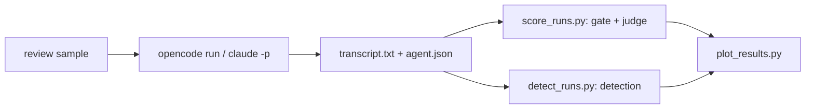

# Benchmarks

Live, paid runs of the engine's eval samples against real harnesses and models.
Nothing here runs in CI.

## Review benchmark

Grades code reviewers on the 14 eval samples of the core `review` prompt: six
original `review/*` samples and eight `review/crbug-*` samples that paraphrase
bugs from the CRBugBench benchmark (see `catalog/core/eval_samples/ATTRIBUTIONS.md`).
Every setup drives Qwen3.6 27B; Opus 5.5 judges.

| Setup | Harness | Reviewer |
|---|---|---|
| `opencode-review` | OpenCode | built-in `/review`, given the request |
| `opencode-playbook-v0.1.0` | OpenCode | the playbook's `review` prompt at release v0.1.0 |
| `opencode-playbook` | OpenCode | the playbook's current `review` prompt |
| `claude-code-review` | Claude Code | built-in `/code-review`, given the request |
| `claude-playbook` | Claude Code | the playbook's current `review` prompt |

Results: [`results/review-qwen3.6-27b/summary.md`](results/review-qwen3.6-27b/summary.md),
with charts beside it. Each run's `prompt.txt` holds exactly what the agent
received. The built-in and v0.1.0 runs do not depend on the current prompt and
were recorded first; the two current-prompt setups were recorded on the text
they show.

### Metrics

- **Passed and judge score.** The engine's own `score`, without fail-fast: a
  run passes when its deterministic gate and its judged rubric both pass. The
  built-in reviewers write no one-line verdict, so they fail the gate's verdict
  check by design; compare them on the judge score.
- **Detection** (`review/crbug-*` only), as CRBugBench measures it: did the
  review catch the sample's known defect (`yes`, `partial`, `no`), and which
  comment reports it. *Strict* counts `yes`, *lenient* counts `partial` as 0.5,
  *top-5* is a `yes` among the first five comments. The known defect is the
  sample's highest-weight rubric criterion. Unlike the paper: one judge model,
  our own prompt wording, and small paraphrased fixtures.
- **Second pass.** For the current prompt, whether the run started its
  bug-only second pass (`second_pass_ran` in `agent.json`).

### Run it

From the repo root, with the project venv active and `OPENROUTER_API_KEY` plus
`ANTHROPIC_API_KEY` (or `ANT_API_KEY`) in the nearest `.env`:

```bash
python benchmarks/run_agents.py --workers 3
```

```bash
python benchmarks/score_runs.py
```

```bash
python benchmarks/detect_runs.py
```

```bash
uv run --no-project --with matplotlib python benchmarks/plot_results.py
```

Each script skips runs it already finished (`--force` redoes them) and takes
`--run-name`. `run_agents.py` also takes `--experiments` and `--samples`, and
`score_runs.py --stub-judge` dry-runs the pipeline for free.



### How runs are isolated

- **Working trees outside the repo** (`~/.cache/playbook-bench`), so no
  `AGENTS.md` or `CLAUDE.md` above them leaks in. OpenCode also gets
  `--dir <scratch>`: it takes its project directory from `PWD`, not the cwd.
- **Claude Code without the developer's setup:** an empty `CLAUDE_CONFIG_DIR`
  per run, `--setting-sources ""`, `--strict-mcp-config` and auto-memory off.
  Not `--bare`, which hides the Agent and Skill tools the review needs. It
  reaches Qwen through OpenRouter's Anthropic-compatible API, with every model
  alias mapped to it.
- **No parent-session variables:** every script drops `ANTHROPIC_*`, `CLAUDE_*`
  and `CLAUDECODE` first. Inherited, they would bill the parent Claude Code
  app instead of the `.env` key.
- **The judge** is the engine's `LLMJudge` running
  `claude -p --bare --model claude-opus-5-5 --effort medium`.

### Known issues

- **Claude Code starts some subagents in the background on its own** (15 of 28
  in the last run, though the model never asked). Each finished background task
  adds a turn, so the transcript joins every turn's answer.
- **One trial per sample is noisy.** A second `opencode-playbook` trial passed
  12 of 14 against this folder's 8 of 14; compare setups on the judge score and
  detection, not on one or two passes.
- **OpenCode ends a run on a mistyped path.** Qwen sometimes writes the scratch
  path with a stray space (`/Users/me/. cache/...`); OpenCode treats it as an
  outside directory, auto-rejects the access and stops (3 of 28 runs).
- **The judge can refuse a transcript** (`[reasoning_extraction]`). The run is
  left unscored, never rewritten.

### Layout

```
benchmarks/results/<run-name>/
  <setup>/<sample>/prompt.txt       what the agent received
  <setup>/<sample>/transcript.txt   what it answered
  <setup>/<sample>/agent.json       command, timing, tool calls
  <setup>/<sample>/score.json       gate, rubric and judge details
  <setup>/<sample>/detect.json      detection verdict (review/crbug-* only)
  summary.md, summary.csv, *.png    written by plot_results.py
```
