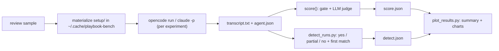

# Benchmarks

Live, paid runs of the engine's eval samples against real harnesses and models.
Nothing here runs in CI.

## Review: Qwen3.6 27B in OpenCode and Claude Code

Grades the eval samples of the core `review` prompt (`prompt_id = "review"`):
the six original `review/*` samples and the eight `review/crbug-*` samples that
paraphrase bugs from the CRBugBench code-review benchmark (see
`catalog/core/eval_samples/ATTRIBUTIONS.md`). `summary.md` reports the two sets
apart as well as together. Each runs under these reviewer setups, all driving
the same model:

| Key | Harness | Reviewer | What the agent receives |
|---|---|---|---|
| `opencode-review` | OpenCode | built-in `/review` | the sample's request only, as `opencode run --command review "<request>"` |
| `playbook-v1` | OpenCode | playbook review, edition `v0.1.0` (the former prompt set v1) | the `review` prompt of edition `v0.1.0`, built from the tag and rendered as `playbook eval --run` renders a sample graded on that edition, + the request |
| `playbook-v2` | OpenCode | playbook review, current text (the former prompt set v2) | the rendered current `review` prompt + the request, as `playbook eval --run --edition head` builds it |
| `claude-code-review` | Claude Code | built-in `/code-review` | the request as the command's arguments: `claude -p "/code-review <request>"` |
| `claude-playbook-v2` | Claude Code | playbook review, current text | the rendered current prompt + the request, as for `playbook-v2` |
| `claude-v2-over-code-review` | Claude Code | prototype: v2 with `/code-review` as its first pass | the current prompt with steps 1-2 rewritten: the Skill tool runs `/code-review` on the request, and the later steps verify, rate and decide (`run_agents.native_first_pass`) |
| `opencode-v2-dual`, `claude-v2-dual` | both | recorded prototype: v2's subagent with the harness's own reviewer alongside | each run's `prompt.txt`; the review's step 1 now ships this in general form, so `run_agents.py` no longer re-runs them |

Three result sets are committed. `review-opencode-qwen3.6-27b/` holds every setup
above, run when prompt sets still existed: `playbook-v2` there is the former
prompt set v2, whose first pass was one subagent.
`review-qwen3.6-27b-v2-bug-hunt/` holds `playbook-v2` and `claude-playbook-v2`
run against the review text whose step 1 starts two first passes together: the
first-pass subagent, and a pass that only hunts bugs. That second pass is the
harness's own reviewer where it runs as a tool (the Skill tool with
`code-review` on Claude Code), else a second read-only subagent with a bug-hunt
brief (OpenCode, whose `/review` no tool can start).
`review-qwen3.6-27b-foreground-rule/` holds `claude-playbook-v2` again, run after
step 1 was told to start both passes in the foreground, in one message, and on
Claude Code never to set the Agent tool's `run_in_background`: in the run before
it, Claude Code started half of its subagents as background tasks, and one run
answered before its passes replied.

- **Harnesses:** OpenCode 1.19.4 (`opencode run --pure --dir <scratch>`) and
  Claude Code 2.1.292 (`claude -p --permission-mode acceptEdits`, isolated as
  described below, with read, search, subagents, skills, git, Python and pytest
  allowed).
- **Agent model:** Qwen3.6 27B through OpenRouter: `openrouter/qwen/qwen3.6-27b`
  in OpenCode, and `qwen/qwen3.6-27b` in Claude Code through OpenRouter's
  Anthropic-compatible API (`ANTHROPIC_BASE_URL=https://openrouter.ai/api`).
  Every Claude Code model alias (subagents, the background model) maps to the
  same model, so no Anthropic model is called.
- **Judge:** the engine's `LLMJudge`, Opus 5.5 at medium effort
  (`claude -p --bare --model claude-opus-5-5 --effort medium`, Anthropic API key),
  one judge sample per criterion. `judge_openrouter.py` reaches the same model
  through OpenRouter when the Anthropic key cannot be used.
- **Scoring:** the engine's own `materialize` / `capture` / `score`, with full
  scoring (no fail-fast), so every run gets both its deterministic `[gate]` and
  its judged `[rubric]`. A sample passes when its `[verdict]` expression holds
  (`gate and rubric` for every review sample). The built-in reviewers do not
  write the playbook's one-line verdict, so they lose the gate's verdict check by
  design; compare them on the judge score.
- **CRBugBench-style detection** (`detect_runs.py`, on the `review-crbug-*`
  samples): the metric the CRBugBench paper reports, next to the pass/fail. The
  same judge answers one question per review: did it catch the sample's known
  defect (`yes`, `partial` or `no`), and which of the review's comments reports
  it. *Strict* detection is the share of `yes`; *lenient* counts `partial` as
  0.5; *top-5* is a `yes` whose first matching comment is among the review's
  first five. The known defect is the sample's own highest-weight rubric
  criterion. Differences from the paper: one judge model instead of a
  three-model panel (`--votes N` averages N verdicts from the same judge), our
  own prompt wording, and small paraphrased fixtures instead of the real
  repositories.
- **Did the second pass run?** `agent.json` records the main loop's tool calls
  (`main_loop_tools`, from Claude Code's stream-JSON and OpenCode's JSON events)
  and `second_pass_ran`: the `code-review` skill was called, or two subagents
  were started. `summary.md` counts it per v2 setup; runs recorded before this
  field show the prototypes' older `native_pass_ran`, or none. Claude Code runs
  also record `subagent_starts`, foreground and background, from the
  `meta.json` Claude Code writes per subagent (backfilled from those files for
  `review-qwen3.6-27b-v2-bug-hunt/`).



### Run it

```bash
python benchmarks/run_agents.py --workers 3
```

```bash
python benchmarks/run_agents.py --run-name review-qwen3.6-27b-v2-bug-hunt --experiments playbook-v2 claude-playbook-v2
```

```bash
python benchmarks/score_runs.py --judge-backend anthropic
```

```bash
python benchmarks/detect_runs.py --judge-backend anthropic
```

```bash
uv run --no-project --with matplotlib python benchmarks/plot_results.py
```

Run them from the repo root with the project venv active. Keys come from the nearest
`.env` at or above the repo root: `OPENROUTER_API_KEY` for the agent (and the
OpenRouter judge) and `ANT_API_KEY` for the Anthropic judge. Each phase skips
runs it already finished; `--force` redoes them. Every phase takes `--run-name`
(default `review-opencode-qwen3.6-27b`).

### Deviations from `playbook eval --run`

- `--dir <scratch>` is passed to `opencode run`. OpenCode 1.19 takes its project
  directory from the inherited `PWD` rather than the process cwd, so the shipped
  `OpenCodeRunner` (cwd only) reviews the caller's checkout instead of the sample.
  `--format json` is the engine's own default; the transcript is the text of its
  events, as the engine reads it, and the tool calls are kept besides.
- Working trees live outside the repo (`~/.cache/playbook-bench`, or
  `BENCH_WORK_ROOT`), so no `AGENTS.md`/`CLAUDE.md` above them leaks into the run.
- The agent runs with `NO_COLOR=1`, `OPENCODE_DISABLE_CLAUDE_CODE=1` (no
  `~/.claude` rules or skills) and `PYTHONDONTWRITEBYTECODE=1`, and the scratch
  repo's `.git/info/exclude` lists tool caches. The judge grades the diff when
  there is one, so a stray `__pycache__` would otherwise replace the review text.
- Transcripts are saved with terminal escape codes stripped, and the committed
  results show the home directory as `~` (`score_runs.py` expands it back).
- The judge is the engine's `LLMJudge` with an explicit command. The engine's
  `[evals.judge]` config sets the judge's model and sample count, but not the
  effort level or `--bare` isolation this benchmark needs.
- Both phases drop a parent Claude Code session's variables (`ANTHROPIC_*`,
  `CLAUDE_*`, `CLAUDECODE`) before spawning anything. Run from inside a Claude
  Code session, the judge's `claude -p` otherwise inherits `ANTHROPIC_BASE_URL`
  and bills the parent app's account instead of the `.env` key.
- Claude Code is isolated by an empty `CLAUDE_CONFIG_DIR` per run,
  `--setting-sources ""`, `--strict-mcp-config` and auto-memory off, so the
  developer's hooks, plugins, settings, `CLAUDE.md` and memory stay out. It does
  not use `--bare`: in bare mode Claude Code offers the model neither the Task
  (subagent) nor the Skill tool, so the v2 review's first-pass subagent silently
  never ran (the Claude Code results committed before this change came from bare
  mode). Its OpenRouter settings are passed to each Claude Code run only,
  never to OpenCode runs in the same batch. Claude Code does not know the model
  and logs an `unrecognized_model` line on stderr, which ends up at the end of
  those transcripts.
- A Claude Code transcript joins the `result` of every turn. A subagent the model
  starts in the background begins another turn when it finishes, so the review
  can sit in an earlier turn than the last; the main loop's tool calls mark such
  calls `:background`. Claude Code runs recorded before this change kept only
  the last turn's answer: in `review-opencode-qwen3.6-27b/` and
  `review-qwen3.6-27b-v2-bug-hunt/`, a run that started a subagent in the
  background (see `subagent_starts`, or its `prompt.txt` and transcript) may
  have lost its review to a short follow-up.

### Layout

```
benchmarks/results/<run-name>/
  <experiment>/<sample>/prompt.txt       what the agent received
  <experiment>/<sample>/transcript.txt   what it answered (stdout + stderr)
  <experiment>/<sample>/agent.json       command, return code, duration
  <experiment>/<sample>/score.json       engine report + judge settings
  <experiment>/<sample>/detect.json      detection verdict (review-crbug-* runs)
  summary.csv, summary.md, *.png         written by plot_results.py (detection.png too)
```

`<sample>` is the sample id with its slash flattened (`review/spot-the-bug` is
stored as `review-spot-the-bug`), so every sample keeps one directory.
