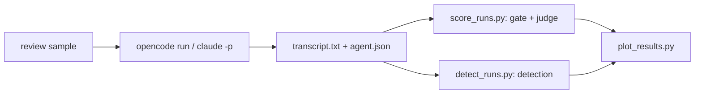

# Benchmarks

Live, paid runs of the engine's eval samples against real harnesses and models.
Nothing here runs in CI.

## Review benchmark

Grades code reviewers on the 14 eval samples of the core `review` prompt: six
original `review/*` samples and eight `review/crbug-*` samples that paraphrase
bugs from the CRBugBench benchmark (see `catalog/core/eval_samples/ATTRIBUTIONS.md`).
Every setup drives Qwen3.6 27B; Opus 5.5 judges.

| Setup | Harness | Reviewer |
|---|---|---|
| `opencode-review` | OpenCode | built-in `/review`, given the request |
| `opencode-playbook-v0.1.0` | OpenCode | the playbook's `review` prompt at release v0.1.0 |
| `opencode-playbook-v0.2.0` | OpenCode | the same prompt at release v0.2.0 |
| `opencode-playbook-v0.3.0` | OpenCode | the same prompt at release v0.3.0 |
| `claude-code-review` | Claude Code | built-in `/code-review`, given the request |
| `claude-playbook-v0.2.0` | Claude Code | the playbook's `review` prompt at release v0.2.0 |
| `claude-playbook-v0.3.0` | Claude Code | the same prompt at release v0.3.0 |

Results: [`results/review-qwen3.6-27b/summary.md`](results/review-qwen3.6-27b/summary.md),
with charts beside it. Each run's `prompt.txt` holds exactly what the agent
received: a playbook setup gets its release's prompt, built from the git tag.
The v0.3.0 runs were recorded just before that release, on the same text.

### What each release changed in the reviewer

Only the `review` prompt is graded here; the release notes in
`catalog/releases/<version>/notes.md` list every change.

**v0.1.0**, the first release:

- The agent reviews alone: it reads the diff starting from the change's central
  file, then the code around it.
- Six priority buckets in order (correctness, failure modes with a list of
  Python traps, security, design, readability, style), each comment tagged with
  its bucket, file and line.
- It ends with a one-line verdict (approve, approve with comments, request
  changes) and never edits the code.
- Here: OpenCode passed 5 of 14 (judge 0.57); not run on Claude Code.

**v0.2.0** (#326 made the v2 prompts the current text):

- A first-pass subagent: before reading the diff, the agent starts one
  read-only subagent in the foreground (Plan on Claude Code, explore on
  OpenCode) that finds issues in a fresh context. The agent then checks each
  finding against the lines it cites, dropping what a second read refutes.
- Correctness also checks that the change does everything its stated intent
  asks for.
- Only the user's request directs the review: commit messages, pull request
  descriptions and code comments are claims to check. A re-review gives each
  earlier finding fixed or still open.
- Each comment gets a severity (`important`, `nit`, `pre-existing`); a
  `Findings:` count line precedes the verdict, which follows from the
  severities.
- It loads the repository's Python skills when they are installed, and asks
  the user first when the change's intent is unclear.
- Here: OpenCode passed 13 of 14 (judge 0.83), Claude Code 14 of 14 (0.85).

**v0.3.0** (#327):

- Two first passes start together, both in the foreground in one message: the
  v0.2.0 first-pass subagent, and an independent pass that only hunts bugs
  (Claude Code's `code-review` skill; elsewhere a second read-only subagent).
- Their findings merge into one list, one entry per defect; a finding only one
  pass reports is still checked. When one pass fails, the other's findings are
  used alone.
- Here: OpenCode passed 8 of 14 (judge 0.64; a second trial passed 12 of 14,
  0.77), Claude Code 14 of 14 (0.88) but at nearly twice v0.2.0's median time.

### Metrics

- **Passed and judge score.** The engine's own `score`, without fail-fast: a
  run passes when its deterministic gate and its judged rubric both pass. The
  built-in reviewers write no one-line verdict, so they fail the gate's verdict
  check by design; compare them on the judge score.
- **Detection** (`review/crbug-*` only), as CRBugBench measures it: did the
  review catch the sample's known defect (`yes`, `partial`, `no`), and which
  comment reports it. *Strict* counts `yes`, *lenient* counts `partial` as 0.5,
  *top-5* is a `yes` among the first five comments. The known defect is the
  sample's highest-weight rubric criterion. Unlike the paper: one judge model,
  our own prompt wording, and small paraphrased fixtures.
- **Second pass.** From v0.3.0, whose prompt asks for a bug-only second pass,
  whether the run started it (`second_pass_ran` in `agent.json`).

### Run it

From the repo root, with the project venv active and `OPENROUTER_API_KEY` plus
`ANTHROPIC_API_KEY` (or `ANT_API_KEY`) in the nearest `.env`:

```bash
python benchmarks/run_agents.py --workers 3
```

```bash
python benchmarks/score_runs.py
```

```bash
python benchmarks/detect_runs.py
```

```bash
uv run --no-project --with matplotlib python benchmarks/plot_results.py
```

Each script skips runs it already finished (`--force` redoes them) and takes
`--run-name`. `run_agents.py` also takes `--experiments` and `--samples`, and
`score_runs.py --stub-judge` dry-runs the pipeline for free. A new release gets
its setups from two `Experiment` lines with its tag in `_bench.py`; the tag
`"head"` grades the checkout's unreleased text.



### How runs are isolated

- **Working trees outside the repo** (`~/.cache/playbook-bench`), so no
  `AGENTS.md` or `CLAUDE.md` above them leaks in. OpenCode also gets
  `--dir <scratch>`: it takes its project directory from `PWD`, not the cwd.
- **Claude Code without the developer's setup:** an empty `CLAUDE_CONFIG_DIR`
  per run, `--setting-sources ""`, `--strict-mcp-config` and auto-memory off.
  Not `--bare`, which hides the Agent and Skill tools the review needs. It
  reaches Qwen through OpenRouter's Anthropic-compatible API, with every model
  alias mapped to it.
- **No parent-session variables:** every script drops `ANTHROPIC_*`, `CLAUDE_*`
  and `CLAUDECODE` first. Inherited, they would bill the parent Claude Code
  app instead of the `.env` key.
- **The judge** is the engine's `LLMJudge` running
  `claude -p --bare --model claude-opus-5-5 --effort medium`.

### Known issues

- **Claude Code starts some subagents in the background on its own** (8 of 14
  starts at v0.2.0, 15 of 28 at v0.3.0, though the model never asked). Each
  finished background task adds a turn, so the transcript joins every turn's
  answer. When `claude -p` exits first, there is no review: the v0.2.0 run on
  `style-only-no-changes-needed` ended "still waiting on the subagent".
- **An empty answer passes `style-only-no-changes-needed`.** Its gate only
  checks that the file is untouched, and its rubric gives 0.6 to three "does
  not claim" criteria that an empty answer meets. The Claude Code v0.2.0 run
  above passed that way.
- **One trial per sample is noisy.** A second `opencode-playbook-v0.3.0` trial passed
  12 of 14 against this folder's 8 of 14; compare setups on the judge score and
  detection, not on one or two passes.
- **OpenCode ends a run on a mistyped path.** Qwen sometimes writes the scratch
  path with a stray space (`/Users/me/. cache/...`); OpenCode treats it as an
  outside directory, auto-rejects the access and stops (3 of the 56 OpenCode
  runs).
- **The judge can refuse a transcript** (`[reasoning_extraction]`) or fail to
  reach the API. The run is left unscored, never rewritten, and
  `score_runs.py` tries it again on its next pass.

### Layout

```
benchmarks/results/<run-name>/
  <setup>/<sample>/prompt.txt       what the agent received
  <setup>/<sample>/transcript.txt   what it answered
  <setup>/<sample>/agent.json       command, timing, tool calls
  <setup>/<sample>/score.json       gate, rubric and judge details
  <setup>/<sample>/detect.json      detection verdict (review/crbug-* only)
  summary.md, summary.csv, *.png    written by plot_results.py
```
