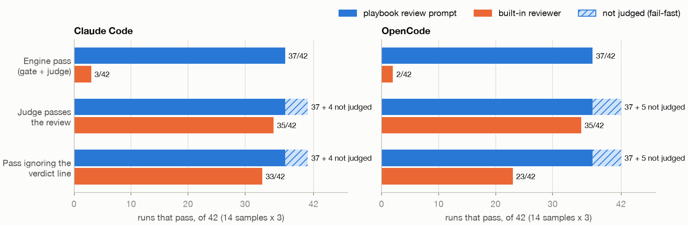
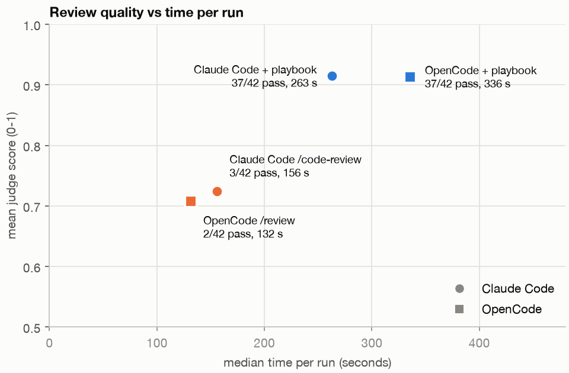
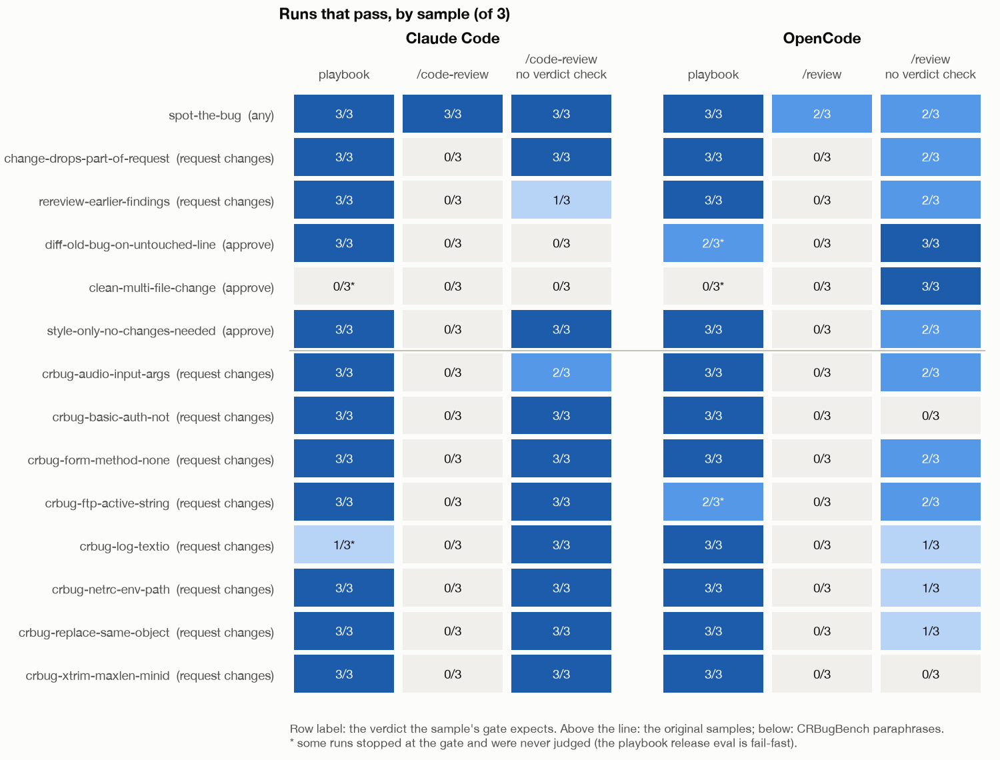
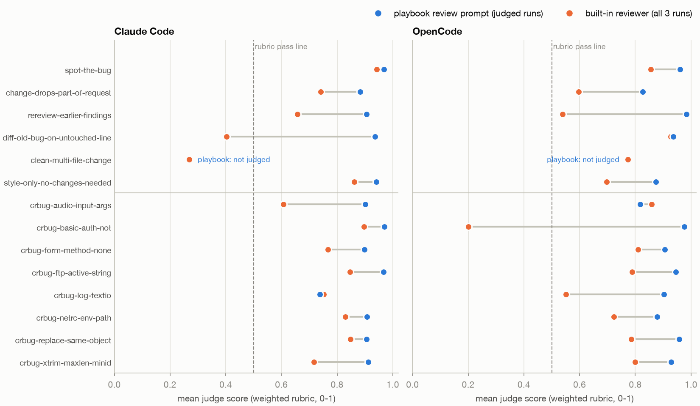
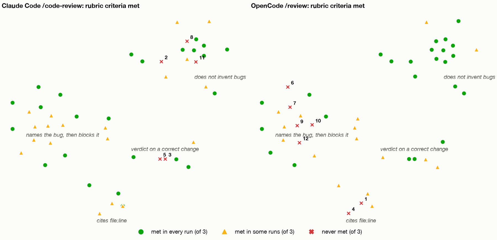
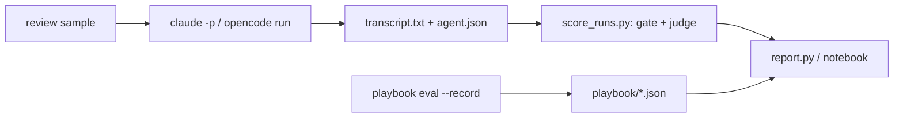

# Benchmarks

Live, paid runs of the engine's eval samples against real harnesses and models.
Nothing here runs in CI. The same results, charts and examples are in the
notebook [`review_benchmark.ipynb`](review_benchmark.ipynb).

## Review benchmark: the playbook's prompt vs built-in reviewers

**Question:** does the playbook's `review` prompt make a better code reviewer
than the review command each harness ships with?

**Answer:** yes, on both harnesses. It passes 37 of 42 runs where the built-in
reviewers pass 2-3, and the judge rates its reviews higher (0.91 vs 0.71-0.72).
Most of the pass-rate gap is output format, though, and the playbook takes about
twice as long per run.



### Setup

| | |
|---|---|
| Model doing the review | Qwen3.8 27B (`qwen/qwen3.8-27b`) through OpenRouter |
| Harnesses | Claude Code 2.1.292, OpenCode 1.19.4 |
| Judge | `gpt-6-luna`, reasoning effort high, 3 votes per rubric criterion |
| Samples | the 14 `review/*` eval samples, 3 runs each: 42 runs per reviewer |
| Limits | 600 s per run |

| Reviewer | What the agent receives | Recorded by |
|---|---|---|
| **Claude Code + playbook** | the playbook's `review` prompt (v0.4.0), ending with the request | the v0.4.0 release eval |
| **Claude Code /code-review** | `/code-review <request>`: the built-in code-review skill | `run_agents.py` |
| **OpenCode + playbook** | the same playbook prompt | the v0.4.0 release eval |
| **OpenCode /review** | `opencode run --command review "<request>"`: the built-in command | `run_agents.py` |

### Results

| Reviewer (14 `review/*` samples x 3 runs) | Engine pass | Judge passes the review | Pass ignoring the verdict line | Judge score | Runs that edited code | Median time |
|---|---|---|---|---|---|---|
| **Claude Code + playbook** | **37/42** | ≥ 37/42 (4 not judged¹) | ≥ 37/42 (4 not judged¹) | **0.91** | 0 of 38 judged¹ | 263 s |
| **Claude Code /code-review** | 3/42 | 35/42 | 33/42 | 0.72 | 2 | 156 s |
| **OpenCode + playbook** | **37/42** | ≥ 37/42 (5 not judged¹) | ≥ 37/42 (5 not judged¹) | **0.91** | 0 of 37 judged¹ | 336 s |
| **OpenCode /review** | 2/42 | 35/42 | 23/42 | 0.71 | 18 | 132 s |

¹ The release eval skips the judge on runs whose gate fails (see [below](#why-the-playbook-rows-are-not-fully-judged)).

### What the columns mean

Each sample grades a review in two layers: a **gate** of deterministic checks
(files left untouched, the verdict line, a key phrase) and a **rubric** of
weighted criteria that an LLM judge scores from 0 to 1.

- **Engine pass**: the eval's own verdict, gate **and** rubric. This is the number releases track.
- **Judge passes the review**: the rubric alone (weighted score ≥ 0.5). Does the judge find the review good, whatever its format?
- **Pass ignoring the verdict line**: the judge passes it **and** every gate check holds except the verdict and `Findings:` lines. This is the fairest comparison with the built-in reviewers.
- **Judge score**: the weighted rubric score averaged over judged runs (0-1).
- **Runs that edited code**: a reviewer must only report. The gate fails any run that changes a file.
- **Median time**: wall-clock time per run.

### Why built-in reviewers get almost no "Engine pass"

- Most gates require a last line that is exactly `approve`, `approve with comments`
  or `request changes`, and some also check a `Findings: N important` line. The
  playbook prompt asks for both lines, so a CI job can parse the result.
  `/code-review` and `/review` never write them.
- So the built-ins fail on **format**, not on what they found. Only `spot-the-bug`,
  whose gate has no verdict check, passes (3/3 and 2/3).
- To compare what they found, read **Judge passes the review**, **Pass ignoring the
  verdict line** and the judge score.

### Why the playbook rows are not fully judged

- The playbook numbers come from the v0.4.0 release eval (`playbook eval --record`),
  which is **fail-fast**: when the gate fails, it skips the judge to save cost.
- 4 Claude Code runs and 5 OpenCode runs stopped there, all on the verdict or
  `Findings:` line (for example `request changes` on a correct change). Their
  judge score and edits are unknown.
- The built-in runs were scored by `score_runs.py`, which judges every run.
- To fill these cells, run the `*-playbook-v0.4.0` setups through this folder's
  scripts (see [Run it](#run-it)).

### Pros and cons

| | Playbook `review` prompt | Claude Code `/code-review` | OpenCode `/review` |
|---|---|---|---|
| **Pros** | Highest pass rate and judge score on both harnesses. Its verdict line can be machine-checked. Never edits code. Behaves the same on both harnesses. | Finds most bugs (judge passes 35/42). 1.7x faster. Nothing to install. | Fastest (132 s). Finds most bugs (judge passes 35/42). Nothing to install. |
| **Cons** | Slowest (263-336 s, about 2x). Needs the playbook installed. Still flags the correct change in `clean-multi-file-change` (0/3 on both harnesses). | No verdict line, so CI cannot gate on it. Flags correct changes (0/3 on two of the three "approve" samples). Invents extra bugs on 3 samples. | Edits the code in 18/42 runs when run non-interactively. Often names a bug without marking it blocking. No verdict line. |



### Scope and validity

- **One model** (Qwen3.8 27B) and one judge (`gpt-6-luna`). A frontier model may close the gap.
- **Small:** 14 short Python samples, 3 runs each. A difference of one run per sample is noise.
- **Home ground:** the samples were written for this playbook. The gates check its
  output format and the rubrics share its vocabulary (severity, verdict). The
  built-ins start at a disadvantage on "Engine pass", which is why the other
  columns exist.
- **The judge is an LLM**, uncalibrated: compare its scores between reviewers, not
  against an absolute bar.
- **Two pipelines:** the playbook rows come from the release eval and the built-in
  rows from `run_agents.py` + `score_runs.py`. Model, judge, samples and timeout
  are the same.
- **More work by design:** the playbook prompt adds a first-pass subagent and a
  check of each finding, which is where the extra time goes.

### By sample

Runs that pass, per sample, on each harness. "no verdict check" is the built-in
reviewer's **Pass ignoring the verdict line**.



The judge score per sample. On most samples the playbook's reviews score higher,
and the widest gaps are where a built-in reviewer edits code or flags a correct
change.



### Which rubric criteria fail

Each point is one of the 48 rubric criteria. Points are placed by the embedding
of the criterion's text (OpenAI `text-embedding-3-small`, then t-SNE), so
criteria that ask for similar things sit together. Color and shape show how
often the built-in reviewer met the criterion in its 3 runs. Numbers mark the
criteria it never met (table below).



- **`/code-review`** misses cluster at *verdict on a correct change* and *does
  not invent bugs*. It reports problems that are not there.
- **`/review`** misses cluster at *names the bug, then blocks it* and *cites
  file:line*. It often fixes the bug instead of reporting it (`crbug-basic-auth-not`
  in all 3 runs), or reports it without calling it blocking.
- The playbook runs are not on the map: the release record keeps only rubric totals.

| # | Sample | Criterion (abridged) | /code-review met | /review met |
|---|---|---|---|---|
| 1 | change-drops-part-of-request | The review cites file and line (for example the argument parser in src/report.py's main) and prop... | 2/3 | 0/3 |
| 2 | diff-old-bug-on-untouched-line | The review does not invent a bug in restock() or its tests (for example claiming it mutates the w... | 0/3 | 3/3 |
| 3 | diff-old-bug-on-untouched-line | The review's verdict is 'approve' or 'approve with comments': the new restock() function and its... | 0/3 | 3/3 |
| 4 | clean-multi-file-change | The review reads every file the change touches (src/units.py, src/shipping.py and both test files... | 1/3 | 0/3 |
| 5 | clean-multi-file-change | The review's verdict is 'approve' or 'approve with comments': the new to_kilograms() helper, its... | 0/3 | 3/3 |
| 6 | crbug-basic-auth-not | The review reports that the new condition is not valid Python: `!` is not a negation operator (it... | 3/3 | 0/3 |
| 7 | crbug-basic-auth-not | The review treats that bug as blocking (important, not a nit or an open question), cites its file... | 3/3 | 0/3 |
| 8 | crbug-form-method-none | The review does not invent bugs: anything else it raises is a real problem in the code shown, and... | 0/3 | 3/3 |
| 9 | crbug-log-textio | The review treats that bug as blocking (important, not a nit or an open question), cites its file... | 1/3 | 0/3 |
| 10 | crbug-replace-same-object | The review treats that bug as blocking (important, not a nit or an open question), cites its file... | 1/3 | 0/3 |
| 11 | crbug-xtrim-maxlen-minid | The review does not invent bugs: anything else it raises is a real problem in the code shown, and... | 0/3 | 3/3 |
| 12 | crbug-xtrim-maxlen-minid | The review treats that bug as blocking (important, not a nit or an open question), cites its file... | 1/3 | 0/3 |

### Example samples

Each sample is a small Python repo with a change to review (usually
`CHANGE.diff`, already applied), a one-line request, a gate and a rubric. Six samples are
original; eight paraphrase real bugs from the CRBugBench benchmark
([`ATTRIBUTIONS.md`](../catalog/core/eval_samples/ATTRIBUTIONS.md)). All 14 are in
[`catalog/core/eval_samples/review/`](../catalog/core/eval_samples/review/).

**`review/crbug-basic-auth-not`: a buggy change; the right verdict is `request changes`.**

> review my change in CHANGE.diff (it is already applied to the working tree). It switches the admin
> credential check to a constant-time comparison, so the check no longer leaks through its timing
> how much of a username or password matched.

```diff
-    if given.username != expected.username or given.password != expected.password:
+    # Be careful to use constant time comparison to prevent timing attacks
+    if (!hmac.compare_digest(given.username, expected.username) or
+        !hmac.compare_digest(given.password, expected.password)):
         return False
```

- **Gate:** `src/auth.py` and the tests untouched, a `request changes` line, no `approve` line.
- **Rubric:** reports that `!` is not Python, so the module no longer imports (0.6).
  Treats it as blocking and cites file and line (0.2). Invents no other bug (0.2).

**`review/clean-multi-file-change`: a correct four-file change; the right verdict is `approve`.**

> review my change in CHANGE.diff (it is already applied to the working tree). It lets quote_cents
> take the parcel weight in pounds as well as kilograms.

- **Gate:** all four files untouched, an `approve` line, no `request changes` line,
  no `Findings: N important` count above zero.
- **Rubric:** approves, since nothing needs fixing (0.4). Invents no defect (0.3).
  Reads every changed file (0.2). Cites file and line and proposes no edits (0.1).

### The prompts

**Built-in reviewers.** Each one receives the sample's request and nothing else:

```text
Claude Code:  claude -p "/code-review review my change in CHANGE.diff (it is already applied ...) ..."
OpenCode:     opencode run --command review "review my change in CHANGE.diff (it is already applied ...) ..."
```

Each run's exact text is in its `prompt.txt`, for example
[`run-1/claude-code-review/review-crbug-basic-auth-not/prompt.txt`](results/review-qwen3.8-27b/run-1/claude-code-review/review-crbug-basic-auth-not/prompt.txt).

**Playbook.** The full rendered prompt for `crbug-basic-auth-not` (244 lines,
the v0.4.0 text) is in
[`playbook/review-prompt.txt`](results/review-qwen3.8-27b/playbook/review-prompt.txt).
Its source is [`catalog/core/prompts/review.md.j2`](../catalog/core/prompts/review.md.j2).
In short, it asks the agent to:

1. Start one read-only subagent first: it finds issues in a fresh context.
2. Check each finding against the lines it cites, and drop what a second read refutes.
3. Walk six priorities in order: correctness, failure modes, security, design,
   readability, style.
4. Tag each comment with file, line, bucket and a severity (`important`, `nit`,
   `pre-existing`).
5. End with `Findings: <n> important, <n> nit, <n> pre-existing`, then one verdict
   line. Never edit the code.

The prompt also includes the repository's Python rules (typing, error handling),
followed by the request.

### Run it

From the repo root, with the project venv active and `OPENROUTER_API_KEY` plus
`OPENAI_API_KEY` (the judge and the embeddings) in the nearest `.env`:

```bash
python benchmarks/run_agents.py --run-name review-qwen3.8-27b/run-1 --experiments claude-code-review opencode-review --workers 8
```

```bash
python benchmarks/score_runs.py --run-name review-qwen3.8-27b/run-1
```

```bash
uv run --no-project --python 3.12 --with matplotlib python benchmarks/report.py
```

- Repeat the first two commands for `run-2` and `run-3`.
- `report.py` redraws every chart and `summary.md` from the committed results.
  `--embed` also rebuilds the rubric map; it needs `--with numpy,scikit-learn`
  and calls the embeddings API.
- To grade the playbook through this pipeline too (filling the "not judged"
  cells), add `--experiments claude-playbook-v0.4.0 opencode-playbook-v0.4.0`.
- The committed playbook rows come from the release eval instead:
  `playbook eval --run --all --target <claude-code-qwen|opencode-qwen> --judge llm --record <file> --jobs 4 --resume`.

Open the notebook with:

```bash
uv run --no-project --python 3.12 --with jupyter,matplotlib jupyter lab benchmarks/review_benchmark.ipynb
```



### How runs are isolated

- **Working trees live outside the repo** (`~/.cache/playbook-bench`), so no
  `AGENTS.md` or `CLAUDE.md` above them leaks in. OpenCode also gets `--dir`,
  because it takes its project directory from `PWD`.
- **Claude Code runs without the developer's setup:** an empty `CLAUDE_CONFIG_DIR`,
  `--setting-sources ""`, `--strict-mcp-config` and auto-memory off. It reaches
  Qwen through OpenRouter's Anthropic-compatible API, with every model alias
  mapped to Qwen.
- **No parent-session variables:** every script drops `ANTHROPIC_*`, `CLAUDE_*` and
  `CLAUDECODE` first.

### Layout

```
benchmarks/results/review-qwen3.8-27b/
  run-<n>/<reviewer>/<sample>/prompt.txt       what the agent received
  run-<n>/<reviewer>/<sample>/transcript.txt   what it answered
  run-<n>/<reviewer>/<sample>/agent.json       command, timing, tool calls
  run-<n>/<reviewer>/<sample>/score.json       gate, rubric and per-criterion judge scores
  playbook/<target>.json                       the playbook's release eval records
  playbook/review-prompt.txt                   the rendered playbook prompt
  rubric_map.json                              the rubric criteria's 2-D embedding map
  summary.md, *.png                            written by report.py
```
