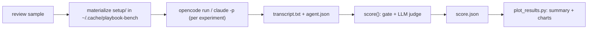

# Benchmarks

Live, paid runs of the engine's eval samples against real harnesses and models.
Nothing here runs in CI.

## Review: Qwen3.6 27B in OpenCode and Claude Code, five reviewers

Grades the eval samples of the core `review` prompt (`prompt_id = "review"`):
the six original `review/*` samples and the eight `review/crbug-*` samples that
paraphrase bugs from the CRBugBench code-review benchmark (see
`catalog/core/eval_samples/ATTRIBUTIONS.md`). `summary.md` reports the two sets
apart as well as together. Each runs under five reviewer setups, all driving the
same model:

| Key | Harness | Reviewer | What the agent receives |
|---|---|---|---|
| `opencode-review` | OpenCode | built-in `/review` | the sample's request only, as `opencode run --command review "<request>"` |
| `playbook-v1` | OpenCode | playbook review, prompt set v1 | the rendered v1 `review` prompt + the request, as `playbook eval --run --prompt-set v1` builds it |
| `playbook-v2` | OpenCode | playbook review, prompt set v2 | the same, from prompt set v2 |
| `claude-code-review` | Claude Code | built-in `/code-review` | the request as the command's arguments: `claude -p "/code-review <request>"` |
| `claude-playbook-v2` | Claude Code | playbook review, prompt set v2 | the rendered v2 prompt + the request, as for `playbook-v2` |

- **Harnesses:** OpenCode 1.19.4 (`opencode run --pure --dir <scratch>`) and
  Claude Code 2.1.292 (`claude -p --bare --permission-mode acceptEdits`, with
  read, search, git, Python and pytest allowed).
- **Agent model:** Qwen3.6 27B through OpenRouter: `openrouter/qwen/qwen3.6-27b`
  in OpenCode, and `qwen/qwen3.6-27b` in Claude Code through OpenRouter's
  Anthropic-compatible API (`ANTHROPIC_BASE_URL=https://openrouter.ai/api`).
  Every Claude Code model alias (subagents, the background model) maps to the
  same model, so no Anthropic model is called.
- **Judge:** the engine's `LLMJudge`, Opus 5.5 at medium effort
  (`claude -p --bare --model claude-opus-5-5 --effort medium`, Anthropic API key),
  one judge sample per criterion. `judge_openrouter.py` reaches the same model
  through OpenRouter when the Anthropic key cannot be used.
- **Scoring:** the engine's own `materialize` / `capture` / `score`, with full
  scoring (no fail-fast), so every run gets both its deterministic `[gate]` and
  its judged `[rubric]`. A sample passes when its `[verdict]` expression holds
  (`gate and rubric` for every review sample). The built-in reviewers do not
  write the playbook's one-line verdict, so they lose the gate's verdict check by
  design; compare them on the judge score.



### Run it

```bash
python benchmarks/run_agents.py --workers 3
```

```bash
python benchmarks/score_runs.py --judge-backend anthropic
```

```bash
uv run --no-project --with matplotlib python benchmarks/plot_results.py
```

Run them from the repo root with the project venv active. Keys come from the nearest
`.env` at or above the repo root: `OPENROUTER_API_KEY` for the agent (and the
OpenRouter judge) and `ANT_API_KEY` for the Anthropic judge. Each phase skips
runs it already finished; `--force` redoes them.

### Deviations from `playbook eval --run`

- `--dir <scratch>` is passed to `opencode run`. OpenCode 1.19 takes its project
  directory from the inherited `PWD` rather than the process cwd, so the shipped
  `OpenCodeRunner` (cwd only) reviews the caller's checkout instead of the sample.
- Working trees live outside the repo (`~/.cache/playbook-bench`, or
  `BENCH_WORK_ROOT`), so no `AGENTS.md`/`CLAUDE.md` above them leaks into the run.
- The agent runs with `NO_COLOR=1`, `OPENCODE_DISABLE_CLAUDE_CODE=1` (no
  `~/.claude` rules or skills) and `PYTHONDONTWRITEBYTECODE=1`, and the scratch
  repo's `.git/info/exclude` lists tool caches. The judge grades the diff when
  there is one, so a stray `__pycache__` would otherwise replace the review text.
- Transcripts are saved with terminal escape codes stripped, and the committed
  results show the home directory as `~` (`score_runs.py` expands it back).
- The judge is the engine's `LLMJudge` with an explicit command. The engine's
  `[evals.judge]` config sets the judge's model and sample count, but not the
  effort level or `--bare` isolation this benchmark needs.
- Both phases drop a parent Claude Code session's variables (`ANTHROPIC_*`,
  `CLAUDE_*`, `CLAUDECODE`) before spawning anything. Run from inside a Claude
  Code session, the judge's `claude -p` otherwise inherits `ANTHROPIC_BASE_URL`
  and bills the parent app's account instead of the `.env` key.
- Claude Code runs in `--bare` mode, so the developer's hooks, plugins,
  `CLAUDE.md` and auto-memory stay out; built-in skills such as `/code-review`
  still resolve. Its OpenRouter settings are passed to each Claude Code run only,
  never to OpenCode runs in the same batch. Claude Code does not know the model
  and logs an `unrecognized_model` line on stderr, which ends up at the end of
  those transcripts.

### Layout

```
benchmarks/results/<run-name>/
  <experiment>/<sample>/prompt.txt       what the agent received
  <experiment>/<sample>/transcript.txt   what it answered (stdout + stderr)
  <experiment>/<sample>/agent.json       command, return code, duration
  <experiment>/<sample>/score.json       engine report + judge settings
  summary.csv, summary.md, *.png         written by plot_results.py
```

`<sample>` is the sample id with its slash flattened (`review/spot-the-bug` is
stored as `review-spot-the-bug`), so every sample keeps one directory.
