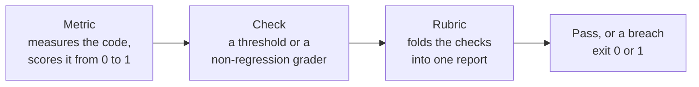
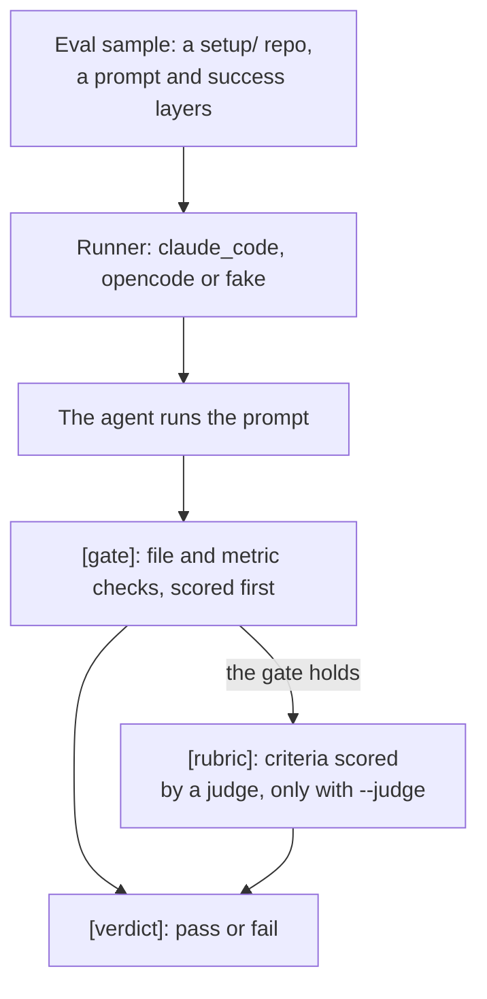

# Checks and evals

This page covers the checks the playbook runs on your code and your commits, and the
eval runner that measures how well a prompt works. It describes the code-quality
metrics gate, the commit-message convention, `playbook ci`, `playbook forge` and
`playbook eval`. Back to the [README](../README.md).

## Code-quality metrics gate

`playbook metrics` is a standalone code-quality gate, and it is opt-in. It measures
Python code with deterministic static metrics: cyclomatic complexity, weighted methods
per class (WMC), LCOM4, depth of inheritance and an approximate coupling between
objects. With the optional extra, it also measures the maintainability index.

The gate grades the result in one of two ways. It compares each metric with an
absolute threshold, or it runs a non-regression check, which fails when the code gets
worse than a baseline. Non-regression is the default.

The gate is independent of `playbook sync`. Nothing in your generated assistant
context depends on it.

These commands show the common ways to run it:

```bash
playbook metrics                              # measure src/ against absolute thresholds
playbook metrics --baseline git:HEAD          # fail if the working tree worsens vs HEAD
playbook metrics src tests --format json      # machine-readable findings
playbook metrics --strict                     # promote warnings to failures (non-zero exit)
playbook metrics --baseline git:origin/main --changed   # only the files a branch changed
```

`playbook metrics` exits with one of three codes:

| Exit | Meaning |
| --- | --- |
| `0` | pass |
| `1` | a breach |
| `2` | a usage error: a bad path, a bad baseline or a malformed `[metrics]` config |

Defaults and per-metric thresholds live in a `[metrics]` table in
`.coding-agent-playbook.toml`. The same `[metrics]` policy drives the pre-commit hook,
the `metrics` step of [`playbook ci`](#playbook-ci) and the quality Stop stages of the
lifecycle hooks. It is read from the committed config only.

Internally, each metric is wrapped in a check, which is a threshold grader or a
non-regression grader. The checks are then folded into one rubric report. This is the
`Metric` / `Check` / `Rubric` model shown below (SPEC §21).



### The metrics

The table lists every metric, the families it belongs to and how it gets selected.

| Metric | Families | Selected | Measures |
| --- | --- | --- | --- |
| `cyclomatic_complexity` | `quality` | by default | 1 + the decision points of each function |
| `wmc` | `quality` | by default | the summed complexity of a class's methods |
| `lcom4` | `quality` | by default | class cohesion: groups of methods sharing no attribute |
| `dit` | `quality` | by default | depth of inheritance |
| `cbo` | `quality` | by default | coupling between objects (approximate) |
| `maintainability_index` | `quality` | by default (needs `radon`) | the SEI maintainability index, 0–100 |
| `ruff_violations` | `quality`, `docstrings` | opt-in, by name | ruff findings per file and code family: `quality` (C901, PLR0911, PLR0912, PLR0913, PLR0915), `docstrings` (D100–D107); needs `ruff` on `PATH` |
| `file_sloc` | `quality` | opt-in, by name (needs `radon`) | source lines per file |
| `docstring_example` | `docstrings` | opt-in, by name | whether each public function's docstring carries a usage example |
| `test_pass_rate` | `testing` | with `--run-tests` | the share of passing tests |
| `coverage` | `testing` | with `--run-tests` | line coverage per file and in total |
| `diff_coverage` | `testing` | with `--run-tests` | the share of the changed executable lines the suite ran |

You choose the metrics with the `--select`, `--extend-select` and `--ignore` flags, or
with the `select`, `extend_select` and `ignore` keys of `[metrics]`. Each one takes
metric names or the family names `quality`, `docstrings` and `testing`.

A family expands to its default members only, so you select an opt-in metric by its
own name. This way, an engine upgrade never changes what an existing `[metrics]`
table measures.

`--changed` limits a run with a `git:` baseline to the Python files changed against
that baseline.

### Clean Code for AI Agents preset

Code that an agent edits stays legible when it keeps to a few budgets. Functions stay
short, nesting and argument lists stay small, and files stay under a few hundred
lines. Public functions carry a docstring with a usage example.

The configuration below turns those budgets into the gate, without editing your own
ruff configuration:

```toml
# .coding-agent-playbook.toml
[metrics]
extend_select = ["ruff_violations", "file_sloc", "docstring_example"]   # opt-in, by name

[metrics.ruff_violations]   # --config for the gate's and the post-edit feedback's ruff calls only
config = { "lint.mccabe.max-complexity" = 10, "lint.pylint.max-args" = 5, "lint.pylint.max-statements" = 20 }

[metrics.thresholds.file_sloc]   # 1.0 up to 300 source lines, 0.0 at 800
warn = 1.0                       # warn above 300 lines
fail = 0.6                       # fail above 500 lines
```

Under the default non-regression mode, existing code that already breaks a budget
stays quiet. Only a change that makes a file worse fails.

### Running tests and coverage (`--run-tests`)

`--run-tests` also runs the execution metrics: `test_pass_rate`, `coverage` and
`diff_coverage`. These metrics shell out to your project's own `pytest` and
`pytest-cov`, then parse the standard junit and coverage XML reports.

Running them has side effects and a cost. They are therefore opt-in, and never part
of the default pre-commit hook. Run them in CI or on demand:

```bash
playbook metrics --run-tests                          # also run the suite + measure coverage
playbook metrics --run-tests --baseline git:HEAD      # fail on new test failures / coverage drop
playbook metrics --run-tests --test-cmd "pytest -q"   # override the test command
playbook metrics --run-tests --select testing --baseline git:HEAD   # the playbook-coverage hook
```

`diff_coverage` grades the change, not the whole file. At least 80% of the changed
executable lines must be executed. Test files and the files in `[metrics] exclude` are
never scored. A change with no executable line passes, without a fake 100%.

`[metrics] run_tests = true` makes `--run-tests` the default for CI and manual runs.
`--no-run-tests` overrides it. The `playbook-metrics` pre-commit hook always passes
`--no-run-tests`, so a commit never runs your suite.

The engine adds no dependency for this. Your target project supplies `pytest` and
`pytest-cov`.

### The `metrics` optional extra (maintainability index)

The core gate uses only the Python standard library, so it runs with nothing extra
installed. The maintainability index is the one metric backed by
[`radon`](https://radon.readthedocs.io/), so it ships as an optional extra. Without
the extra, that single metric is skipped transparently.

This command installs the extra:

```bash
pip install 'coding-agent-playbook[metrics]'   # adds radon for maintainability_index
```

## Commit-message convention (commitizen)

The playbook has no commit-message linter of its own. It uses the convention of
[commitizen](https://commitizen-tools.github.io/commitizen/), configured where
commitizen reads it, and every check calls `cz check`.

To set it up, add commitizen to your dev tools with `uv add --dev commitizen`. Then
declare the convention in `pyproject.toml`:

```toml
# pyproject.toml
[tool.commitizen]
name = "cz_conventional_commits"   # commitizen's default; use cz_customize + schema_pattern for your own
```

A repo whose history predates the convention sets a cut-over date, so that older
commits are grandfathered:

```toml
# .coding-agent-playbook.toml
[hooks.commit_convention]
cutover_date = "2026-10-15"   # "YYYY-MM-DD", quoted: an unquoted TOML date is an error
```

Range checks skip every commit whose committer date is before `cutover_date`. A commit
rebased or amended after that date counts as new and must conform. When
`cutover_date` is unset, every commit is checked.

The convention is then enforced in three places.

The `playbook-commit-msg` pre-commit hook checks every new commit message, yours
included, with no cut-over. It needs the `commit-msg` hook type installed.

The `commit-message-convention` lifecycle hook denies a `git commit` by the assistant
when the message fails. With `[hooks.commit-message-convention] check_push = true`,
it also denies a `git push` whose commits after the cut-over fail. This push check is
off by default, for two reasons. The commit check and `playbook-commit-msg` already
see every new commit, and the scan can take seconds per push.

The `commit-convention` step of `playbook ci` checks the branch's commits after the
cut-over. When `PLAYBOOK_PR_TITLE` is set, it also checks the pull-request title,
because in a squash-merge repo the title becomes the commit subject.

In the engine's own repository, a pull request that changes shipped rules, prompts,
skills or hooks (`catalog/core/<kind>/` or `catalog/plugins/<plugin>/<kind>/`) must
be titled `feat` or `fix`, or carry a breaking `!`. Any other type fails the step,
with a message naming the changed artifacts, because commitizen would not bump the
release for it.

A missing `cz` fails the CI step and the pre-commit hook loudly. The lifecycle hook
fails open instead, and shows a hint to install `cz` once per session.

## `playbook ci`

`playbook ci` is the one required status check. It runs every off-workstation twin of
the lifecycle hooks: the CLI commands that run the same checks as those hooks, outside
an agent session. It checks the branch against its merge base with the default
branch.

Each step runs as a child process, with no shell and a timeout per step. `playbook ci`
reports every step, and does not stop at the first failure.

These commands show how to run it and how to choose the steps:

```bash
playbook ci                                   # every applicable step vs the default branch
playbook ci --base origin/main --steps validate,scan-secrets
playbook ci --steps scan-sinks                # --steps also switches on opt-in steps
playbook ci --format json                     # one {step, argv, exit, duration_s, status} per step
```

The table lists each step, the command it runs and when it runs.

| Step | Runs | When |
| --- | --- | --- |
| `sync-check` | `playbook sync --check` | `[output] commit = true` only: under the default, a fresh clone has no output to compare |
| `validate` | `playbook validate` | always |
| `metrics` | `playbook metrics --baseline git:<merge base> --changed --no-run-tests` | always (static, never the suite) |
| `coverage` | `playbook metrics --run-tests --select testing --baseline git:<merge base>` | `[metrics] run_tests = true`, or `--steps coverage` |
| `gate-scan` | `playbook gate-scan`: new suppressions, skipped tests, loosened checker config, removed CI steps or jobs, loosened secret or SAST scanners | always |
| `scan-secrets` | `playbook scan-secrets` over the branch | always |
| `commit-convention` | `cz check` on the commits after `cutover_date`, plus `$PLAYBOOK_PR_TITLE` (a leading `[Draft]`, `Draft:` or `(Draft)` stripped), which must be `feat`, `fix` or `!` when shipped catalog guidance changed | `[tool.commitizen]` or `[hooks.commit_convention]` is set |
| `commit-trailers` | `playbook check-commit-trailers` over the branch | a commit-trailer row is configured |
| `check-deps` | `playbook check-deps`: newly declared dependencies against your policy | a dependency policy is configured |
| `scan-sinks` | `playbook scan-sinks` over the branch | only when `--steps` names it |

`playbook ci` exits with one of three codes:

| Exit | Meaning |
| --- | --- |
| `0` | every step that ran passed |
| `1` | a step failed or timed out |
| `2` | a usage error, an unresolvable base, a blank `--base`, or an empty range |

An empty range means the base is `HEAD` or already contains it, so nothing would be
checked.

`playbook ci` never fetches and never reads a forge's variables. The CI job fetches
the history and passes the base with `--base`.

### GitHub Actions

The job below runs `playbook ci` on pull requests. It needs the full history, so the
checkout sets `fetch-depth: 0`.

> [!WARNING]
> The pull-request title is attacker-controlled text. Pass it only through `env:`,
> never inside a `run:` line, so that it cannot inject shell commands.

```yaml
# .github/workflows/ci.yml
jobs:
  playbook-ci:
    if: github.event_name == 'pull_request'
    runs-on: ubuntu-latest
    steps:
      - uses: actions/checkout@v4
        with:
          fetch-depth: 0                 # playbook ci diffs <merge base>..HEAD
      - uses: actions/setup-python@v5
        with:
          python-version: "3.12"
      - name: Install the project with its dev tools (coding-agent-playbook, commitizen)
        run: python -m pip install -e ".[dev]"
      - name: playbook ci
        run: playbook ci --base origin/main
        env:
          PLAYBOOK_PR_TITLE: ${{ github.event.pull_request.title }}
```

### GitLab CI

A GitLab *merge request pipeline* clones a shallow history, with a `GIT_DEPTH` of 20
by default. It fetches only the pipeline's own ref, never the target branch. The job
below therefore sets `GIT_DEPTH: 0`, fetches the target branch and passes the base
explicitly. The title reaches `playbook ci` only through `variables:`, never inside a
`script:` line:

```yaml
playbook-ci:
  rules:
    - if: $CI_PIPELINE_SOURCE == "merge_request_event"
  variables:
    GIT_DEPTH: 0
    PLAYBOOK_PR_TITLE: $CI_MERGE_REQUEST_TITLE
  script:
    - git fetch origin "$CI_MERGE_REQUEST_TARGET_BRANCH_NAME"
    - playbook ci --base "${CI_MERGE_REQUEST_TARGET_BRANCH_SHA:-$CI_MERGE_REQUEST_DIFF_BASE_SHA}"
```

`CI_MERGE_REQUEST_TARGET_BRANCH_SHA` is set only in merged results pipelines.
Elsewhere it is empty, and the base is `CI_MERGE_REQUEST_DIFF_BASE_SHA`, the merge
base of the pull request's diff.

The shell syntax targets Linux runners. The job installs the project with its dev
tools, as on GitHub. A draft marker at the start of the title (`Draft:`, `[Draft]` or
`(Draft)`) is not checked, because the squash commit does not carry it.

How strictly the job gates a merge depends on where its definition lives. On GitLab,
a pull request's pipeline runs that pull request's own `.gitlab-ci.yml`. There are
three levels:

1. On Free, add the job and turn on *Pipelines must succeed* (Settings → Merge
   requests). On Free a pull request can otherwise edit its own pipeline: it can
   delete the job or make it optional in the same change. The `gate-scan` step flags
   a removed job, script item or `include:` entry, and a `playbook-ci` job that gains
   `allow_failure: true`, `when: manual` or `when: never`. Only a reviewer stops the
   merge, though.
2. With "Pipelines must succeed", keep the CI configuration in a separate protected
   project. Point Settings → CI/CD → General pipelines → *CI/CD configuration file*
   at `.gitlab-ci.yml@group/ci-config`, a project the pull request's authors cannot
   push to. The pull request then cannot change the job that gates it.
3. On Ultimate, use a pipeline execution policy. It injects the `playbook-ci` job into
   every pipeline of the projects it covers, and a project's own `.gitlab-ci.yml`
   cannot remove it.

## `playbook forge`

`playbook forge` runs one forge operation on GitHub or GitLab. A forge is a git
hosting service with its own CLI and CI system. A forge operation is one issue, pull
request, label or check action, offered in the same form on every forge.

On every call, `playbook forge` reads the repo's git config and maps the current
branch's push remote to its forge. It then runs that forge's CLI: `gh` 2.94.0 or
later, or `glab` 1.115.0 or later. The CLI runs with its own login and with
translated arguments.

Skills and agents name only `playbook forge`, so their text is the same on both
forges. The core skill `forge`, which is always rendered, teaches the operations to
the assistant.

`playbook forge` is the only engine code that contacts a forge, and only when someone
runs it. Hooks, `sync`, `check`, `validate` and `playbook ci` never contact a forge.

The engine never reads or stores a forge token. The CLI uses its own login:
`gh auth login`, `glab auth login`, or `GH_TOKEN` or `GITLAB_TOKEN` in the
environment. The guards judge `playbook forge` calls from the same operation tables,
so a body file sent through it counts as egress like any other.

These calls show a few operations:

```bash
playbook forge which                                     # forge, CLI, host, API host, repo, remote
playbook forge issue create --title "Add X" --body-file plan.md --label ready
playbook forge issue view 12 --comments
playbook forge pr create --title "feat: add X" --body-file pr.md --base main
playbook forge pr checks 34
playbook forge -C ../other-repo pr list --state merged --json
```

The table maps each operation to what it runs on each forge.

| Operation | GitHub (`gh`) | GitLab (`glab`) |
| --- | --- | --- |
| `issue create --title --body… [--label]… [--assignee @me] [--parent n] [--blocked-by n,…] [--confidential]` | `gh issue create` | `glab issue create`; `--parent` exits 3, `--blocked-by` is a blocking link (Premium, else exit 3) |
| `issue view <n> [--comments]`, `issue list [--state] [--label]… [--no-label] [--assignee] [--search] [--limit]` | `gh issue view/list --json` | `glab issue view -F json`, `glab issue list -O json`; notes through `glab api`, every page, system notes dropped |
| `issue comment <n> --body…` | `gh issue comment` | a note through `glab api` |
| `issue label <n> [--add a,b] [--remove c]`, `issue assign <n> --add @me`, `issue edit <n> [--title] [--body…]` | `gh issue edit` | `glab issue update` |
| `issue close <n> [--comment] [--reason completed\|not-planned\|duplicate]` | `gh issue close` (one call) | a note with the reason as its closing line, then `glab issue close` |
| `issue link-child <parent> <child>`, `issue children <parent>` | sub-issues | exit 3 |
| `issue block <child> <blocker>`, `issue blockers <n>` | blocked-by links | `is_blocked_by` issue links (Premium, else exit 3) |
| `label list`, `label create <name> [--color] [--description]` | `gh label` | `glab label` |
| `pr create --title --body… [--base] [--draft]` | `gh pr create --head <branch>` | `glab mr create --source-branch <branch> --push=false` |
| `pr view <n> [--comments]`, `pr list [--state] [--label] [--external]` | `gh pr view/list --json`; `--external` keeps authors outside the repo, with `author_association` | `glab mr view/list -F json`; `--external` looks each author up in the project's members |
| `pr diff <n>`, `pr checkout <n>`, `pr checks <n>` | `gh pr diff/checkout/checks` | `glab mr diff --raw`, `glab mr checkout`, the jobs of `glab ci get --merge-request` |
| `pr comment <n> --body… [--reply-to <id>]`, `pr label`, `pr edit`, `pr ready`, `pr close [--comment]` | `gh pr comment/edit/ready/close`; a reply goes into the review thread | `glab mr note create`, `glab mr update`, a note then `glab mr close` |
| `ref view <ref>` | `#n` / `n`: the pull request, else the issue | `#n` / `n`: the issue, `!n`: the merge request; a URL by its path |
| `which` | prints `{forge, cli, host, api_host, repo, remote}` without running the CLI | the same |
| `auth status` | `gh auth status --hostname <host> --active` | `glab auth status --hostname <host>` (never `-t`), then `glab api user` for a token kept only in the environment |

You pass a body with `--body TEXT`, `--body-file PATH` or `--body-file -`, which reads
stdin. `issue create` and `pr create` also take `--template PATH`, read as a body
file. The body always reaches the CLI on stdin, never on its command line. In every
body sent to GitLab, each `/` at the start of a line is indented by one space, so
that no quick action runs.

Read operations print the same JSON fields on both forges: `number`, `url`, `title`,
`body`, `state` (`open`, `closed` or `merged`), `labels`, `assignees`, `author`,
`created_at`, `updated_at` and `confidential`. A pull request also has `draft`,
`base` and `head`. Write operations print the URL they created or changed, or
`{"url": …}` with `--json`.

`pr create` never pushes. When the branch is not on the push remote, it exits 2 with
the hint `git push -u <remote> <branch>`. On GitLab, `pr create` and `pr edit` refuse
a title with `[skip ci]`, `[ci skip]`, `[skip pipeline]` or `[no ci]`, since the
pipeline would not run.

`playbook forge` has no merge, no issue deletion, no attachment upload, and no CI
secret or variable write.

The exit code tells the agent what to do next:

| Exit | Meaning | The agent |
| --- | --- | --- |
| `0` | success | continues |
| `1` | the call or the CLI failed; the CLI's stderr passes through unchanged | reads the error |
| `2` | a human must act: unknown forge, CLI missing or older than the minimum, not logged in, detached `HEAD`, outside a repo, host mismatch, branch not pushed | stops and passes on the one-line hint |
| `3` | the forge or its plan lacks the operation | applies the skill's text fallback |

### Which forge, which host

`playbook forge` finds the forge from the push remote of the current branch. The push
remote is the first of these that is set: `branch.<b>.pushRemote`,
`remote.pushDefault`, `branch.<b>.remote`, then `origin`. On a detached `HEAD`, it is
`remote.pushDefault`, then `origin`.

The remote's URL is `pushurl` before `url`, read raw. Only when the raw host does not
map does `playbook forge` use `git remote get-url --push`, which applies `insteadOf`.
An SSH alias is resolved offline with `ssh -G`.

The host maps to a forge through the first of these rules that matches:

1. the `[forge] hosts` table
2. `github.com` or `gitlab.com`
3. a host name containing `github` or `gitlab`
4. a host equal to `GH_HOST`, or to `GITLAB_HOST`, `GITLAB_URI` or `GL_HOST`

Errors name the host, never the URL. A host that none of these rules names needs one
committed line:

```toml
[forge]
hosts = { "git.acme.com" = "gitlab", "ssh.acme.com" = { forge = "gitlab", api_host = "gitlab.acme.com" } }
```

A value is `"github"`, `"gitlab"`, or a table with `forge` and an optional
`api_host`. `api_host` is the host the CLI talks to when it is not the remote's host.
Only `playbook forge` reads the table, and `playbook validate` reports its unknown
keys and values.

Every call tells the CLI its host in the child process's environment only. It sets
`GH_HOST=<api host>`, or `GITLAB_HOST=https://<api host>` plus `GITLAB_API_HOST` when
the API host is not the remote's. It also turns off prompts, update notifiers and
telemetry with `GH_PROMPT_DISABLED`, `GLAB_NO_PROMPT`, `GH_NO_UPDATE_NOTIFIER`,
`GH_NO_EXTENSION_UPDATE_NOTIFIER`, `GLAB_CHECK_UPDATE`, `GH_TELEMETRY=false`,
`GLAB_SEND_TELEMETRY=false` and `DO_NOT_TRACK`.

A `GITLAB_API_HOST`, or a `glab` `api_host` setting, that names another host exits 2.

### Running on Domino Data Lab

Where the repository lives depends on the kind of Domino project. In a git-based
project, it is at `/mnt/code`, with `origin` set to the URL the project was created
with. In a project on Domino's own file system, attached repositories are at
`/repos/<name>` and imported ones at `/mnt/imported/code/<name>`. In that case `/mnt`
is not a clone.

Run `playbook forge` from the repository, or pass `-C <path>`. gitlab.com and hosts
whose name contains `gitlab` are detected. Any other host needs its `[forge] hosts`
line.

Domino's stored Git credential clones the repository, but `glab` cannot use it. Each
user sets up the following once:

1. Add `glab`, and `gh` for GitHub, to the compute environment's Dockerfile. `sudo`
   is usually unavailable in a workspace, and a runtime install does not reach jobs.
2. Add `GITLAB_TOKEN`, with the scopes `api` and `write_repository`, or `GH_TOKEN`,
   under Account Settings → User environment variables. Then start a new workspace.
   Domino injects the token into workspaces, jobs and apps. One GitLab token per
   user environment is the limit, so several GitLab instances need a persisted home
   and `glab auth login` per host.
3. Add `coding-agent-playbook` to `requirements.txt`.

When `DOMINO_PROJECT_ID` is set, the exit-2 hints name these steps. A job launched
from a commit has a detached `HEAD`, so `pr create` asks for
`git checkout -b <name>`. Git actions taken in Domino's UI run outside the agent, and
no guard sees them.

The script below, `domino-forge-check.sh`, checks a workspace read-only. It covers
`origin`, the branch state, the credential wiring, `glab` and `sudo`, and whether the
API answers. It prints no secret: URLs lose their user and password, tokens and
credential files are reported only as present or absent, and `glab` runs without
`-t`. Save it and run `bash domino-forge-check.sh` in a workspace terminal:

```bash
#!/usr/bin/env bash
# domino-forge-check.sh: what `playbook forge` needs in this Domino workspace, checked read-only.
# It changes nothing and prints no secret: URLs lose their user and password, token variables
# and credential files are reported as present or absent only, and `glab` runs without -t.
# Usage: bash domino-forge-check.sh [repo-dir ...]   (default: /mnt/code, /repos/*, /mnt/imported/code/*)
set -u

redact() { sed -E 's#(://)[^/@]*@#\1<redacted>@#'; }
present() { if [ -n "${!1:-}" ]; then echo "set"; else echo "unset"; fi; }
row() { printf '  %-30s %s\n' "$1" "$2"; }
first_line() { "$@" 2>/dev/null | head -n 1; }

echo "== Domino"
row "DOMINO_PROJECT_ID" "$(present DOMINO_PROJECT_ID)"
row "working directory" "$PWD"

echo "== Tools"
for tool in git glab gh ssh curl python3 playbook; do
  row "$tool" "$(command -v "$tool" || echo missing)"
done
command -v glab >/dev/null && row "glab --version" "$(first_line glab --version)"
command -v gh >/dev/null && row "gh --version" "$(first_line gh --version)"
if command -v sudo >/dev/null && sudo -n true 2>/dev/null; then
  row "sudo" "works without a password"
else
  row "sudo" "not available without a password (install tools in the compute environment)"
fi

echo "== Credentials (presence only)"
for var in GITLAB_TOKEN GITLAB_ACCESS_TOKEN OAUTH_TOKEN GH_TOKEN GITHUB_TOKEN GIT_ASKPASS; do
  row "$var" "$(present "$var")"
done
for var in GITLAB_HOST GITLAB_API_HOST GH_HOST; do
  row "$var" "$(printf '%s' "${!var:-unset}" | redact)"
done
glab_config="${GLAB_CONFIG_DIR:-$HOME/.config/glab-cli}/config.yml"
row "glab config file" "$([ -f "$glab_config" ] && echo present || echo absent)"
row "git-credentials file" "$([ -f "$HOME/.git-credentials" ] && echo present || echo absent)"

if [ "$#" -gt 0 ]; then
  dirs=("$@")
else
  dirs=(/mnt/code /repos/* /mnt/imported/code/*)
fi
for dir in "${dirs[@]}"; do
  [ -d "$dir" ] || continue
  echo "== Repository $dir"
  if ! git -C "$dir" rev-parse --is-inside-work-tree >/dev/null 2>&1; then
    row "git" "not a git work tree"
    continue
  fi
  branch="$(git -C "$dir" symbolic-ref -q --short HEAD)"
  row "branch" "${branch:-(detached HEAD: run git checkout -b <name> before pr create)}"
  remote=""
  [ -n "$branch" ] && remote="$(git -C "$dir" config "branch.$branch.pushRemote")"
  [ -z "$remote" ] && remote="$(git -C "$dir" config remote.pushDefault)"
  [ -z "$remote" ] && [ -n "$branch" ] && remote="$(git -C "$dir" config "branch.$branch.remote")"
  { [ -z "$remote" ] || [ "$remote" = "." ]; } && remote="origin"
  url="$(git -C "$dir" config "remote.$remote.pushurl" || git -C "$dir" config "remote.$remote.url")"
  row "push remote" "$remote"
  row "push URL" "$(printf '%s' "${url:-none}" | redact)"
  case "$url" in
    *://*@*) row "credentials in the URL" "yes (redacted)" ;;
    *) row "credentials in the URL" "no" ;;
  esac
  helpers="$(git -C "$dir" config --get-all credential.helper | wc -l | tr -d ' ')"
  row "git credential helpers" "$helpers"
  if [ -n "$branch" ]; then
    if git -C "$dir" rev-parse --verify --quiet "refs/remotes/$remote/$branch" >/dev/null; then
      row "branch on the remote" "yes"
    else
      row "branch on the remote" "no (git push -u $remote $branch before pr create)"
    fi
  fi
  host="$(printf '%s' "$url" | sed -E 's#^[a-z+]+://##; s#^[^@/]*@##; s#[:/].*$##')"
  [ -n "$host" ] || continue
  row "host" "$host"
  if command -v curl >/dev/null; then
    code="$(curl -sS -o /dev/null -m 10 -w '%{http_code}' "https://$host/api/v4/version" 2>/dev/null)"
    row "API reachable (no token sent)" "HTTP ${code:-none} (401 or 200: reachable)"
  fi
  if command -v glab >/dev/null; then
    if glab auth status --hostname "$host" >/dev/null 2>&1; then
      row "glab auth status" "logged in"
    elif GITLAB_HOST="https://$host" glab api --hostname "$host" user >/dev/null 2>&1; then
      row "glab auth status" "a token in the environment works"
    else
      row "glab auth status" "not logged in (set GITLAB_TOKEN as a user environment variable)"
    fi
  fi
  if command -v playbook >/dev/null; then
    row "playbook forge which" "$(cd "$dir" && playbook forge which 2>&1 | tr -d '\n' | tr -s ' ')"
  fi
done
```

## Running evals

An eval sample is a reproducible test case for a prompt: a starting repo state, an
invocation and a definition of success. `playbook eval` works with these samples.
With `--list` or `--show`, it prints the prompt-to-sample graph, which links each
prompt to its eval samples. With `--run`, it executes samples end to end against
an agent and grades the results.

Samples are grouped by task: a task is the eval samples of one prompt, kept in
`eval_samples/<prompt>/<name>/` in every layer. A sample's id is `<prompt>/<name>`,
so `playbook eval review --run` runs every sample of the `review` prompt and
`playbook eval review/spot-the-bug --run` runs one.

These commands run one sample with each runner and with the main options:

```bash
playbook eval refactor/extract-helper --run --runner claude_code   # real: drive the Claude Code CLI
playbook eval refactor/extract-helper --run --runner opencode       # real: drive the OpenCode CLI
playbook eval refactor/extract-helper --run --runner fake          # hermetic demo / CI: no network, no CLI
playbook eval refactor/extract-helper --run --target claude-opus    # a named eval target from [evals.targets]
playbook eval refactor/extract-helper --run --target opencode:my-org/coder-32b  # harness:model, no config
playbook eval --targets                                             # list the targets and whether each CLI is installed
playbook eval refactor/extract-helper --run --judge llm --judge-samples 3 # also score [rubric] via an LLM judge
playbook eval refactor/extract-helper --run --full-scoring          # run every check (no short-circuit)
playbook eval refactor/extract-helper --run --format json          # machine-readable report
```

The diagram shows how a run scores a sample:



Each run copies the sample's `setup/` into a scratch git repo. When `setup/` has a
`pyproject.toml`, `uv sync` installs its dependencies into `<scratch>/.venv`. The
agent runs with the sample's environment on `PATH`: `<scratch>/.venv/bin` comes
first and `VIRTUAL_ENV` names that venv, for Claude Code and OpenCode runs, with or
without an endpoint. So `python` and `pytest` in the agent's shell are the
sample's own. The setups whose agent writes or runs tests declare a pytest
`pythonpath`, so plain `pytest` imports their code and no agent has to edit the
sample's config. generate-tests/* and refactor/* declare
`[tool.pytest.ini_options] pythonpath = [".", "src"]`, so both `src.<module>` and
bare `<module>` imports work. characterize/legacy-pricing, the review samples that
ship tests and review-architecture/layer-leak declare `pythonpath = ["."]`. make-testable/inject-clock
needs no such entry: its `tests/` is a package, so pytest puts `setup/` on the
import path. Review-only setups without tests do not declare it. The `tests_pass`
check is different: it runs `python -m pytest --cov` in the candidate tree with
the interpreter that runs the playbook, not the scratch venv, which holds only the
sample's declared dependencies. That interpreter must have `pytest` and
`pytest-cov`, as the `dev` extra provides.

A sample declares its success criteria as layers (SPEC §6.5.3):

| Layer | What it declares |
| --- | --- |
| `[gate]` | deterministic file and metric checks, composed by a small boolean `expr` |
| `[rubric]` | optional: weighted criteria, scored by an LLM judge |
| `[verdict]` | a boolean expression over `[gate]` and `[rubric]` |
| `[aggregate]` | optional: a cross-trial result, `pass@k` or `pass^k` |

The layers compile into one rubric of checks, with the same `Metric` / `Check` /
`Rubric` model as the metrics gate (SPEC §21). The `[gate]` layer holds file
predicates (`file_exists`, `file_contains`, `file_unchanged` and `file_forbidden`)
and static or execution metric checks. A metric check uses a threshold normalized to
0–1, or non-regression against the `setup/` baseline.

The `[gate]` layer is scored deterministically into one report, rendered like the
report of `playbook metrics`. The verdict of each trial is derived from the layer
results.

A handle is one entry of a `[gate]` or `[rubric]` layer. Instead of inlining a gate or
a rubric, a handle can name one with `{ref = "name"}`. In the `[gate]` layer, the name
resolves to a composed boolean gate registered with `@register_gate`, in the
`coding_agent_playbook.gates` group. In the `[rubric]` layer, it resolves to a
code-defined `Rubric` subclass registered with `@register_rubric`, in the
`coding_agent_playbook.rubrics` group. Several eval samples can then share one gate
or rubric by name. The engine ships no built-in gates or rubrics: both are
third-party extension points.

Judged scoring of the `[rubric]` layer is opt-in, with `--judge`. You pick a judge
from the `coding_agent_playbook.judges` group. The shipped judge, `llm`, shells out to
the `claude` CLI and is gated by `available()`. `--judge-samples N` averages N
gradings per criterion. The flag's old spelling, `--samples`, is a deprecated alias
until the next release.

Omit `--judge` for a deterministic-only run. The rubric layer is then skipped, and a
skipped layer is neutral in the verdict. Judged scores are labelled uncalibrated: the
text report carries a note, and the JSON report sets `"uncalibrated_judge": true`.

A cost-tiered scheduler runs the cheap deterministic checks first, and stops scoring
once the gate is lost. With the default `gate and rubric` verdict, a failing file or
metric check therefore never spends an LLM call. A sample whose verdict or aggregate
a skipped layer could change, such as one with a `gate or rubric` verdict, is always
scored in full. `--full-scoring` forces every check to run, for a complete report.

A runner drives the agent. Two real runners ship, and both are opt-in. `claude_code`
is the default and drives the `claude` CLI. `opencode` drives the `opencode` CLI.
Each one is gated by `available()` on its binary, and CI never exercises them.
`--runner fake` is the hermetic driver for demos and CI.

### Eval targets

An eval target is a harness and a model, named once in the `[evals]` table of the
committed config. The model is sent to the harness exactly as written, as
`--model <model>`, so any model a deployment serves works the day it ships:

```toml
[evals]
default = "claude-opus"
release = ["claude-opus"]          # the targets release metrics run on

[evals.targets.claude-opus]
harness = "claude_code"            # a runner name: claude_code, opencode or fake
model = "claude-opus-5-5"
runs = 3                           # optional
label = "Claude Opus"              # optional, display only
price = { input = 3.0, output = 15.0 }  # optional, USD per million tokens

[evals.judge]                      # one judge for every target
model = "claude-opus-5-5"          # the LLM judge's --model
samples = 3                        # the default of --judge-samples
```

The machine-local `.coding-agent-playbook.local.toml` may add targets (under new
names), change `default` and override `[evals.judge]` keys; `release` is committed
only. A run picks its target from the first of these that names one:

1. `--target <name>` or `--target <harness>:<model>` (split at the first colon);
2. the `PLAYBOOK_EVAL_TARGET` environment variable;
3. the local file's `default`;
4. the committed file's `default`;
5. otherwise Claude Code on its own default model, recorded as `default`.

`--runner <name>` still works: it is the target with that harness and no model, and
cannot be combined with `--target`. An unknown target name is a usage error that
lists the configured names. Each result records the target's name, harness,
requested model and the model the harness reported (`null` when it reports none):
the JSON report's `target` object, and a `target:` line in the text report.
`--compare` does not take `--target` yet.

### Endpoints

A target or the judge can reach a custom endpoint, such as an internally deployed
model behind an Anthropic-compatible gateway. Declare the endpoint once and refer
to it by name:

```toml
[evals.endpoints.internal]
api = "anthropic"                  # anthropic | openai-chat | openai-responses
base_url = "https://llm.internal.example"
token_env = "INTERNAL_LLM_TOKEN"   # the variable's NAME; the token is never in a file
auth_header = "bearer"             # or "x-api-key" (anthropic only; default bearer)
headers_env = "INTERNAL_LLM_HEADERS"  # optional: extra "Name: Value" header lines
context_tokens = 200000            # optional
max_output_tokens = 8192           # optional

[evals.targets.internal-claude]
harness = "claude_code"
endpoint = "internal"
model = "internal-opus"            # required on an endpoint: the id it serves
small_model = "internal-haiku"     # optional background model, defaults to model

[evals.judge]
endpoint = "internal"              # optional; the judge then needs a model
model = "internal-opus"
```

Write an `anthropic` `base_url` without `/v1`, as `ANTHROPIC_BASE_URL` takes it:
the same endpoint then serves Claude Code targets, the judge and OpenCode targets.
An `openai-chat` or `openai-responses` `base_url` includes its version path (such
as `/v1`) and is used as written.

The token comes only from the variable `token_env` names, or, in the local file
only, from `token_command` (a command whose output is the token). Inline secret
keys such as `token`, `api_key` or `password` are refused in both files. An
endpoint may be declared in either file; the local file may add only the token
part (`token_env` or `token_command`) to an endpoint the committed file declares,
and a committed target or judge may name only a committed endpoint. A missing or
empty token variable is a usage error (exit `2`) that names the variable.

Claude Code speaks only the Anthropic Messages API, so a Claude Code target or the
judge on an `openai-chat` or `openai-responses` endpoint is refused with a hint to
use an OpenCode target.

A Claude Code run on an endpoint is isolated from your own settings: it gets an
empty scratch `CLAUDE_CONFIG_DIR`; inherited `ANTHROPIC_*`, `CLAUDE_CODE_USE_*` and
OAuth variables are removed; the token reaches it only through its environment
(`ANTHROPIC_AUTH_TOKEN` for bearer, `ANTHROPIC_API_KEY` for x-api-key); the base
URL and the background model go in per-run `--settings`; the model is `--model`;
the context window and output limit are set when declared; telemetry and
non-essential traffic are off. The token never appears in argv, in a file the
engine writes or in a result, and is redacted from transcripts.

An OpenCode target reaches an endpoint of any of the three API shapes, so an
internal OpenAI-compatible server (vLLM, TGI, Ollama) can be evaluated directly.
It needs OpenCode 1.1.64 or later. Each run gets an inline config in
`OPENCODE_CONFIG_CONTENT`: one provider, `playbook-target`, is the only enabled
provider, with the SDK package for the API shape (`@ai-sdk/openai-compatible` for
`openai-chat`, `@ai-sdk/openai` for `openai-responses`, `@ai-sdk/anthropic` for
`anthropic`), the base URL (for `anthropic`, with the `/v1` the SDK expects
appended unless `base_url` already ends in it), the token as an `{env:PLAYBOOK_ENDPOINT_TOKEN}`
reference, the model and small model as served model ids, the declared context
and output limits, and a zero built-in cost. The model is sent as
`--model playbook-target/<model>`. The run gets empty scratch `XDG_CONFIG_HOME`,
`XDG_DATA_HOME` and `XDG_STATE_HOME` directories, so your global OpenCode config,
stored keys and sessions stay out, and `OPENCODE_DISABLE_CLAUDE_CODE=1` keeps your
Claude Code instructions out. Inherited `OPENCODE_*`, `OTEL_*`, `ANTHROPIC_*` and
`OPENAI_*` variables and every `*_API_KEY` are removed. OpenCode inserts the token
into its config text unescaped, so a token holding a double quote, a backslash or
a control character is a usage error (exit `2`) naming the variable. OpenCode runs
with `--format json`: the transcript is its text events, the token totals are
summed over its steps, and stderr is read apart.

A result records the endpoint's name and a 12-character fingerprint of its URL,
never the URL or the token (`target.endpoint` in the JSON report), and
`target.harness_settings` is `isolated`. A target without an endpoint keeps
today's behaviour, and its result says `personal`: your own harness settings and
login were used.

`playbook eval --targets --check` runs one short prompt through each target's
harness and prints `ok` or `FAIL` per target, exiting `1` if any fails. It is a
paid call per target; the harness makes it, the engine makes no network call.

### Release metrics

`playbook eval --run --all --runs N --record <path>` runs every eval sample `N`
times on one eval target and writes a release metrics file to `<path>`. A sample id
in place of `--all` records only that sample. `--runs` defaults to the target's
`runs`, else 1, and `--judge` adds the judge's scores and `--full-scoring` grades
every check, as in `--run`. `--format` does not apply, since the file is always JSON:

```bash
playbook eval --run --all --runs 3 --target claude-opus --judge llm \
  --record catalog/releases/0.3.0/metrics/claude-opus.json
```

Before any run, `--record` refuses these, with exit 2:

- a target without an explicit model (`--runner`, or the built-in default);
- a moving model alias as the target's `model` or `small_model`: `opus`,
  `sonnet`, `haiku`, `opusplan`, `best`, `default` (also with a `[1m]` suffix or
  a `provider/` prefix) and any name ending in `latest`, because the next release
  could grade another model;
- with `--judge`, an `[evals.judge] model` that is missing or a moving alias;
- a missing credential for the isolated harness or judge (see below);
- a selected sample whose prompt cannot be resolved.

`--record` runs the harness and the LLM judge isolated from your personal
settings, as a target on an endpoint always is. Claude Code starts with an empty
temporary `CLAUDE_CONFIG_DIR`, and OpenCode with empty temporary XDG config, data
and state directories and without Claude Code instructions. Your own instructions,
plugins, hooks, MCP servers and login do not reach a measured run, so a recording
can be reproduced on another machine, and the judge starts in seconds. The
isolated judge also starts in an empty temporary directory, so no project
`CLAUDE.md` or `.claude/` settings reach it. Isolated Claude Code agent runs use
`--permission-mode acceptEdits` with an allow list of read and search tools and of
`git`, `python`, `pytest`, `uv` and `ls` in the shell, because nobody can answer a
prompt in print mode: the agent edits files in its scratch repo, any other command
is denied, and recorded scores no longer depend on a personal default mode. Inherited
`ANTHROPIC_*`, `CLAUDE_CODE_USE_*` and OAuth variables are dropped (for OpenCode,
also other provider keys and `OPENCODE_*` and `OTEL_*` variables). Each process
therefore needs a credential in the environment: a target or judge on an endpoint
uses the token named by that endpoint's `token_env` (or its `token_command`), and
one without an endpoint uses `ANTHROPIC_API_KEY`. An OpenCode target without an
endpoint sends its `model` exactly as written, so name it `anthropic/<model id>`:
any other model is refused with exit 2 before the first paid call.
When a credential is missing, `--record` exits 2 before the first paid call, and
the message names `ANTHROPIC_API_KEY` and `token_env`. The key goes only into the
child environment: never into argv, the logs or the file. The `fake` runner needs
no credential. A plain `--run` without `--record` keeps your own settings.

A sample that cannot be scored stops the recording, so a file never lacks a sample
silently. Once written, the command exits 0 whatever the scores are.

The file is JSON with `"schema_version": 1`. It holds:

| Key | What it records |
| --- | --- |
| `release`, `commit` | the engine version, and the checked-out commit (`null` outside git) |
| `previous` | `null`; the regression check sets the baseline release it compared with |
| `target` | `name`, `harness`, `harness_version` (the CLI's `--version`), `model`, `reported_model` (the model the harness reported most often), `label`, `endpoint`, `price`, `judge_model`, `runs` and `isolated` (`true`: the harness and the judge ran without your personal settings; absent in older files) |
| `summary` | `samples`, `runs`, `pass_rate` over every run, `mean_score` over the samples, total `tokens` and `cost_usd`; `rerun` and `carried` counts, written by `--carry-from` and by the regression check (in a full record every entry counts as rerun); with `--carry-from`, `tokens` and `cost_usd` count only the fresh runs |
| `samples.<id>` | `prompt_id`, `graded` (`head`, the current text), `prompt_digest` (the prompt's artifact digest), `sample_digest` (`sample.toml` and `setup/`), `inputs_digest` (the strict render of what the agent received, rules included, with `sample_digest`; absent in older files), `passes` out of `runs`, `mean_score`, `stdev`, `checks` (the mean score of each check that ran), `duration_seconds_mean`, `tokens_mean` and `cost_usd_mean`; a carried entry adds `measured_in` (`release` and `commit`) |
| `controls.<id>` | a pinned sample's runs on its frozen edition, in the same shape, with `graded` the edition tag and `inputs_digest` hashing the edition's render; left out of `summary` |
| `setup_digest`, `setup` | `setup_digest` is the sha256 of everything outside the samples that decides scores, and `setup` holds its parts by name: `harness`, `harness_version` (`"unknown"` when the CLI's `--version` probe fails, `null` without a CLI), `model`, `endpoint_fingerprint`, `small_model`, `runs`, `judge_model`, `judge_endpoint_fingerprint` (the `[evals.judge] endpoint`'s, `null` without one), `judge_samples`, `judge_version` (the judge CLI's `--version`, in the same way), `fail_fast`, `isolated` and `scoring_digest` (the engine's scoring modules: checks, rubric compiler, scoring, runners, the judge and its prompt, the sample model and the release metrics fold), so a later record can name the part that differs; an `"unknown"` version never matches; both keys are absent in older files |

Every sample grades the current text. A sample pinned to an edition also runs on
that edition as a control, `N` times too, so `--record` costs one more set of runs
per pinned sample. Its edition is loaded and its prompt rendered before any run.
Since the edition's text never changes, a control that moves between two
releases points at a model or harness drift rather than at the guidance.

`--carry-from PREVIOUS.json`, with `--all` and `--record` only (else exit 2),
reruns only what changed since that metrics file and writes one complete file:

```bash
playbook eval --run --all --target claude-opus --judge llm \
  --record catalog/releases/0.4.0/metrics/claude-opus.json \
  --carry-from catalog/releases/0.3.0/metrics/claude-opus.json
```

A baseline of another target is refused before any run. When the baseline has no
`setup_digest`, an entry without `inputs_digest` (as in 0.2.0's files), or a
`setup` part that differs from this run's, every sample reruns and the command
says why, naming the parts. Otherwise new samples, samples whose `inputs_digest`
changed and every edition control rerun; every other entry is carried: copied
from the baseline without `vs_previous` or `accepted`, with `measured_in` naming
the release and commit that measured it (kept when it was already carried).
Before the first paid run the command prints the plan: each rerun with its
reason, and the carried count.

Cost comes only from the target's `price`. Without one it is `null`, and so are
tokens and cost when a run's harness reported no tokens. The harness's own cost
estimate is never used: for a custom endpoint, Claude Code prices an unknown model
from a bundled table. The Claude Code runner reads tokens and the model from
`claude -p --output-format json`; the OpenCode runner sums the tokens of the
`step_finish` events of `opencode run --format json` (subagent steps are not
emitted, so it undercounts them) and reports no model.

A reader ignores keys it does not know, so comparison keys can be added under
version 1. Removing or retyping a key needs version 2.

### Regression check

`playbook eval --check-regressions <new> --against <baseline>` compares a release
metrics file with the previous release's file for the same target:

```bash
playbook eval --check-regressions catalog/releases/0.3.0/metrics/claude-opus.json \
  --against catalog/releases/0.2.0/metrics/claude-opus.json \
  --accept review-spot-the-bug="the new rubric is stricter"
```

Per sample:

- a mean score drop above 0.05, or passing most runs before and failing most now,
  is a `regression` (the same rule as `--compare`); the mirror is an `improvement`;
- a sample whose `sample_digest` changed is `not_comparable`, never a regression;
- a sample the baseline lacks is `new`; one the new file lacks is noted;
- a carried entry (one with `measured_in`, copied by `--carry-from`) is `carried`:
  its `vs_previous` holds the previous mean and a delta of 0, and it never blocks;
- a cost per run rise above 25%, or a token rise when either cost is `null`, is a
  warning only.

A harness version change between the files is noted as a likely cause, and so is
a control whose score moved on the same edition; controls never block.
`--accept SAMPLE=REASON` (repeatable) accepts one regression; accepting a sample
that did not regress, a carried one included, is refused. The command stores the
comparison in the new file: `previous`, each sample's `vs_previous` (`mean_score`,
`delta`, `status`, `reasons`, `warnings` and the `accepted` reason) and
`regressions`, `accepted_regressions`, `improvements`, `not_comparable`, `rerun`
and `carried` in the summary. A
reason stored there still holds when the check runs again against the same
baseline.

It prints a table, or JSON with `--format json`, and exits 0 when no regression
is unaccepted, 1 when one is, and 2 when the files are not release metrics, are
for different targets, or an `--accept` is malformed.

### Release metrics at release time

`uv run scripts/release.py prepare --eval` adds the release metrics to the release
pull request. In its scratch checkout of `origin/main`, before any release file is
written, it runs `playbook eval --run --all --target <name> --record
catalog/releases/<version>/metrics/<name>.json` on that checkout's engine for every
target in the `[evals] release` list of the committed `.coding-agent-playbook.toml`,
with `--judge llm` when `[evals.judge] model` is set. Those runs are isolated, so
set `ANTHROPIC_API_KEY` (or each endpoint's `token_env`) before you start. It
sets each file's `release` to the version being prepared and compares it with the previous release's file for
the same target, as `--check-regressions` does, storing the comparison in the file.
A target without a previous file is recorded without a comparison.

- `--accept SAMPLE=REASON` (repeatable) accepts that sample's regression on every
  target where it regressed; one that regressed on no target is refused.
- An unaccepted regression refuses the pull request. The run prints each target's
  table and exits 1.
- On a refusal after recording, the recorded files are copied to a kept temporary
  directory named in the error. `--reuse-metrics DIR` reads a target's file from
  there instead of running it again, if it was recorded on the same base commit.

The pull request body adds a `Release metrics` section to the notes, with one line
per target and its notes; each line says how many samples were rerun and how many
carried ("N rerun, M carried"). These runs are paid and only the maintainer starts them;
CI never does.

`playbook eval` has no `--run-tests` flag. A sample runs the test suite if and only if
its `[gate]` references an execution metric, `coverage` or `test_pass_rate`.

A run exits with one of three codes:

| Exit | Meaning |
| --- | --- |
| `0` | the report passes |
| `1` | the report fails |
| `2` | a usage error, or a sample that cannot be scored at all |

A usage error is an unknown sample, runner or judge, or a real runner or judge whose
CLI is not on `PATH`. A sample cannot be scored at all when its prompt fails to
render, or when the judge gives no score after its retries.

### Comparing two sides: a ref, an edition or the current text (opt-in, paid)

`playbook eval --compare <base> [<head>]` runs eval samples on two sides and
compares the results. A side is one of:

- a git ref (`origin/main`, `HEAD`): a detached `git worktree` of the ref;
- `head`: the current text in place, uncommitted edits included;
- `edition:<tag>`: release `<tag>`'s graded set, built from the tag's manifest
  into the work directory on the fly. Nothing is committed and no pin is needed.

`<head>` defaults to the `HEAD` ref. The compared eval samples come from the
samples themselves, through the task registry: every eval sample, or, against an
edition, the eval samples of the prompts the edition grades.

The comparison is off by default: CI and the release gate never run it. Every run
drives a real agent, and the judge too with `--judge`. It therefore needs your own
agent credentials, with the `claude` or `opencode` CLI logged in. It also **costs
money**: each eval sample makes 2 sides x 3 runs = 6 agent runs by default.

These commands measure a text change against a release in place, compare HEAD with
`origin/main`, and narrow a comparison to one eval sample:

```bash
playbook eval --compare edition:v0.1.0 head --judge llm                          # release v0.1.0's text vs the current text
playbook eval --compare origin/main --judge llm                                  # base origin/main vs HEAD
playbook eval refactor/extract-helper --compare origin/main --judge llm --compare-runs 5 --format json
```

Every eval sample runs as `playbook eval <id> --run --format json`. A git-ref side
runs it in its checkout, through that checkout's own engine, with `--edition head`:
the base side therefore grades the base ref's prompts and rule bodies, pinned eval
samples included. An engine older than pinned eval samples does not take
`--edition head`; the side then runs without it, and grades the ref's text anyway,
since no eval sample is pinned there. `head` runs it in the repository with
`--edition head`, so a pinned sample grades the current text too. An edition side
runs it in the repository with `--edition-dir <dir>`, so every sample grades the
built edition.

`--compare` takes one or two sides, so a task or eval sample id goes before it:
`playbook eval <id> --compare <base>`. When the second side names a task or an
eval sample, the comparison prints a hint saying so.

Before the first paid run, every selected eval sample must render on both sides:
a side in place renders it in the engine, and a git ref through one hermetic
`--runner fake` run of its own engine. When one does not render (an edition lacks
its prompt, or a ref lacks the sample), the comparison names each failure, runs
nothing and exits `2`.

These options shape the comparison:

| Option | Default | Effect |
| --- | --- | --- |
| `--compare-runs N` | 3 | the runs per eval sample on each side |
| `--compare-out` | a new temporary directory, printed on stderr | the directory `<dir>` that keeps the checkouts, built editions and reports |

A positional `<task>` or `<id>` narrows the comparison to that task's eval samples
or that one eval sample.

`--runner`, `--judge`, `--judge-samples` and `--full-scoring` are checked once, the
way `--run` checks them. They then pass through to every run. Both sides therefore
run in one invocation with the same runner and judge, and so with the model their
CLIs are configured to use. Pin that model in the agent CLI's own configuration
before you start. The first line of the table and the `runner` and `judge` keys of the
JSON report record the runner and the judge.

Every run's JSON report is kept under
`<dir>/reports/{base,head}/<eval-sample>-<n>.json`. Keep `<dir>` out of the
repository.

For each eval sample, the table lists each side's outcome (its passing runs) and its
mean score with its spread. The spread is the population standard deviation of the
runs' `aggregate_score`.

> [!NOTE]
> Pass `--judge` for a judge score. Without it, the compared score is the
> deterministic gate score only. The column headers, the `score` key of the JSON
> report and a note on stderr say so.

A regression is a mean score drop above 0.05, or an eval sample that passes on the
base but fails in 2 of 3 runs on HEAD. An eval sample passes on the base when a
majority of its runs pass. An eval sample with no scorable run on a side is
`UNSCORABLE`, never `ok`: the table names the side, and the JSON report lists it
under the sample's `unscorable` key and counts such samples in `unscorable`.

The comparison is advisory, not a merge gate. It exits `0` whatever it shows. It exits
`2` on a usage error (an unknown or unavailable runner or judge, a bad count, or
more than two sides), when a ref does not check out, when an edition's tag or
manifest is missing, or when an eval sample does not render on a side.
