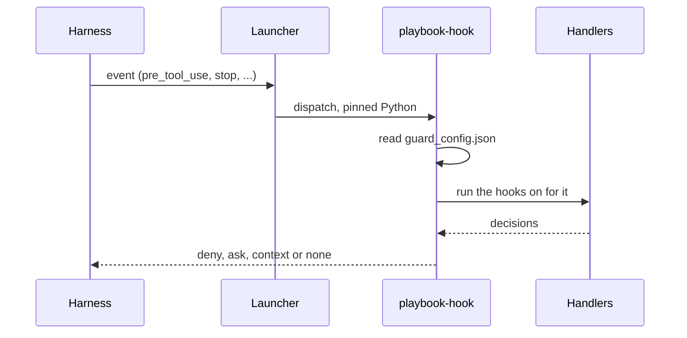

# Hooks

This page covers the two kinds of hooks the playbook uses. The first half explains
the pre-commit hooks a consumer repo (a repository the playbook is installed into)
installs, which run when git commits, checks out or merges. The second half explains
the assistant lifecycle hooks, which run inside an assistant's session. See the
[glossary](../CONTEXT.md) for the terms. Back to the [README](../README.md).

## Pre-commit integration

`coding-agent-playbook` ships a `.pre-commit-hooks.yaml` file, so a consumer repo can
add the playbook to its pre-commit pipeline directly. The configuration below is for
the default policy, `[output] commit = false`, where generated output is gitignored:

```yaml
# In your repo's .pre-commit-config.yaml:
default_install_hook_types: [pre-commit, post-checkout, post-merge]
default_stages: [pre-commit]   # keep your other always_run hooks off checkout/merge
repos:
  - repo: https://git.example.com/your-group/coding-agent-playbook   # your Git copy of the engine
    rev: v0.1.0a0     # the engine version your project pins
    hooks:
      - id: playbook-sync                  # re-render local output after checkout / merge
        additional_dependencies: [playbook-rules-<org>]   # every third-party overlay package / out-of-tree adapter (bundled plugins need none)
      - id: playbook-no-generated-output   # refuse commits that stage generated output
        additional_dependencies: [playbook-rules-<org>]
```

> [!WARNING]
> If you use an overlay, read this. These pre-commit hooks are `language: python`, so
> pre-commit runs them in its own virtualenv. That virtualenv holds only the engine at
> `rev:`, not your project environment. List every overlay package, and any
> out-of-tree adapter, under `additional_dependencies`, and keep `rev` on the engine
> version you pin. Otherwise `playbook sync` refuses to run instead of silently
> re-rendering without your organization's rules. It reports "overlay package(s) or
> bundled plugin(s) in overlays_enabled are not usable here" and marks each overlay
> package `not importable`. The simpler option is to use the `repo: local` and
> `language: system` hooks that `playbook init` writes (described below). They run
> the `playbook` from your project environment.

Next, install all three git hook types. With `default_install_hook_types` set, a
plain `pre-commit install` does it. You can also name them explicitly:

```bash
pre-commit install --hook-type pre-commit --hook-type post-checkout --hook-type post-merge
```

Explicit `--hook-type` flags replace `default_install_hook_types`, so always name all
three. The new stage names need pre-commit ≥ 3.2.

From then on, every checkout and pull re-renders `.claude/`, `.opencode/`,
`.agents/skills/`, `AGENTS.md` and, when enabled, `.continue/`. The render runs
locally, with the engine and overlays already installed. After you pull a dependency
bump, run `uv sync` (or your equivalent) and then `playbook sync`. A commit that
stages any of these paths fails, and the error gives the exact
`git rm -r --cached -- …` command that unstages them.

Repos that set `[output] commit = true` keep the legacy flow instead. They use
`- id: playbook-sync-check`, which fails a commit when the committed output drifts
from what the engine would produce.

`playbook init` writes a starter `.pre-commit-config.yaml` for you. The starter suits
air-gapped machines, because every pre-commit hook in it is `repo: local` and
`language: system`. It holds the playbook hooks for your `[output] commit` policy,
plus `ruff`, `ruff-format` and `mypy`. As a result, pre-commit never clones a remote
hook repo, and the playbook hooks see your overlays. The trade-off is that those
tools must already be installed in your environment, because `language: system`
runs them from `PATH` instead of installing them.

If you re-run `init` on a config from before v0.16, it swaps the old
`playbook sync --check` pre-commit hook for the two new ones. If you edited that old
hook, `init` tells you to delete it instead. See SPEC.md §13.2 for the full template
and the pre-commit hooks deliberately left out.

### Pre-commit hooks

The pre-commit hooks below run at `git commit`, or at checkout, merge or the
`commit-msg` stage, for people and assistants alike. They are not the
[assistant lifecycle hooks](#assistant-lifecycle-hooks), which run inside an
assistant's session. Most lifecycle guards have one of these as their off-workstation
twin, which runs the same check outside the assistant's session.

| Hook ID | When it runs | What it does |
| --- | --- | --- |
| `playbook-sync` | `post-checkout`, `post-merge` | Runs `playbook sync` to re-render the gitignored output. Default policy (`[output] commit = false`). |
| `playbook-no-generated-output` | Every commit | Runs `playbook sync --check-staged` and fails the commit when generated output is staged. Default policy. |
| `playbook-sync-check` | Every commit | Legacy policy (`[output] commit = true`). Runs `playbook sync --check` and fails the commit on drift. |
| `playbook-validate` | Manual only (`pre-commit run --hook-stage manual playbook-validate`) | Runs `playbook validate`, which surfaces canonical-source mistakes (typo'd `applies_if` keys, orphan eval samples, etc.). Meant for overlay authors. |
| `playbook-metrics` | Every commit (Python files) | Runs `playbook metrics --baseline git:HEAD --no-run-tests` and fails the commit when staged Python worsens against `HEAD`. **Static only**: `--no-run-tests` keeps your test suite out, even when `[metrics] run_tests = true`. |
| `playbook-coverage` | Manual only (`pre-commit run playbook-coverage --hook-stage manual`, or move it to `pre-push`) | **Runs your test suite** with coverage. Changed lines must be at least 80% executed (`diff_coverage`), and total coverage must not drop below `HEAD`. Needs `pytest-cov` in your project. |
| `playbook-secrets` | Every commit | Runs `playbook scan-secrets --staged`. Fails when staged lines add a known token format (cloud keys, GitHub and GitLab tokens, chat and LLM API keys, PEM private keys, JWTs, URLs with inline passwords) or when a credential file (`.env*`, `*.pem`, …) is staged. Output is masked. It is the stdlib, air-gapped stand-in for gitleaks. |
| `playbook-commit-msg` | `commit-msg` | Runs commitizen's `cz check --commit-msg-file` against your [`[tool.commitizen]` convention](checks.md#commit-message-convention-commitizen). It is `language: system`, so `cz` comes from your environment, and a machine without it fails loudly. |
| `playbook-notebooks` | Every commit (notebooks) | Runs `playbook check-notebooks` and fails when a staged notebook keeps cell outputs, which may embed data rows. For ML and data-science repos. |
| `playbook-scan-sinks` | Every commit (Python, notebooks) | Runs `playbook scan-sinks --staged` and fails when staged code adds an unsafe deserialization sink (`pickle.loads`, `torch.load(weights_only=False)`, …). For ML repos. |
| `playbook-docs` | Every commit (documentation: `*.md`, `*.rst`, `docs/**`, `mkdocs.yml`) | Runs `playbook docs-check` on the staged docs. It checks the relative links and Python code blocks of changed Markdown, then runs only the docs tools your repo configures (`mkdocs build --strict`, `sphinx-build -W --keep-going`, doctests your pytest `addopts` collect, markdownlint, doc8). A configured tool that is not installed is skipped with an install hint. `[guardrails.docs] mode = "off"` turns it off, and `"warn"` reports without failing. |

`playbook-commit-msg` needs the `commit-msg` git hook type. Add it to
`default_install_hook_types` (`[pre-commit, post-checkout, post-merge, commit-msg]`),
or append `--hook-type commit-msg` to the `pre-commit install` line above.

The air-gapped starter that `playbook init` writes carries `repo: local` twins of
these pre-commit hooks:

- `coding-agent-playbook-metrics`, with `--no-run-tests`.
- `coding-agent-playbook-coverage`, which is manual.
- `coding-agent-playbook-secrets`.
- `coding-agent-playbook-docs`, which runs `playbook docs-check`.

Two more are added only when the repo opted into them. `coding-agent-playbook-commit-msg`
runs commitizen. `coding-agent-playbook-commit-trailers` runs
`playbook check-commit-trailers`, which applies the commit-trailer rows of
`[hooks.git-commit-push-policy-guard]`. Both run at the `commit-msg` stage, which the
starter then installs.

When you run `init` against an existing `.pre-commit-config.yaml`, it adds only the
sync pre-commit hooks the file lacks. Copy any new pre-commit hook you want into your
file by hand (SPEC §13.2).

## Assistant lifecycle hooks

An assistant lifecycle hook is a handler that runs on an assistant's events, such as
before a tool call, after an edit or when the assistant stops. It can block the
action, warn, or feed information back to the agent. Lifecycle hooks are the fourth
canonical kind, next to rules, prompts and skills. Each hook is a `<id>/HOOK.md`
directory whose static frontmatter binds assistant events (`pre_tool_use`,
`post_tool_use`, `stop`, `session_start`, …) to a handler.

The engine ships its own set of hooks in `catalog/core/hooks/`. They are guards,
filed under five hook families, one per job:

- Protect the playbook's own outputs.
- Verify the work before the assistant says it is done.
- Feed lint back after an edit.
- Keep secrets and destructive commands out.
- Keep a local audit trail.

Claude Code and OpenCode enforce these hooks natively. Every other assistant reads
the same guidance as text. Overlays (`<pkg>/resources/hooks/`), bundled plugins
(`catalog/plugins/<name>/hooks/`) and `playbook/hooks/` can add their own hooks
(SPEC §6.6.7).

The diagram below follows one event from the assistant to the answer it gets back.
The harness is Claude Code or OpenCode. The launcher is
`.claude/hooks/playbook/launch.sh` or the OpenCode plugin.



The launcher passes the event to the `playbook-hook` dispatcher, using the pinned
Python interpreter. The dispatcher reads `guard_config.json`, runs the hooks that are
on for the event, and sends the harness the result: deny, ask, context or none.

### Turning them on

Hooks are off until a repo opts in, and an engine upgrade never turns them on.
Without `[hooks] enabled = true`, every mode of `playbook sync` renders byte for byte
what it rendered before. The one exception is the one-time move of the Claude Code
rules to `.claude/rules/coding-agent-playbook.md` (SPEC §10.3.1). In write mode, sync
also prints one line:
`hooks available: add [hooks] enabled = true or re-run playbook init`.

`playbook init` asks `Enable assistant lifecycle hooks? [Y/n]` and writes your
answer. `playbook init --no-hooks` writes `enabled = false` without asking. You can
also edit the committed config yourself. The example below shows the main keys of
the `[hooks]` table:

```toml
# .coding-agent-playbook.toml
[hooks]
enabled = true                       # the opt-in: an absent table or key means off
tiers = ["default"]                  # add "opt-in" to turn every opt-in hook on
enable = ["coverage-diff-gate"]      # single hooks, whatever their tier
disable = ["typing-lint-feedback"]   # wins over enable
unattended_ask = "deny"              # what an `ask` becomes when no human can answer

[hooks.stop-ci-parity-gate]          # [hooks.<hook-id>]: that hook's own settings
stages = ["typecheck", "tests"]      # execution stages: they run your code, so they
max_blocks = 2                       # also need a trust approval (below)
```

Some policy is shared with the off-workstation twins of the hooks. It lives in the
`[guardrails]` table, which applies even when hooks are off:

```toml
[guardrails.git]
protected_branches = ["develop"]           # extends main, master and release/*

[guardrails.secrets]
allow_paths = ["tests/fixtures/sample.env"]   # exempt paths, such as test fixtures
extra_globs = ["~/.glab/config.yml"]          # more credential files, such as glab's GLAB_CONFIG_DIR
```

The secret guards know GitHub and GitLab tokens, the credential files of `gh` and
`glab`, and the GitLab Runner's `config.toml`. Two GitLab setups need one committed
row each.

The first is a moved `glab` config. When `GLAB_CONFIG_DIR` or `XDG_CONFIG_HOME` moves
`glab`'s config, add that directory's `config.yml` to `extra_globs`, as above. Do the
same for a Windows runner's `config.toml`, which has no fixed path. Write its path
with forward slashes, as in `"C:/GitLab-Runner/config.toml"`.

The second is a replaced token prefix. When an administrator replaced the `glpat-`
personal access token prefix, add a pattern for the new prefix. Start the pattern
with the prefix itself, so the scan stays fast. `secret-content-guard` and
`stop-diff-sweep` both apply it. The `playbook scan-secrets` and `playbook ci` scans
keep the built-in rules. In this example the new prefix is `acmepat-`:

```toml
[hooks.secret-content-guard]
extra_patterns = [
  { id = "gitlab-custom-pat", label = "GitLab personal access token", regex = 'acmepat-(?<![A-Za-z0-9_].{8})(?:[0-9A-Za-z_-]{20}|[0-9A-Za-z_-]{27,300}\.(?:[0-9a-z]{2}\.)?[0-9a-z]{9})(?![0-9A-Za-z_-])' },
]
```

Then run `playbook sync`. With hooks on, sync also does three things:

- It writes `guard_config.json`, the Claude Code registrations and launcher, and the
  OpenCode plugin.
- It pins this worktree's Python interpreter.
- It prints a `✓ Hooks:` summary line that counts the enabled and skipped hooks per
  adapter.

`playbook check` lists every hook with its state for each adapter, so advice is never
mistaken for enforcement. The state is `enforced`, `degraded` (registered, with a
gap), `advisory` (text only), or an em dash when the hook reaches that adapter in
neither way.

`[hooks]`, `[guardrails]` and `[metrics]` are team policy. They are read from the
committed file only, and `.coding-agent-playbook.local.toml` cannot set them. A
developer deviates at run time instead, with the
[kill switches and escape hatches](#kill-switches-and-escape-hatches) below.

### The catalog's hooks

The tables below list every hook the catalog ships, one table per hook family. Each
hook has a tier, which decides when it is on:

- `default` hooks are on in any repo that enabled hooks.
- `opt-in` hooks ship off. You turn them on through `tiers` or `enable`.
- `overlay` hooks are mechanisms that ship inert. Only an organization overlay
  activates them, with its own data.

An overlay can also make a hook `mandatory`, which `[hooks] disable` cannot turn off.

The "Enforced on" column says where the hook blocks or answers natively. "Checked on
OpenCode" means that OpenCode reports but cannot block, because its Stop event is
evidence-only and its session start relies on an experimental API. On every other
assistant, the hook's guidance reaches the assistant as text.

#### Protect the playbook

| Hook | Tier | Enforced on | What it does |
| --- | --- | --- | --- |
| `guard-generated-outputs` | `default` | Claude Code, OpenCode | Deny hand edits of files `playbook sync` generates and point at the canonical source. |
| `control-plane-guard` | `default` | Claude Code, OpenCode | Stop the agent disabling or rewriting its own guardrails (hook config, settings files, pre-commit config). |
| `stop-drift-and-orphan-gate` | `default` | Claude Code; checked on OpenCode | Block the end of a turn while generated outputs differ from the lockfile or orphans remain. |
| `validate-then-sync-on-canonical-edit` | `default` | Claude Code, OpenCode | Report `playbook validate` failures for an edited canonical source in-turn; sync only when `[hooks] auto_sync` allows. |
| `resync-on-detector-input-change` | `default` | Claude Code, OpenCode | Name the rules and prompts a dependency, Dockerfile, CI or notebook change newly activates. |
| `session-start-playbook-briefing` | `default` | Claude Code; checked on OpenCode | Prove the guards answer (one `PLAYBOOK-GUARDS: OK` heartbeat line) and report playbook anomalies at session start. |
| `eval-sample-authoring-lint` | `default` | Claude Code, OpenCode | Parse and trial-compile an edited eval sample; never runs it. |
| `guard-eval-fixtures` | `opt-in` | Claude Code, OpenCode | Ask before editing a committed eval sample's frozen `setup/` fixtures. |
| `document-layout-guard` | `default` | Claude Code, OpenCode | Deny a spec or plan written into a framework's own folder (`docs/superpowers`) or under `.scratch/`, naming the `[layout]` directory it belongs in. |

#### Verify before done

Stop hooks run when the assistant is about to end its turn. They are stages of one
coordinator, `stop-ci-parity-gate`. The stages run in a fixed order, once per working
tree. A red tree gets one combined reason, at most `max_blocks` times per stop chain.

| Hook | Tier | Enforced on | What it does |
| --- | --- | --- | --- |
| `stop-ci-parity-gate` | `default` | Claude Code; checked on OpenCode | The Stop coordinator: lint and verify the "done" claim; with an approved stage list, also typecheck and run the tests. |
| `clean-code-metrics-nonregression` | `default` | Claude Code, OpenCode | Stage `quality-metrics`: touched Python must not worsen against `HEAD` under your `[metrics]`; after each edit, report ruff's complexity codes (C901, PLR0911, PLR0912, PLR0913, PLR0915) on the changed lines. |
| `docstring-nonregression` | `default` | Claude Code, OpenCode | Stage `docstrings`: removed docstrings and new undocumented public symbols. |
| `gate-weakening-guard` | `default` | Claude Code, OpenCode | Stage `gate-integrity`: new suppressions, skipped or deleted tests, loosened checker config, removed CI steps or jobs (GitHub workflows, GitLab CI), secret or SAST scanners loosened. |
| `block-precommit-bypass` | `default` | Claude Code, OpenCode | Deny skipping the playbook pre-commit hooks (`--no-verify`, `SKIP=`, `core.hooksPath`). |
| `tests-with-source-nudge` | `default` | Claude Code; checked on OpenCode | Stage `tests-nudge`: name each new public function, class or method no test mentions. |
| `coverage-diff-gate` | `opt-in` | Claude Code; checked on OpenCode | Stage `coverage`: changed lines at least 80% covered, total coverage not below the last green run. |
| `subagent-stop-verify` | `opt-in` | Claude Code | Run the scoped Stop stages on an editing subagent's files before it may stop. |
| `prompt-output-contract-on-stop` | `opt-in` | Claude Code | Stage `output-contract`: the final answer must match the active playbook prompt's output contract. |

The `quality-metrics` and `docstrings` stages block the Stop only when all of these
hold. Otherwise each finding is a context line for the assistant:

- `[metrics] fail_on_breach` is `true`, which is the default.
- Your own `[metrics]` selection includes the metric that got worse.
- `.pre-commit-config.yaml` declares `playbook-metrics` or
  `coding-agent-playbook-metrics`. The stage is then never stricter than the commit
  gate a person runs.

When your commits or your CI may not run that gate, set `block = "always"`. It drops
only the pre-commit condition, so the stage can enforce on its own:

```toml
[hooks.clean-code-metrics-nonregression]
block = "always"   # default "auto": block only where pre-commit gates metrics

[hooks.docstring-nonregression]
block = "always"
```

The `max_blocks` limit still applies. OpenCode cannot block a Stop, so there the
findings stay context lines. An overlay's `block = "always"` cannot be loosened back
to `"auto"`.

#### Edit feedback

| Hook | Tier | Enforced on | What it does |
| --- | --- | --- | --- |
| `post-edit-ruff-format` | `default` | Claude Code, OpenCode | Format already-clean Python after an edit (safe fixes only) and report the ruff findings CI fails on. |
| `ml-unsafe-deserialization-guard` | `default` | Claude Code, OpenCode | Deny an edit that adds pickle-based loads or other unsafe deserialization. |
| `error-handling-lint-feedback` | `default` | Claude Code, OpenCode | Report bare or blind excepts, silent `pass`, a missing `raise ... from` (warn only). |
| `typing-lint-feedback` | `default` | Claude Code, OpenCode | Report missing annotations on public signatures, `Any`, mutable defaults (warn only). |
| `pytest-conventions-feedback` | `default` | Claude Code, OpenCode | Report unittest-style asserts, broad `pytest.raises`, composite asserts (warn only). |
| `prompt-write-scope-guard` | `default` | Claude Code | Keep read-only playbook prompts from editing code, and test-writing prompts inside their test globs. |
| `toolchain-missing-hint` | `default` | Claude Code, OpenCode | When ruff, mypy, pytest or commitizen is missing, name the project's install command once. |
| `skill-nudge` | `default` | Claude Code, OpenCode | Name the skill that covers a file the first time a session edits it, notebooks included; `playbook check` shows it degraded on OpenCode, which has no notebook tool. |
| `notebook-output-hygiene` | `opt-in` | Claude Code, OpenCode | Warn when an edited notebook keeps cell outputs, embedded images or base64 payloads. |

#### Secrets and risky actions

| Hook | Tier | Enforced on | What it does |
| --- | --- | --- | --- |
| `secrets-path-guard` | `default` | Claude Code, OpenCode | Deny agent reads and writes of credential files (`.env`, keys, cloud and SSH credentials) and commands that print a forge token. |
| `secret-content-guard` | `default` | Claude Code, OpenCode | Deny a write that would persist a secret token, and a push whose commits add one. |
| `stop-diff-sweep` | `default` | Claude Code; checked on OpenCode | Stage `secrets`: block when the turn's working tree adds a token or an untracked credential file. |
| `destructive-command-guard` | `default` | Claude Code, OpenCode | Deny catastrophic shell commands; ask before one that would lose uncommitted work. |
| `git-commit-push-policy-guard` | `default` | Claude Code, OpenCode | Deny changes to git identity, authorship or signing; ask before committing on the default branch. |
| `commit-message-convention` | `default` | Claude Code, OpenCode | Deny an agent's commit whose message fails `cz check` (see [commitizen](checks.md#commit-message-convention-commitizen)). |
| `dependency-allowlist-guard` | `default` | Claude Code, OpenCode | Deny the wrong package manager and lockfile hand edits; ask before a new direct dependency. |
| `exfil-channel-guard` | `default` | Claude Code, OpenCode | Ask before repository data leaves through ordinary tools (a new remote, an upload, `scp`, mail). |
| `taint-escalation` | `opt-in` | Claude Code, OpenCode | After the session reads untrusted content (forge issues and pull requests included), ask before pushes, installs, network calls and text sent to a forge. |
| `command-convention-guard` | `opt-in` | Claude Code, OpenCode | Apply your repository's Bash convention rows (the engine provides no rows of its own). |
| `network-egress-guard` | `overlay` | Claude Code, OpenCode | Restrict agent network egress to approved hosts; an air-gapped overlay activates it. |
| `sensitive-data-read-guard` | `overlay` | Claude Code, OpenCode | Ask before raw-data reads (data globs, large CSVs, notebook outputs); a regulated overlay activates it. |
| `pii-prompt-guard` | `overlay` | Claude Code | Block a prompt carrying checksum-validated personal data; a regulated overlay activates it. |

#### Audit

| Hook | Tier | Enforced on | What it does |
| --- | --- | --- | --- |
| `guard-decision-log` | `default` | Claude Code, OpenCode | Log every guard deny, ask, override and degraded event locally, as ids and flags only. |
| `local-audit-log` | `opt-in` | Claude Code, OpenCode | One structure-only local audit line per tool call, prompt and session boundary. |
| `precompact-checkpoint` | `opt-in` | Claude Code | Before compaction, remember where your own prompts are; re-inject them, masked, after it. |

### Where hooks run

Only Claude Code and OpenCode run the hooks. Every other assistant gets the same
guidance as text, which the playbook calls a guardrail. The table shows how the hooks
reach each assistant.

| Assistant | How the hooks reach it |
| --- | --- |
| Claude Code | Natively, on every event: one managed matcher group per event in `.claude/settings.json`, each running `.claude/hooks/playbook/launch.sh`. Your keys, your hook groups and `.claude/settings.local.json` are never touched, and a hand-edited managed group is restored with a warning. |
| OpenCode ≥ 1.18.29 | Natively, through the one generated plugin `.opencode/plugins/playbook-hooks.js` (OpenCode's V1 plugin API): tool calls before and after, plus session start (an experimental API) and Stop (evidence only: it reports, it cannot block). Restart OpenCode after sync reports that the plugin changed. |
| Codex, Cursor, GitHub Copilot, Gemini, GitLab Duo and other `AGENTS.md` readers | Advice only: the `## Guardrails` section at the end of `AGENTS.md`, one line per guardrail; skill `playbook-guardrails` holds the full text of each and where it is enforced. |
| Continue | Advice only: `.continue/rules/30-guardrail-<id>.md`. |
| Agent Harness (opt-in) | Advice only: `rules/30-guardrail-<id>.md`, plus the `.playbook/hooks/<id>/` sidecar that keeps `import-harness` lossless. |

### Kill switches and escape hatches

These environment variables let a developer switch hooks off, or relax them, at run
time. The hook process reads them only from its own environment, and only with the
exact values below. Set them where you start the assistant, for example
`PLAYBOOK_HOOKS=off claude`.

| Variable | Effect |
| --- | --- |
| `PLAYBOOK_HOOKS=off` | Every hook off for this session, mandatory ones included; the pre-commit hooks and `playbook ci` stay the control. |
| `PLAYBOOK_HOOKS_DISABLE=<id>,<id>` | Those hooks off, unless an overlay made them mandatory. |
| `PLAYBOOK_GATE=off` | The Stop coordinator lets the turn end, reported as not verified. |
| `PLAYBOOK_ALLOW_GENERATED_EDIT=1` | Allow hand edits of generated files. |
| `PLAYBOOK_HOOK_WRAPPER_PREFIXES=proxy,proxy run` | Your own command launchers: the guards and the "tests pass" check judge the command after them. An entry naming a command the guards inspect (`git`, `rm`, `sudo`, `uv`, …) is ignored, and `playbook-hook doctor` warns. |
| `PLAYBOOK_HOOK_UNATTENDED=1` | Mark a headless run: an `ask` becomes what `[hooks] unattended_ask` says. |

A `VAR=1 cmd` prefix inside an assistant's shell command never counts. A variable set
through a settings file's `env` object is ignored and reported.

### Trust

Trust decides which hook code may run on your machine. The engine's own hooks run
built-in handlers only. A hook that runs an external command or script, from an
overlay or from `playbook/hooks/`, runs only when two conditions hold. First, its
source is listed in `[hooks] allow_code_from`, as `"<repo-local>"` or as an overlay
package name. Second, you approved its command and script hash on this machine.

An interactive `playbook sync`, where stdin and stdout are terminals, asks `[y/N]` for
each pending item. The answer is stored per user, outside the repository, and is
shared by the clone's worktrees. Any change to the command or script asks again.
Execution Stop stages, which run your code (`typecheck`, `tests`, `coverage`), are
approved the same way.

There is no non-interactive approve flag. A scripted machine bootstrap therefore
needs one interactive `playbook sync` per machine. The pinned interpreter is not a
trust approval.

### Checking that they run

The `playbook-hook` command has two tools for this. `doctor` reports the health of
the hooks in this worktree, and `simulate` shows what one event would return:

```bash
playbook-hook doctor              # pin, state dir, guard_config.json digest, trust, wrappers, OpenCode, decision-log summary
playbook-hook doctor --repin      # re-pin this worktree's interpreter to the running python
playbook-hook simulate pre_tool_use --harness claude_code < payload.json   # what the harness would get
playbook-hook simulate pre_tool_use --env PLAYBOOK_HOOKS=off < payload.json  # try a kill switch
```

`doctor` is read-only, apart from `--repin`. It exits 0 when healthy, 1 when degraded
and 2 when broken.

`simulate` runs the exact dispatch pipeline on one payload, the JSON the harness would
send on stdin. It uses a throwaway state directory, so your real decision log is
never touched.

With `session-start-playbook-briefing` on, Claude Code shows `PLAYBOOK-GUARDS: OK` at
session start. This heartbeat line proves the guards answer.
`.claude/rules/coding-agent-playbook.md` ends with a line asking Claude to tell you
when that heartbeat is missing.

### Caveats

Each assistant loads and runs project hooks in its own way. These caveats tell you
where the hooks may not run as you expect.

Start Claude Code at the repository root. Claude Code reads project settings only
from the `.claude/` of the directory a session starts in. A session started in a
subdirectory loads no playbook hook, and the heartbeat cannot report it either.

Claude Code holds project hooks until you accept the folder's trust dialog. `-p` and
SDK runs count as trusted. Anthropic-hosted cloud sessions run no project hook. The
`disableAllHooks` setting, or a managed `allowManagedHooksOnly` policy, silently drops
them.

On Windows, the hooks work with Git Bash, which Claude Code uses for shell-form hooks.
On a PowerShell-only install, the hook command fails and Claude Code shows a
non-blocking hook error. The hooks are fail-open there.

Copilot CLI and other tools also read `.claude/settings.json`. The dispatcher ignores
a payload that is not Claude Code's, but Copilot CLI's `preToolUse` fails closed on
errors. If you use a repo with Copilot CLI, verify it against the real CLI before you
rely on its hooks, above all on Windows.

With Gemini CLI, never run `gemini hooks migrate` on playbook-managed entries. Its
`--from-claude` conversion copies `timeout`, which is in seconds, into a milliseconds
field.

OpenCode ≥ 1.18.29 is required, and `playbook-hook doctor` warns below it. The plugin
targets OpenCode's V1 plugin API. Under V2, an inert `setup()` stub loads without
error and logs that the hooks are inactive, and the `AGENTS.md` guidance remains.

The hook files are generated, not committed. Under the default
`[output] commit = false`, the launcher, the plugin and `guard_config.json` are local
output, which `playbook sync` renders in each clone. Until then, a registration is
inert and never blocks.

### Invariants

The hooks always keep these promises:

- Every hook decision is one of `deny | ask | context | none`. A hook never rewrites
  a tool's input.
- `dispatch` exits 0 or 10 (a decided deny), and a raw 2 is never a deny. A broken
  install fails open instead of blocking your assistant, unless an overlay opted into
  its strict mode.
- An engine upgrade never adds executable hooks. An absent `[hooks]` table, or one
  without `enabled = true`, means no hook output: no settings entries, launcher, shim
  or guardrail text.
- `.local.toml` never carries policy. `[hooks]`, `[guardrails]` and `[metrics]` there
  are ignored.
- No repository or overlay code runs without your user-local trust approval.
- `settings.local.json` is never written. User keys, hook groups and permission
  entries in `.claude/settings.json` stay untouched.
- Committed outputs are machine-independent. The interpreter and tool pins live under
  the git directory.
- No telemetry and no network. Guards never connect to a host, and the decision log
  stays local and stores no content (no commands, paths, prompts or values).
- A Stop stage that errors, times out or finds its tool missing is reported as not
  verified, never as green.
- Every speed bump, meaning a guard that runs on your own machine, has an
  off-workstation twin: a pre-commit hook or a `playbook ci` step.
- Hooks are git-only in v1. Outside a git work tree, nothing is pinned.
