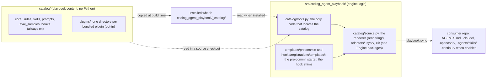

# Overview

What the engine is, what it ships, and how its source and packages are laid out. Back to the [README](../README.md).

## Why coding-agent-playbook?

- **One source, every assistant.** Author your rules, prompts, and skills once
  as markdown + YAML frontmatter. The engine renders them into whatever each
  tool expects — `.claude/`, `.opencode/`, `.continue/` (when enabled), the
  universal `AGENTS.md`, and the shared skill root `.agents/skills/` that Codex
  and OpenCode read — so you stop
  hand-maintaining the same guidance in five formats.
- **Generated output stays out of git.** Rendered files carry an
  `AUTOGENERATED` header and are **local-only** by default: `playbook sync`
  gitignores them through a managed `.gitignore` block, a `post-checkout` /
  `post-merge` hook re-renders them on every machine, and a pre-commit guard
  refuses commits that stage them. The context your assistants read is always
  rendered from the source of truth — never a stale committed copy. (Prefer
  committing it? Set `[output] commit = true` for the legacy drift-check flow.)
- **Context-aware, not noise.** A detector inspects the repo (dependencies,
  frameworks, ML stack, project kind) and each artifact's `applies_if` predicate
  decides what ships — a FastAPI rule only reaches FastAPI repos, the ML
  serialization-security rule only ML repos. Assistants get the rules that
  actually apply. Only a short always-loaded core rides every turn; scoped rules
  load on demand, as references inside skills the assistant picks by
  description.
- **Built for organizations.** Three layers compose by artifact `id`: engine
  generic content → pip-installable org overlay packages → repo-local
  `playbook/` overrides. Central teams distribute standards as versioned
  dependencies; individual repos extend or override locally — no forking, no
  copy-paste.
- **Enterprise-friendly.** Copies, not symlinks (cross-platform,
  banking-safe). No telemetry, ever. No outbound network by default — even the
  pre-commit hooks run locally, so it works fully offline; only
  [`playbook forge`](checks.md#playbook-forge) contacts a forge, and only when someone
  runs it. Distribute via internal PyPI / git.
- **Mistakes caught before they ship.** `playbook validate` cross-checks the
  canonical source (prompt↔rule inclusion symmetry, eval-sample back-references,
  typo'd predicate keys), and a local lockfile records the engine version and
  content hash of every artifact it produced, so regenerations are reproducible
  (and, with `[output] commit = true`, reviewable in a diff).
- **Guardrails inside the session (opt-in).** Lifecycle hooks, rendered
  natively for Claude Code and OpenCode, stop an assistant from hand-editing
  generated files, persisting a secret, skipping your pre-commit hooks or
  ending a turn on a red tree. Every other assistant gets the same guidance as
  text: one line per guardrail in `AGENTS.md`, the full text in a skill.
  Nothing changes until a repo opts in.
- **Self-contained artifacts.** Every markdown link in every artifact must
  resolve inside the shipped bundle; external links pass only through the
  `[links] allowed_domains` allowlist (default: none). Deterministic — no
  network — and enforced on CI for the engine's own artifacts (SPEC §12.6).
- **Quality is measurable.** Prompts can declare paired eval samples (positive +
  false-positive guards), so prompt behavior is testable rather than vibes —
  authored as `[gate]` / `[rubric]` layers and run end-to-end with
  `playbook eval --run`.

## Status

Engine and CLI are implemented: detector, renderer, six adapters
(Continue, Claude Code, OpenCode, AGENTS.md, the `shared_skills` adapter, which
writes the shared skill root `.agents/skills/` read by Codex and OpenCode, and the opt-in
[Agent Harness](https://agentharnesses.io/specification)), the `playbook`
commands (`init` / `sync` / `check` / `validate` / `render` / `eval` /
`metrics` / `import-harness` / `validate-harness`), the off-workstation checks
(`ci` / `gate-scan` / `scan-secrets` / `scan-sinks` / `check-deps` /
`check-commit-trailers` / `check-notebooks` / `docs-check`), the forge operations on GitHub and
GitLab ([`forge`](checks.md#playbook-forge), through `gh` or `glab`), the Tier 0 eval schema
plus the v1.1 eval runner (`playbook eval --run`, deterministic layers live;
judged rubric scoring live via `--judge`), and the code-quality metrics gate.
v0.20 adds the opt-in [assistant lifecycle hooks](hooks.md#assistant-lifecycle-hooks):
a shipped pack of guards that Claude Code and OpenCode enforce natively and every
other assistant reads as advice, all run by one dispatcher, the `playbook-hook`
runtime (`dispatch` for the harnesses; `simulate` and `doctor` for you). v0.21
delivers scoped rules as references inside skills ([Rules inside
skills](skills.md#rules-inside-skills)). See `SPEC.md` for the full design, and
`CONTEXT.md` for the vocabulary these docs use (always rule, scoped rule,
member rule, skill, reference, layer, bundled plugin, adapter): it is the
project's only glossary.

Working on the engine itself:

```bash
uv sync --extra dev   # install engine + dev tools
uv run pytest         # run the test suite
uv run playbook --version  # smoke-test the CLI
```

## Architecture

`playbook sync` composes the three source layers, keeps what applies to the
repo, renders it once, and hands every artifact to every enabled adapter. With
hooks on, one dispatcher answers every harness event at run time:

```text
 sources (later layer wins by id)    resolve                               render
 engine catalog/core/  ─┐            OverlayResolver: one winner per id    sandboxed Jinja,
 overlays, plugins     ─┼──────────► (hooks: overlays only add)  ────────► StrictUndefined
 repo-local playbook/  ─┘            detector facts + applies_if                 │
 rules, prompts, skills, hooks       member rules join the skill they belong to  │
                                     resolve_effective_hooks ([hooks])           │
                                                                                 ▼
 adapters: each writes what its harness reads
   continue       .continue/rules/ (one file per rule) + .continue/prompts/ (opt-in)
   claude_code    .claude/ (always rules + "Where guidance lives" in
                           .claude/rules/coding-agent-playbook.md,
                           a rule-free .claude/CLAUDE.md stub,
                           skills with their rules/ in .claude/skills/<id>/)
                           + managed hook entries in .claude/settings.json
                           + .claude/hooks/playbook/launch.sh
   opencode       .opencode/ + .opencode/plugins/playbook-hooks.js
   agents_md      AGENTS.md (always; always rules + "Where guidance lives";
                           one ## Guardrails line per hook when hooks are on)
   shared_skills  .agents/skills/ (the shared skill root: Codex, OpenCode)
   agent_harness  HARNESS.md tree + .playbook/ sidecar (opt-in)
 sync-level       .coding-agent-playbook.lock
                  .coding-agent-playbook/hooks/guard_config.json (+ copied hook scripts)

 run time (hooks on): every harness event reaches one dispatcher
   Claude Code ── sh .claude/hooks/playbook/launch.sh ──┐
   OpenCode ───── .opencode/plugins/playbook-hooks.js ──┴──► <pinned python> -I -m
                                                             coding_agent_playbook.hook_runtime
                                                             dispatch <event>
   the playbook-hook dispatcher reads guard_config.json, runs every on hook in-process,
   answers deny | ask | context | none and exits 0, or 10 for a deny; the interpreter
   pin lives under <git-dir>/playbook-hooks/, never in the repository
```

Generated output is local-only by default (`[output] commit = false`): the
adapters' files, the launcher, the OpenCode plugin and `guard_config.json` are
gitignored and re-rendered in each clone by the post-checkout `playbook sync`.
`.claude/settings.json` is co-owned with you: sync manages only its own entries
there (hook groups and the native deny rows of the guards that are on),
recognised by their lockfile hash, and never touches your keys or
`.claude/settings.local.json`. The launcher and the OpenCode plugin are
written whole, so a file of yours at either path (one whose first line is not
the `AUTOGENERATED` marker), a hard link at it (the engine would rewrite the
other name too), or a symlink on the way to it, stops `playbook sync` with
exit 1 naming the file, and nothing is written: rename yours, then re-run. Guards on a developer machine are speed bumps;
the authoritative checks run off the workstation, as the
[pre-commit hooks](hooks.md#pre-commit-hooks) and [`playbook ci`](checks.md#playbook-ci).

### Engine packages

`src/coding_agent_playbook/` is a flat set of top-level packages and a few root
modules, each named after a `CONTEXT.md` term where one exists
([ADR 0002](adr/0002-flat-concept-packages-with-an-enforced-dependency-direction.md)).
A package imports only the packages below it, siblings joined by `|` never
import each other, and an underscore module is imported only from inside its
own package. A package's interface is its non-underscore modules; every
package `__init__.py` holds only a docstring (the root's lazy `__version__`
and `cli/`'s `main` are the two exceptions).

```text
 highest first; a package may import any package below it
 cli                the `playbook` entry point: main, the parser, `python -m`
  └ commands        one module per subcommand; twins/ (the guard twins: ci, gate-scan, scan-*, check-*)
   └ sync           the sync pipeline: plan, write, check modes, machine-local hook pins
    └ validation    the validation rule set and its findings (`playbook validate`, sync's gate)
     └ agent_harness | evals | precommit
                    the Agent Harness tree round trip | eval samples: load, compile, run | the pre-commit template
      └ adapters    one adapter per harness (base.py is the out-of-tree interface); claude_code/
       └ rendering  the Renderer: sandboxed Jinja, output formats, RenderSession
        └ hooks     the sync-time half of a hook: resolution/, contract/, registrations/, guard_config/
         └ skills   skill documents, member rules, references
          └ metrics_gate  `playbook metrics` and the Stop-stage metrics call
           └ config       the two consumer config files and their tables
            └ catalog     the catalog: layer roots, the artifact source, overlay resolution
             └ detector | lockfile   detector facts and predicates | the lockfile and its drift
              └ grading            the grading kernel: metrics, checks, rubrics, scheduler
               └ generated_output  sentinel, atomic writes, symlinks, gitignore, write guard
                └ artifacts        the artifact types: rule, prompt, skill, hook, path globs
                 └ security | toml_writer | exit_two
                                   stdlib-only secret, PII and path judges + the trust store
                                   | the TOML writer | ExitTwoError, the CLI's exit-2 error

 hook_runtime  a separate stack outside the order: it imports only itself, the stdlib and the
               stdlib leaves (artifacts.path_classes, artifacts.path_globs, catalog.roots,
               detector.pep503, detector.pyproject_deps, generated_output.atomic_io,
               generated_output.sentinel, lockfile, security), so every hook event stays cheap;
               its deferred branches are named ignore_imports lines of hook-runtime-stack.
               Root modules cli (`playbook-hook`), __main__ and ruff (the post-edit ruff seam);
               config/ shell/ git/ state/ diagnostics/ harness/ judges/ dispatch/ stop/ and
               handlers/ (one subpackage per hook pack: safety, protect, verify, feedback,
               audit, plus _shared). Only commands (the twins), sync and hooks import it,
               and only its public modules.
 templates/precommit/  data: the air-gapped pre-commit starter
```

The external contract never moves with the packages: committed launchers run
`python -I -m coding_agent_playbook.hook_runtime`, the console scripts point at
`coding_agent_playbook.cli:main` and `coding_agent_playbook.hook_runtime.cli:main`,
out-of-tree adapters import `coding_agent_playbook.adapters.base`, child processes
run `python -m coding_agent_playbook.cli`, and the entry-point group names
(`coding_agent_playbook.adapters`, `.overlays`, `.runners`, `.metrics`, `.checks`,
`.hook_handlers` and the rest) stay as they are.

Seven import-linter contracts in `pyproject.toml` (`[tool.importlinter]`)
enforce this: `engine-layers` (the order above), `stdlib-leaves`,
`hook-runtime-stack`, `grading-kernel` (the kernel imports only the stdlib
leaves), `command-independence` (no command imports another), `private-modules`
and `twins-use-judges` (a guard twin reaches its guard's judge through
`hook_runtime.judges`, never a handler). They run from pytest
(`tests/architecture/test_import_contracts.py`), so the CI gate keeps its four
commands. Section 6 of `specs/prT-package-layout.md` designs each contract.

## Editing content

Everything the playbook ships as content lives in `catalog/`, outside the
Python package; `src/coding_agent_playbook/` is engine logic only. Writing a
rule, prompt, eval sample, skill or hook never means touching Python:

- `catalog/core/` holds the engine's built-ins: `rules/` (the always rules),
  `skills/` (each skill with its member rules in `rules/`), `prompts/`, `eval_samples/` and the lifecycle `hooks/`, always on (a hook still
  runs only where `[hooks]` turns it on, and a core skill is written only where
  one of its rules applies).
- `catalog/plugins/<name>/` holds one **bundled plugin** per directory
  (today `superpowers` and `mattpocock_skills`), off until a consumer lists
  `coding_agent_playbook.plugins.<name>` in `overlays_enabled`. A new
  directory there is a new plugin, with no code change. A plugin may ship
  any kind `core/` does, `eval_samples/` included: its samples use its own
  `prompts/` and are listed only where the plugin is enabled.

`catalog/README.md` is the contributor guide: where each kind lives, how to
add a rule, prompt, eval sample, skill or bundled plugin, and the four commands
CI runs. There is still one wheel: the build copies `catalog/` into it, so
`pip install coding-agent-playbook` ships everything. Build releases from the
sdist (`uv build` or `python -m build`, never `--wheel`).


