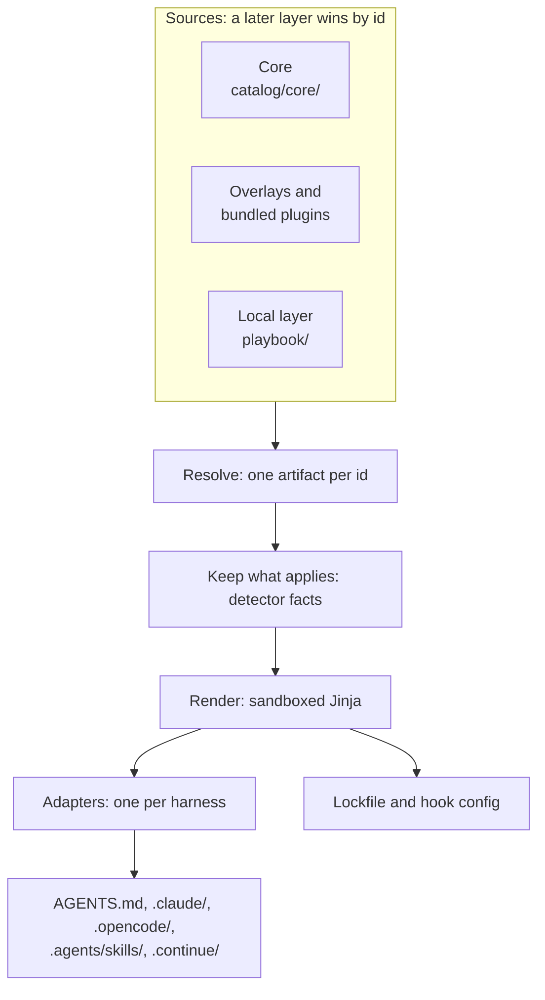
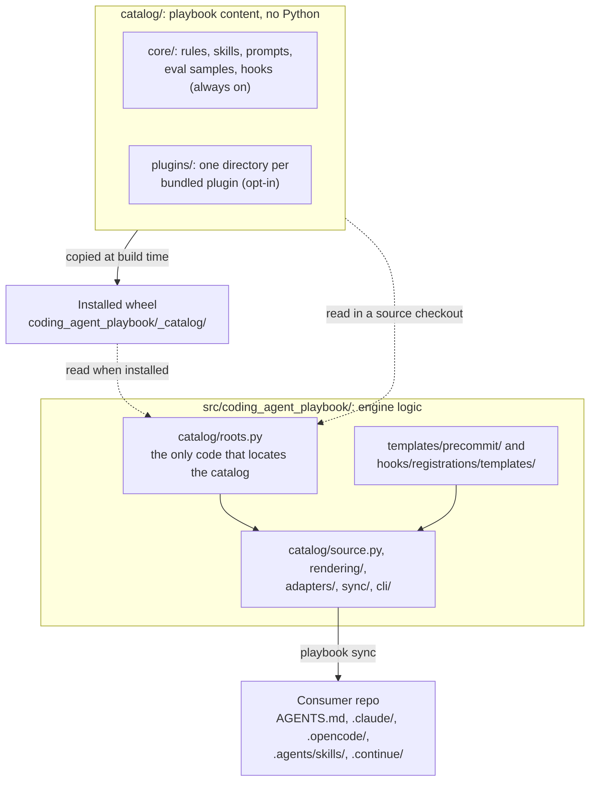

# Overview

This page explains what the engine is, what it ships, and how its source and
packages are laid out. Read it first if you are new to the project. Back to the
[README](../README.md).

## Why coding-agent-playbook?

The engine is an installable Python package. It renders one catalog of guidance
for coding agents into the files each agent reads in your repo. The catalog holds
rules, prompts, skills, hooks and eval samples. The paragraphs below give the
reasons to use it.

One source serves every assistant. You author your rules, prompts and skills
once, as Markdown with YAML frontmatter. The engine renders them into whatever
each tool expects: `.claude/`, `.opencode/`, `.continue/` (when enabled), the
universal `AGENTS.md`, and `.agents/skills/`, the shared skill root that Codex
and OpenCode read. You stop maintaining the same guidance by hand in five
formats.

Generated output stays out of git. Rendered files carry an `AUTOGENERATED`
header and are local-only by default. `playbook sync` gitignores them through a
`.gitignore` block that it manages. A `post-checkout` and `post-merge` git hook
re-renders them on every machine. A pre-commit hook refuses any commit that
stages them. So the context your assistants read is always rendered from the
source of truth, never a stale committed copy. If you prefer to commit it, set
`[output] commit = true` to use the legacy drift-check flow.

Each repo gets only the guidance that applies to it. A detector inspects the
repo: its dependencies, frameworks, ML stack and project kind. Then each
artifact's `applies_if` predicate decides whether the artifact ships. A FastAPI
rule reaches only FastAPI repos, and the ML serialization-security rule reaches
only ML repos. Only a short always-loaded context reaches the model on every
turn. Scoped rules load on demand, as references inside skills that the
assistant picks by their description.

The playbook is built for organizations. Three layers compose by artifact `id`,
and a later layer overrides an earlier one. First comes the engine's generic
content. Next come organization overlay packages, which you install with pip.
Last come the overrides a repo keeps in its own `playbook/` directory. Central teams
distribute standards as versioned dependencies. Each repo extends or overrides
them locally, with no fork and no copy-paste.

The engine suits enterprise environments. It writes copies, not symlinks, so it
works on every platform and is safe for banking. It sends no telemetry, ever. It
makes no outbound network calls by default. Even the pre-commit hooks run
locally, so the engine works fully offline. Only
[`playbook forge`](checks.md#playbook-forge) contacts a forge, and only when
someone runs it. You distribute the engine through an internal PyPI index or
git.

Mistakes are caught before they ship. `playbook validate` cross-checks the
canonical source. For example, it checks that inclusions between prompts and
rules are symmetric, that eval-sample back-references match, and that no
predicate key has a typo. A local lockfile records the engine version and the
content hash of every artifact the engine produced. This makes every
regeneration reproducible. With `[output] commit = true`, you can also review a
regeneration in a diff.

Guardrails can act inside the session, if you opt in. Lifecycle hooks are
handlers that run on agent events. The engine renders them natively for Claude
Code and OpenCode. They stop an assistant from hand-editing generated files,
persisting a secret, skipping your pre-commit hooks or ending a turn on a red
tree. Every other assistant gets the same guidance as text: one line per
guardrail in `AGENTS.md`, and the full text in a skill. Nothing changes until a
repo opts in.

Artifacts are self-contained. Every Markdown link in every artifact must resolve
inside the shipped bundle. External links pass only through the
`[links] allowed_domains` allowlist, which is empty by default. The check is
deterministic and needs no network. CI enforces it for the engine's own
artifacts (SPEC §12.6).

Prompt quality is measurable. A prompt can declare paired eval samples, which
are reproducible test cases for it: a positive case and a false-positive guard.
So you can test how a prompt behaves instead of judging it by feel. You author
the samples as `[gate]` and `[rubric]` layers and run them end to end with
`playbook eval --run`.

## Status

The engine and the CLI are implemented, including the detector, the renderer and
the code-quality metrics gate. The table lists the other parts that ship today.

| Part | What ships |
| --- | --- |
| Adapters | Six: Continue, Claude Code, OpenCode, `AGENTS.md`, `shared_skills` and the opt-in [Agent Harness](https://agentharnesses.io/specification). The `shared_skills` adapter writes the shared skill root `.agents/skills/`, which Codex and OpenCode read. |
| `playbook` commands | `init`, `sync`, `check`, `validate`, `render`, `eval`, `metrics`, `import-harness` and `validate-harness`. |
| Off-workstation checks | `ci`, `gate-scan`, `scan-secrets`, `scan-sinks`, `check-deps`, `check-commit-trailers`, `check-notebooks` and `docs-check`. |
| Forge operations | GitHub and GitLab. [`forge`](checks.md#playbook-forge) runs them through `gh` or `glab`. |
| Evals | The Tier 0 eval schema and the eval runner, `playbook eval --run`. Its deterministic layers are live, and judged rubric scoring is live through `--judge`. |

Since v0.20 the engine also ships the opt-in
[assistant lifecycle hooks](hooks.md#assistant-lifecycle-hooks). They are a set
of guards that Claude Code and OpenCode enforce natively, and that every other
assistant reads as advice. One dispatcher runs them all: the `playbook-hook`
runtime. Its `dispatch` command is for the harnesses, and its `simulate` and
`doctor` commands are for you. Since v0.21 scoped rules are delivered as
references inside skills, as
[Rules inside skills](skills.md#rules-inside-skills) explains.

[`SPEC.md`](../SPEC.md) holds the full design. [`CONTEXT.md`](../CONTEXT.md)
defines the vocabulary these docs use, such as always rule, scoped rule, member
rule, skill, reference, layer, bundled plugin and adapter. It is the project's
only glossary.

If you work on the engine itself, these commands install it with its dev tools,
run the test suite and smoke-test the CLI:

```bash
uv sync --extra dev   # install engine + dev tools
uv run pytest         # run the test suite
uv run playbook --version  # smoke-test the CLI
```

## Architecture

The engine turns the catalog into the files each harness reads. A harness is a
coding-agent runtime, such as Claude Code, OpenCode or Codex. This diagram shows
the main steps.



`playbook sync` composes the three source layers and keeps what applies to the
repo. It renders the result once and hands every artifact to every enabled
adapter. An adapter is the engine part that writes one harness's native files.

The next diagram shows the same pipeline in more detail, with what each adapter
writes. It also shows the run-time side: with hooks on, one dispatcher answers
every harness event.

```text
 sources (later layer wins by id)    resolve                               render
 engine catalog/core/  ─┐            OverlayResolver: one winner per id    sandboxed Jinja,
 overlays, plugins     ─┼──────────► (hooks: overlays only add)  ────────► StrictUndefined
 repo-local playbook/  ─┘            detector facts + applies_if                 │
 rules, prompts, skills, hooks       member rules join the skill they belong to  │
                                     resolve_effective_hooks ([hooks])           │
                                                                                 ▼
 adapters: each writes what its harness reads
   continue       .continue/rules/ (one file per rule) + .continue/prompts/ (opt-in)
   claude_code    .claude/ (always rules + "Where guidance lives" in
                           .claude/rules/coding-agent-playbook.md,
                           a rule-free .claude/CLAUDE.md stub,
                           skills with their rules/ in .claude/skills/<id>/)
                           + managed hook entries in .claude/settings.json
                           + .claude/hooks/playbook/launch.sh
   opencode       .opencode/ + .opencode/plugins/playbook-hooks.js
   agents_md      AGENTS.md (always; always rules + "Where guidance lives";
                           one ## Guardrails line per hook when hooks are on)
   shared_skills  .agents/skills/ (the shared skill root: Codex, OpenCode)
   agent_harness  HARNESS.md tree + .playbook/ sidecar (opt-in)
 sync-level       .coding-agent-playbook.lock
                  .coding-agent-playbook/hooks/guard_config.json (+ copied hook scripts)

 run time (hooks on): every harness event reaches one dispatcher
   Claude Code ── sh .claude/hooks/playbook/launch.sh ──┐
   OpenCode ───── .opencode/plugins/playbook-hooks.js ──┴──► <pinned python> -I -m
                                                             coding_agent_playbook.hook_runtime
                                                             dispatch <event>
   the playbook-hook dispatcher reads guard_config.json, runs every on hook in-process,
   answers deny | ask | context | none and exits 0, or 10 for a deny; the interpreter
   pin lives under <git-dir>/playbook-hooks/, never in the repository
```

Generated output is local-only by default (`[output] commit = false`). The
adapters' files, the launcher, the OpenCode plugin and `guard_config.json` are
gitignored. The post-checkout `playbook sync` renders them again in each clone.

You share `.claude/settings.json` with sync. Sync manages only its own entries
there: the hook groups and the native deny rows of the guards that are on. It
recognises those entries by their lockfile hash. It never touches your own keys
or `.claude/settings.local.json`.

The launcher and the OpenCode plugin are different, because sync writes each of
them whole. So `playbook sync` stops with exit 1 if it finds one of these at
either path:

- A file of yours, meaning one whose first line is not the `AUTOGENERATED`
  marker.
- A hard link, because the engine would rewrite the other name too.
- A symlink on the way to that path.

Sync names the file and writes nothing. Rename your file, then run
`playbook sync` again.

> [!NOTE]
> Guards on a developer machine are speed bumps. The authoritative checks run off
> the workstation, as the [pre-commit hooks](hooks.md#pre-commit-hooks) and
> [`playbook ci`](checks.md#playbook-ci).

### Engine packages

The engine's code lives in `src/coding_agent_playbook/`. It is a flat set of
top-level packages and a few root modules. Each one is named after a
`CONTEXT.md` term where one exists
([ADR 0002](adr/0002-flat-concept-packages-with-an-enforced-dependency-direction.md)).
Three import rules apply:

- A package imports only the packages listed below it in the diagram that
  follows.
- Siblings joined by `|` never import each other.
- An underscore module is imported only from inside its own package.

A package's interface is its non-underscore modules. Every package's
`__init__.py` holds only a docstring. There are two exceptions: the root's lazy
`__version__` and the `main` of `cli/`.

The diagram lists the packages from highest to lowest. Its last part describes
`hook_runtime`, a separate stack outside that order.

```text
 highest first; a package may import any package below it
 cli                the `playbook` entry point: main, the parser, `python -m`
  └ commands        one module per subcommand; twins/ (the guard twins: ci, gate-scan, scan-*, check-*)
   └ sync           the sync pipeline: plan, write, check modes, machine-local hook pins
    └ validation    the validation rule set and its findings (`playbook validate`, sync's gate)
     └ agent_harness | evals | precommit
                    the Agent Harness tree round trip | eval samples: load, compile, run | the pre-commit template
      └ adapters    one adapter per harness (base.py is the out-of-tree interface); claude_code/
       └ rendering  the Renderer: sandboxed Jinja, output formats, RenderSession
        └ hooks     the sync-time half of a hook: resolution/, contract/, registrations/, guard_config/
         └ skills   skill documents, member rules, references
          └ metrics_gate  `playbook metrics` and the Stop-stage metrics call
           └ config       the two consumer config files and their tables
            └ catalog     the catalog: layer roots, the artifact source, overlay resolution
             └ detector | lockfile   detector facts and predicates | the lockfile and its drift
              └ grading            the grading kernel: metrics, checks, rubrics, scheduler
               └ generated_output  sentinel, atomic writes, symlinks, gitignore, write guard
                └ artifacts        the artifact types: rule, prompt, skill, hook, path globs
                 └ security | toml_writer | exit_two
                                   stdlib-only secret, PII and path judges + the trust store
                                   | the TOML writer | ExitTwoError, the CLI's exit-2 error

 hook_runtime  a separate stack outside the order: it imports only itself, the stdlib and the
               stdlib leaves (artifacts.path_classes, artifacts.path_globs, catalog.roots,
               detector.pep503, detector.pyproject_deps, generated_output.atomic_io,
               generated_output.sentinel, lockfile, security), so every hook event stays cheap;
               its deferred branches are named ignore_imports lines of hook-runtime-stack.
               Root modules cli (`playbook-hook`), __main__ and ruff (the post-edit ruff seam);
               config/ shell/ git/ state/ diagnostics/ harness/ judges/ dispatch/ stop/ and
               handlers/ (one subpackage per hook family: safety, protect, verify, feedback,
               audit, plus _shared). Only commands (the twins), sync and hooks import it,
               and only its public modules.
 templates/precommit/  data: the air-gapped pre-commit starter
```

The external contract never moves with the packages. These names and commands
stay as they are:

- Committed launchers run `python -I -m coding_agent_playbook.hook_runtime`.
- The console scripts point at `coding_agent_playbook.cli:main` and
  `coding_agent_playbook.hook_runtime.cli:main`.
- Out-of-tree adapters import `coding_agent_playbook.adapters.base`.
- Child processes run `python -m coding_agent_playbook.cli`.
- The entry-point group names stay the same: `coding_agent_playbook.adapters`,
  `.overlays`, `.runners`, `.metrics`, `.checks`, `.hook_handlers` and the rest.

Seven import-linter contracts enforce these rules. They live in the
`[tool.importlinter]` table of `pyproject.toml`.

| Contract | What it enforces |
| --- | --- |
| `engine-layers` | The order above. |
| `stdlib-leaves` | A stdlib leaf imports only the stdlib and other leaves. |
| `hook-runtime-stack` | The hook runtime imports only itself, the stdlib and the stdlib leaves. |
| `grading-kernel` | The kernel imports only the stdlib leaves. |
| `command-independence` | No command imports another. |
| `private-modules` | An underscore module is imported only from inside its own package. |
| `twins-use-judges` | A guard twin reaches its guard's judge through `hook_runtime.judges`, never a handler. |

The contracts run from pytest, in `tests/architecture/test_import_contracts.py`,
so the CI gate keeps its four commands. Section 6 of
`specs/prT-package-layout.md` explains the design of each contract.

## Editing content

Everything the playbook ships as content lives in `catalog/`, outside the Python
package. `src/coding_agent_playbook/` holds engine logic only. So you never
touch Python to write a rule, prompt, eval sample, skill or hook. The catalog
has two parts.

`catalog/core/` holds the engine's built-ins, which are always on. They are
`rules/` (the always rules), `skills/` (each skill, with its member rules in
`rules/`), `prompts/`, `eval_samples/` and the lifecycle `hooks/`. A hook still
runs only where `[hooks]` turns it on. A core skill is written only where one of
its rules applies.

`catalog/plugins/<name>/` holds one bundled plugin per directory: today
`superpowers` and `mattpocock_skills`. A bundled plugin is an opt-in layer that
ships inside the engine. It stays off until a consumer repo lists
`coding_agent_playbook.plugins.<name>` in `overlays_enabled`. A new directory
there is a new plugin, with no code change. A plugin may ship any kind of
content that `core/` does, `eval_samples/` included. Its samples use its own
`prompts/` and are listed only where the plugin is enabled.

[`catalog/README.md`](../catalog/README.md) is the contributor guide. It
explains where each kind lives and how to add a rule, prompt, eval sample, skill
or bundled plugin. It also lists the four commands CI runs.

Even though the content lives outside the Python package, there is still one
wheel. The build copies `catalog/` into it, so `pip install coding-agent-playbook`
ships everything. Build releases from the sdist (`uv build` or
`python -m build`), never with `--wheel`.

This diagram shows where the catalog lives in a source checkout and in an
installed wheel, and how the engine finds it.


