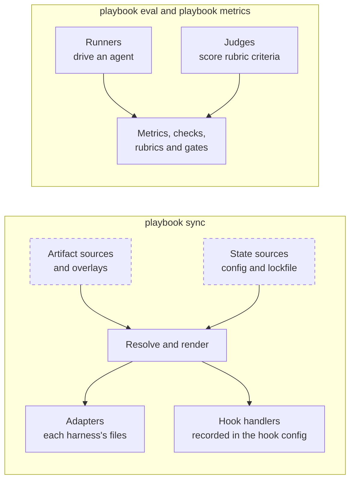

# Extension points

An extension point is an entry-point group through which an installed package adds
engine code. A package declares its entries in its own `pyproject.toml`:

```toml
[project.entry-points."coding_agent_playbook.metrics"]
my_metric = "my_package.metrics:MyMetric"
```

The engine reads eight of the groups today. Three are declared for later: the
engine finds overlays by package name, and it builds its filesystem sources itself.
Where each one plugs in (dashed: the engine does this itself today, and the group
is not read yet):



| Extension point | Entry-point group | What a package adds | Read today |
| --- | --- | --- | --- |
| [Adapters](adapters.md) | `coding_agent_playbook.adapters` | A harness's native files | Yes |
| [Runners](runners.md) | `coding_agent_playbook.runners` | An agent to run eval samples with | Yes |
| [Judges](judges.md) | `coding_agent_playbook.judges` | A scorer for rubric criteria | Yes |
| [Metrics](metrics.md) | `coding_agent_playbook.metrics` | A code measurement | Yes |
| [Checks](checks.md) | `coding_agent_playbook.checks` | A grading strategy | Yes |
| [Rubrics](rubrics.md) | `coding_agent_playbook.rubrics` | A named rubric | Yes |
| [Gates](gates.md) | `coding_agent_playbook.gates` | A named composed gate | Yes |
| [Hook handlers](hook-handlers.md) | `coding_agent_playbook.hook_handlers` | Code a lifecycle hook runs | Yes, at sync |
| [Overlays](overlays.md) | `coding_agent_playbook.overlays` | A layer of catalog content | No: by package name |
| [Artifact sources](artifact-sources.md) | `coding_agent_playbook.artifact_sources` | Where artifacts are read from | No: reserved |
| [State sources](state-sources.md) | `coding_agent_playbook.state_sources` | Where config and lockfile live | No: reserved |

Where the engine ships its own entries in a group, an in-tree entry wins a name
clash with an installed one.

```{toctree}
:hidden:

adapters
runners
judges
metrics
checks
rubrics
gates
hook-handlers
overlays
artifact-sources
state-sources
```
