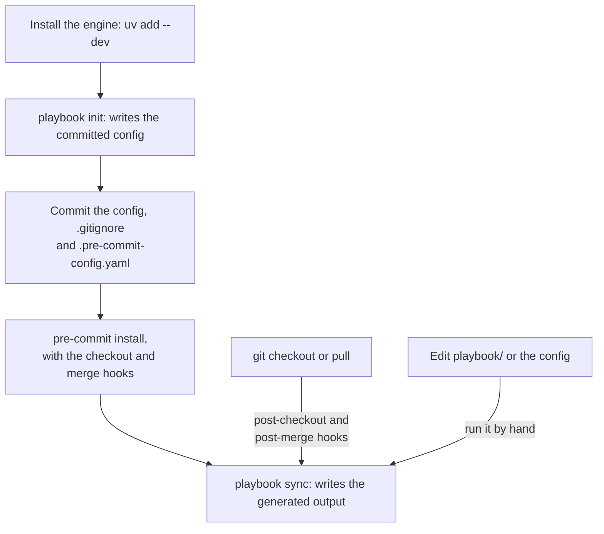
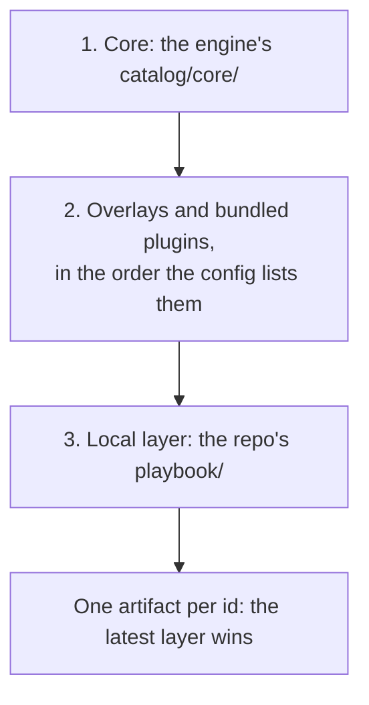

# Setting up a repo

This page shows how to add the playbook to a consumer repo, that is, a repository the
playbook is installed into. You install the engine, initialize the repo, generate its
output and choose which content applies. The [glossary](../CONTEXT.md) defines the
terms used here. Back to the [README](../README.md).

## Using the playbook in an external repo

Add the playbook to any repo whose coding agents should get context generated from
the catalog's canonical rules, prompts and skills. The engine writes this context,
its generated output, into `.claude/`, `.opencode/`, `AGENTS.md` and
`.agents/skills/`. It also writes `.continue/` when you enable it.

The diagram shows the whole procedure. You run the first steps once. After that, the
git hooks re-run `playbook sync` after every checkout and pull, and you run it by
hand when you edit `playbook/` or the config.



### 1. Install

The engine is the installable package that inspects your repo, renders the catalog
and writes the files of each coding agent. Install it as a dev dependency of your
project, from your local checkout of the engine (here next to your project). If your
organization ships its own rules and prompts in an overlay package, install that
package too:

```bash
uv add --dev --editable ../coding-agent-playbook   # the engine, from your checkout
uv add --dev playbook-rules-<org>             # optional: your org's overlay
```

If your packages come from an internal index, `uv add --dev coding-agent-playbook`
works the same way. `pip` works too, with `pip install -e ../coding-agent-playbook`. The engine needs
Python 3.12 or later.

> [!WARNING]
> The hooks pin the project's interpreter, so install the engine per project. Never
> install it with `uv tool install` or `pipx`.

### 2. Initialize

Run `playbook init` once to set up the repo:

```bash
playbook init
```

`playbook init` first detects your stack. It then asks whether to enable the
[assistant lifecycle hooks](hooks.md#assistant-lifecycle-hooks), handlers that run on
agent events, for example before a tool runs or after an edit. Pass `--no-hooks` to
skip them. Then it writes three files:

- `.coding-agent-playbook.toml`, the committed project config shown in step 4 below.
  It includes `[output] commit = false` and your answer as `[hooks] enabled`.
- `.coding-agent-playbook.local.toml`, which holds each engineer's personal
  overrides. It is gitignored automatically.
- A merged `.pre-commit-config.yaml`.

Last, it runs `playbook sync` once. This generates the initial output, and the
managed block in `.gitignore` that keeps that output out of git.

An adapter writes the files of one harness, a coding-agent runtime such as Claude
Code or OpenCode, in that harness's native format. Without `--adapters`, `init`
enables `claude_code`, `opencode` and `shared_skills`. `AGENTS.md` is always written,
whatever adapters you enable.

Continue is opt-in since v0.21. Its upstream is in maintenance, and its IDE already
reads `AGENTS.md` and `.claude/skills/`. To enable it as well, run:

```bash
playbook init --adapters claude_code,opencode,shared_skills,continue
```

Codex needs no adapter, because it reads `AGENTS.md` and `.agents/skills/`. GitLab Duo
reads `AGENTS.md` too.

> [!NOTE]
> An agent that runs on the forge's servers sees only what is committed. A forge is
> the git hosting service, such as GitHub or GitLab. A GitLab Duo agent flow and a
> hosted coding agent are two examples. With the default `[output] commit = false`
> such an agent finds no `AGENTS.md`, so set `commit = true` in repos that use one.

A framework is the bundled plugin or overlay that supplies the spec-driven workflow
skills an agent follows from idea to merge. Choose it with
`playbook init --framework superpowers | mattpocock | none`. The default is `none`.
The option writes the committed `framework` key.

A prompt set is one complete version of the core prompts, the slash commands you
invoke by name. Choose it with the top-level key `prompts = "v1"` or
`prompts = "v2"`. The default is `v1`.

The v2 prompt set keeps the v1 names and `includes_rules`. It also tells the agent
which skills to load and how to check its work. Switching changes only the prompt
text, so the command list stays the same. A prompt with no v2 twin, that is, no
prompt of the same id in `prompts/v2/`, keeps its v1 text. Eval samples keep grading
v1. To grade v2, run `playbook eval <id> --run --prompt-set v2`.

Next, install the git hooks with pre-commit. Install all three hook types, so that
the automatic sync runs after checkouts and pulls:

```bash
pre-commit install --hook-type pre-commit --hook-type post-checkout --hook-type post-merge
```

Commit `.coding-agent-playbook.toml`, `.pre-commit-config.yaml` and `.gitignore`. Do
**not** commit the generated files.

### 3. Generate

`playbook sync` writes the generated output, and it is the command you run most:

```bash
playbook sync     # regenerate .claude/, .opencode/, AGENTS.md, .agents/skills/ (+ .continue/)
```

By default the generated output is local-only. It is not in the repository, so run
`playbook sync` once right after you clone a repo, then install the hooks as in
step 2. From then on, the `post-checkout` and `post-merge` hooks re-run it after
every checkout and pull. Run it by hand whenever you change `playbook/` or the
config.

Sync also handles output that an earlier sync left behind, such as the files of a
skill you removed or of an adapter you disabled. It deletes such a file when the file
is untouched. Otherwise it keeps the file gitignored, so it can never slip into a
commit.

> [!NOTE]
> `playbook sync --check` is for the legacy flow that commits the output, and for CI
> in that flow. Under the default it is only meaningful in a working copy that has
> already been synced.

`AGENTS.md` holds the always rules, the rules that nearly every task needs. A member
rule is not in it. A member rule is a rule in a skill's `rules/` directory, or a
scoped rule that names a skill with `skill:`. It arrives in that skill's `rules/`
directory instead, and a generated `## Where guidance lives` section maps file kinds
to those skills. The core skills are listed under "Rules inside skills" in
[skills.md](skills.md#rules-inside-skills).

`AGENTS.md` is generated whatever adapters are enabled, as long as at least one of
these applies:

- An always rule.
- A Where line, that is, a line of the `## Where guidance lives` map. A skill gets
  one when it has member rules and a `playbook.files` phrase, and an enabled adapter
  writes a skill root.
- A guardrail, the one-line text form of a hook.

Claude Code gets the same always-rule sections and the same map in
`.claude/rules/coding-agent-playbook.md`, which it loads natively. The generated
`.claude/CLAUDE.md` is a stub with no rules in it. OpenCode v1 attaches that file
when it reads under `.claude/`, so the stub keeps OpenCode from loading the rules
twice (SPEC §10.3.1).

Any other file in `.claude/rules/` is yours. `sync` exits 1 rather than do any of
the following:

- Overwrite a file of yours already named `coding-agent-playbook.md` there.
- Write over a hard link at that path.
- Write through a symlink on the way to it, such as a symlinked `.claude` or
  `.claude/rules`, or a link at the file itself.

A symlinked or hard-linked `.claude/CLAUDE.md`, such as a link to `../AGENTS.md`,
stops it the same way.

What `sync` does with git depends on `[output] commit` in
`.coding-agent-playbook.toml`.

With `commit = false`, the default, `sync` writes every generated path into a managed
block of `.gitignore`. Everything outside the block is left byte-for-byte alone. The
block starts and ends with these two lines:

```text
# >>> coding-agent-playbook (managed — do not edit) >>>
# <<< coding-agent-playbook <<<
```

Git may still track generated files, for example in a repo migrating from committed
output. In that case `sync` warns and prints the exact `git rm -r --cached -- …`
command to run. It never touches git state itself. `playbook sync --check-staged`
fails when a commit stages generated output.

With `commit = true`, the legacy mode, the output is committed. `sync` removes the
managed block, and `playbook sync --check` fails a commit on drift.

### 4. Define which resources apply

The content a repo gets comes from three layers. A layer is one source of catalog
content. When two layers hold an artifact with the same `id`, the later layer wins
(SPEC §11). The diagram shows the order:



1. Core, the engine's generic content, ships with `coding-agent-playbook`. It is
   kept in the engine repository's `catalog/core/`.
2. Overlay packages are organization packages you install. You enable them in the
   config, in the order they apply. The engine finds them by their package name, so
   you only list them:

   ```toml
   # .coding-agent-playbook.toml
   schema_version = 1
   # top-level keys: TOML puts anything after a [table] header inside that table
   overlays_enabled = ["playbook_rules_bnp"]     # ordered; later wins on id collision
   adapters_enabled = ["claude_code", "opencode", "shared_skills"]   # the init default
   # AGENTS.md is always emitted
   # add "continue" to opt in; drop "shared_skills" to skip .agents/skills/
   # add "agent_harness" to also emit an Agent Harness tree (opt-in)

   [project]
   name = "risk-models"
   kind = "python-application"          # python-library | ml-research | notebook
   description = "Counterparty risk scoring service"

   [engine]
   version = "0.1.0a0"                  # engine version the config was written for (required)

   [output]
   commit = false     # default: generated output is gitignored (local-only)
   ```

   `playbook init` writes this file for you, together with `[storage]` and
   `[detector_cache]` tables. Keep its `[engine]` table.

   Running `playbook init` again rewrites the file, and so does
   `playbook check --refresh` after you add a dependency. Both rebuild it from the
   committed file alone. Init's answers and the fresh `[detector_cache]` replace
   their keys. Every other value is kept, including tables the engine does not
   manage, such as `[hooks]`, `[links]` and `[metrics]`. Comments and layout are not
   kept.

   The enabled lists are top-level keys only, so they go **above the first
   `[table]` header**. TOML nests a key written after a header inside that table.

   Every command that loads the config checks for the following mistakes before
   anything is written. These commands are `sync`, `check`, `validate`, `render`,
   `eval` and `init`. Each stops with an `error:` (exit 2) when it finds one of them:

   - An `[overlays]` or `[adapters]` table, or `overlays.enabled = …`.
   - An `overlays_enabled` or `adapters_enabled` key written after a `[table]`
     header, for example appended to the end of the file. TOML nests it in that
     table.
   - A misspelled key such as `overlay_enabled`.
   - A value that is not a list of non-empty strings.

   The error names the file and the exact line to write instead.

   A personal `.coding-agent-playbook.local.toml` can set `adapters_enabled` too,
   above its `[user_choices]` header. Its list replaces the committed one for your
   checkout only. No command writes the local file into the committed config.

3. The local layer is the repo's own `playbook/` directory. Put per-repo rules,
   prompts, skills or eval samples there. Anything in it wins on an `id` collision:

   ```text
   playbook/
   ├── rules/         # add a new rule, or override one by reusing its id
   │                  # (a scoped rule names its skill with `skill:`)
   ├── prompts/
   ├── skills/        # <id>/SKILL.md (+ scripts/, references/)
   └── eval_samples/
   ```

Not every resource renders in every repo. The detector inspects the repo and
records facts about it, such as its Python version and ML stack. Each artifact's
`applies_if` predicate then decides whether the artifact is written. For example:

- A FastAPI rule does not ship to a repo without FastAPI.
- The ML serialization-security rule ships only to repos with an ML stack.
- The uv workflow reference ships only to repos the detector sees as uv projects,
  that is, repos with a `uv.lock`.

A skill that owns rules follows them. It is written only when at least one of its
rules applies.

Run `playbook check` to see the detected facts and exactly which rules and prompts
are active. It is the fastest way to find out why one of your rules does not appear.
