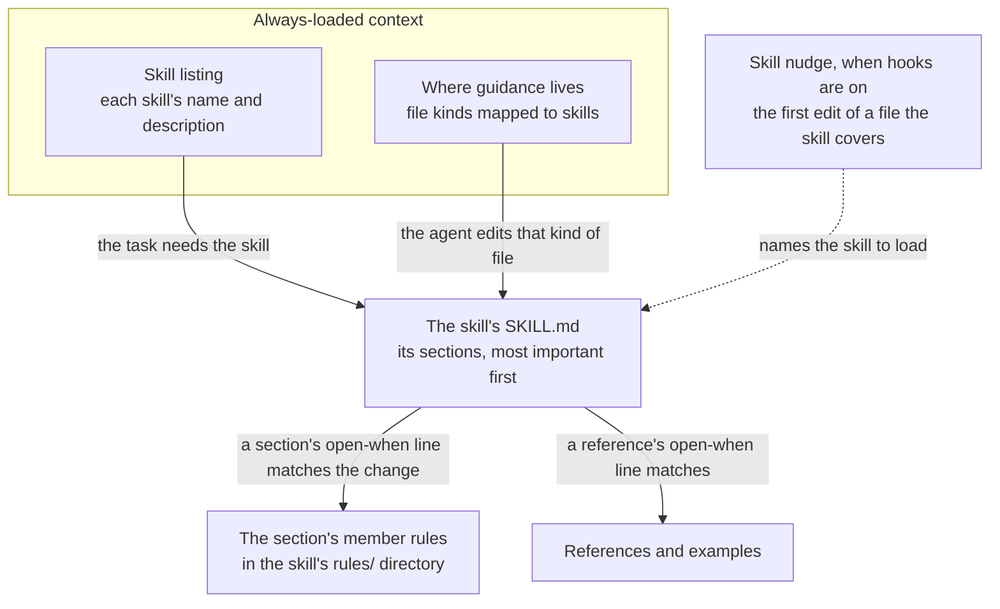

# Skills and bundled plugins

This page explains how the engine writes skills into every skill root, how core's
skills hold their member rules, and how to use the bundled plugins and the Agent
Harness format. Read it when you add or override a skill, or before you enable a
bundled plugin. Back to the [README](../README.md).

## Skills: one source, every Agent-Skills root

A skill is a named unit of on-demand guidance: a short index the agent loads by
name, plus member rules and references it opens only when needed. A skill root is a
directory that harnesses scan to discover skills. The [glossary](../CONTEXT.md)
defines both terms.

A canonical skill is the source the engine renders a skill from. It can be one of
yours, kept as `playbook/skills/<dir>/SKILL.md` with optional `scripts/` and
`references/` directories. It can also be one shipped by an overlay or by core.
Three adapters write every canonical skill natively, into their harness's own skill
root. They share one `SkillWriter`, so every copy is byte-identical:

```text
playbook/skills/<dir>/  ──►  SkillWriter  ──┬──►  .claude/skills/<id>/     (claude_code)
  SKILL.md (id: <id>)                       ├──►  .opencode/skills/<id>/   (opencode)
  scripts/ references/                      └──►  .agents/skills/<id>/     (shared_skills: Codex, OpenCode)
                                     Continue: degraded to a prompt (.continue/prompts/<id>.md)
                                     AGENTS.md: skills are not emitted (a skill with rules gets a "Where guidance lives" line)
```

The last two lines show the targets that get no skill directory. Continue gets a
prompt instead. `AGENTS.md` gets no skills, and names a skill with rules only in its
"Where guidance lives" map.

Every skill must declare `id:` in its `SKILL.md` frontmatter. That `id`, not the
source folder name, is the output directory name, the key used to merge overlays,
and the emitted `name`. The engine overwrites any `name` you write yourself. A
skill without `id:` falls back to the id `skill`, so several skills without an id
collapse into one. `playbook validate` reports each of them.

The `shared_skills` adapter writes `.agents/skills/`, the shared skill root. Codex
reads it natively, and OpenCode reads it as a compatibility root. Claude Code and
Continue read `.claude/skills/`. The adapter is on by default but not
force-enabled, so you can opt out by dropping `shared_skills` from
`adapters_enabled`.

Because OpenCode reads several roots, it can find more than one copy of a skill.
OpenCode v2 keeps one copy per skill, and prefers `.opencode` over `.agents` over
`.claude`. OpenCode v1 logs one duplicate-skill warning per extra copy. Set
`OPENCODE_DISABLE_EXTERNAL_SKILLS` or `OPENCODE_DISABLE_CLAUDE_CODE_SKILLS` to
silence those warnings.

Engines before v0.21 wrote these copies to `shared_skills/`. The next
`playbook sync` deletes the unchanged ones and keeps anything you edited or git
tracks. It reports a tracked file on stderr, and under `commit = true` every kept
file. An edited, untracked copy stays owned and gitignored without a notice. See
`MIGRATION.md`, v0.21.

The engine never writes a file directly into a skill root. Every write goes to
`<root>/<id>/…`, because OpenCode v2 loads any root-level `*.md` in a skill root as
a skill.

Sync copies a skill's `scripts/`, `references/` and `examples/` directories whole,
dot-files included. Python bytecode caches are the one exception. Sync never copies
a `__pycache__/` directory or a `*.pyc` or `*.pyo` file into a skills root, and
never lists one in the lockfile. A skill's `rules/` directory is rendered instead of
copied, as one file per member rule that applies (see
[Rules inside skills](#rules-inside-skills)).

Each emitted `SKILL.md` follows the Agent Skills standard. Its frontmatter `name` is
the skill `id`, which is also its directory name. `playbook validate` flags a skill
without a `description`, and an id that does not match `^[a-z0-9]+(-[a-z0-9]+)*$`
or is longer than 64 characters. OpenCode would otherwise skip such skills
silently.

The `AUTOGENERATED` sentinel marks the skill directories the engine owns. Every
generated `SKILL.md` carries it as its first body line. A skill directory you write
by hand has no sentinel, and sync never touches it. If a hand-written
`<root>/<id>/` has the same id as a canonical skill, sync leaves it alone and prints
a warning instead of overwriting it. Rename one of the two. `playbook sync --check`
and the staged-output guard make the same call, so such a directory is neither
drift nor generated output.

When you remove a skill, or a script from one, `playbook sync` deletes only the
files it wrote that you have not touched since and that git does not track. It then
prunes the emptied directories in all roots. It never prunes above a skills root,
and never the target of a symlinked root such as
`.claude/skills -> ../.agents/skills`.

Sync never deletes an edited copy, a tracked file, or a file you added to a
generated skill directory. Edited or tracked leftovers stay owned until you remove
them, and under the default they stay gitignored. Files you added stay yours. This
one rule holds under `commit = true` too. It also covers a script or reference that
turns from a file into a folder, or back. An edited or tracked copy in the way is
left alone with a warning, and `playbook sync --check` names it until you move it.
A path you re-point through a symlink, or a skill directory whose `SKILL.md` you
rewrote, is yours from then on.

Output written through a link that leads out of the repo, such as
`.claude/skills -> /shared/skills`, gets no lockfile entry. The leftover policy
therefore never deletes it, and a removed skill's files there stay until you delete
them. A stale command or rule file there that carries the sentinel is still
removed, and `playbook sync --check` reports it.

Skill directories follow the rules above, and a skills root that is a dangling link
or a file is skipped with a warning. Anywhere else, anything in the way of output
stops `playbook sync` with exit 1 and a message naming it. Sync never deletes it.
Three kinds of obstacle stop sync:

- A dangling link, such as `.claude/commands -> ../tools/cc` with no `tools/cc`.
  Create the target, or re-point or remove the link.
- A file where an output directory goes, such as a file at `.claude/commands`.
- A directory, FIFO or socket where an output file goes, such as an `AGENTS.md/`
  directory or `mkfifo AGENTS.md`.

Move or fix the obstacle, then re-run sync.

Inside a skill directory, sync never writes through a link that leads out of that
directory. It skips the files under the link with a warning, and
`playbook sync --check` names the link until you remove or re-point it.

### Rules inside skills

Core ships eight base skills. Seven are the Python skills in the table below, which
hold member rules. The eighth, `playbook-guardrails`, holds none. The gated
`domino-*`, `python-documentation` and `playbook-creator` skills join them where the
repo calls for them.

A member rule is a scoped rule seen from the skill that owns it. A core member rule
lives in its skill's `rules/` directory, as
`catalog/core/skills/<skill>/rules/<rule-id>.md`, and that location makes it a
member. The two always rules stay in `catalog/core/rules/always/`.

An agent reaches a member rule in stages, so it loads only what the task needs:



The skill listing and the "Where guidance lives" map are part of always-loaded
context, and either can lead the agent to a skill's `SKILL.md`. When hooks are on,
a skill nudge also names the skill the first time the agent edits a file it covers.
From that index, the agent opens a section's member rules, or a reference, only
when its open-when line matches the change.

Each skill groups its rules into sections, from CRITICAL to LOW. The table lists
core's base skills, their topic and when sync writes them:

| Skill | Its topic | Written when |
| --- | --- | --- |
| `python-coding` | line- and function-level idioms: names, types and docstrings, code shape, error handling, data shapes, Protocols and dataclasses, dependency injection, pure core, asyncio, timeouts and retries, performance idioms, Pydantic at I/O boundaries | always (most of its rules are ungated) |
| `python-testing` | `pytest` conventions, test doubles, fixtures, parametrization, async tests | pytest is detected |
| `python-tooling` | static checks (ruff and mypy), pytest configuration, the uv workflow (uv projects) | always (static checks are ungated) |
| `ml-data` | `ml-serialization-security` and the NumPy, pandas, polars and torch conventions | the ML stack includes one of its libraries |
| `web-application` | web backends: app wiring, request and response schemas, error boundaries, security, and the database with SQLAlchemy or Alembic | a web framework (FastAPI, Flask, Django or Starlette) is a dependency |
| `design-patterns` | the shape of code inside a module: responsibilities, abstractions and coupling, smells, Pythonic patterns | always |
| `python-architecture` | relations between modules: layers, import direction, the composition root, ports, project organization, persistence | always (its persistence rules need SQLAlchemy or Alembic) |
| `playbook-guardrails` | the full text of every enabled hook's guardrail | hooks are on |

Other core skills are gated on the repo, so they cost nothing where they do not
apply:

- The Domino skills, `domino-apps`, `domino-jobs` and `domino-agents`, are written
  only in a Domino project, or where the committed config sets
  `platforms = ["domino"]`.
- `python-documentation` covers documentation practice.
- `playbook-creator` is written where the repo has a playbook layer: `catalog/`, a
  `playbook/` directory, or an overlay package.

`playbook-guardrails` takes no rules. A guardrail is the text form of a hook, for a
harness that cannot run the hook. With hooks on, sync fills this skill with the full
text of every enabled hook's guardrail, one section per hook. It writes the skill to
`.opencode/skills/` and `.agents/skills/`. Claude Code runs the hooks itself, so
`.claude/skills/` gets the skill only for a hook Claude Code cannot run. Continue
keeps its `30-guardrail-<id>.md` rule files. `AGENTS.md` keeps one line per
guardrail, the hook's `summary`, and names the skill.

Core also ships `forge`, which takes no rules and is written in every repo. It
teaches the assistant the operations of [`playbook forge`](checks.md#playbook-forge),
what to do on its exit codes, and where pull request templates live.

Sync renders each rule that applies as `<skills root>/<skill>/rules/<rule-id>.md`.
It also appends a generated index to the skill's `SKILL.md`, in three parts:

- A "How to use this skill" paragraph.
- A `## Rules` part, with one heading per section that has an active rule, such as
  `### Mocking [CRITICAL]`. Each heading is followed by the section's "open when"
  line and a table of its rules.
- A `## References and examples` part.

The skill's description gains a generated "Covers ..." clause that names its active
sections. A skill without sections names its rules instead, ending with "and N more"
when not all of them fit. The engine keeps the description within 300 characters.

`AGENTS.md` and `.claude/rules/coding-agent-playbook.md` then carry only the always
rules and a generated `## Where guidance lives` map from file kinds to these skills.
The map is left out when no enabled adapter writes a skills root.

A skill's `rules/`, `references/` and `examples/` directories hold different
things. `rules/` holds the member rules. Each one covers one topic in its own file,
is gated by `applies_if`, is ordered by priority and is listed in the index.
`references/` holds free-form, long-form documents such as decision guides and
walkthroughs. A reference has no priority, and no gate of its own beyond the
skill's `playbook.references` entry. `examples/` holds runnable example code.

> [!NOTE]
> A skill's `.claude/skills/<skill>/rules/` directory is
> unrelated to Claude Code's `.claude/rules/` directory, which holds always-loaded
> rule files. Claude Code loads a skill's `rules/` only when the skill is used.

Core's Python guidance is vendored content, copied from two MIT-licensed sources.
Each skill that holds their text ships the license notice as
`references/LICENSE.<source>`, so the notice lands in every synced skill directory.
Continue reads no skills, so its output carries no license copy. If you render for
Continue only, keep a copy of those notices next to its rules yourself.

To add a rule to a core skill, name the skill in the rule. Writing
`skill: python-coding` in `playbook/rules/<file>.md`, or in an overlay, is enough,
because membership is resolved after every layer is merged. Every scoped rule
outside a skill's `rules/` must name a skill. `playbook validate` fails on a scoped
rule without `skill:` and lists the skills it may name, and `playbook sync` writes
nothing until you fix it. A rule from another layer without `section:` lands in an
"Other" section, listed last, and `playbook validate` warns about it.

To override a core skill, add your own copy, such as
`playbook/skills/python-coding/SKILL.md`. The core rules still attach to it, so keep
its `playbook:` block with `use_when`, `files` and `sections`. A skill without that
block, such as a bundled plugin skill, takes no rules.

Continue reads no skills. When it is enabled, it still gets one `.continue/rules/`
file per rule, and a skill with rules is never turned into a Continue prompt.

## Bundled plugins: superpowers, mattpocock_skills

A bundled plugin is an opt-in layer that ships inside the engine wheel. Bundled
plugins were called packs before v0.19. A bundled plugin layers exactly like an
overlay package but needs no extra install, and it stays off until you list it.
Each one is a plain content directory, `catalog/plugins/<name>/` in the engine
repository, and you enable it as `coding_agent_playbook.plugins.<name>`.

The first bundled plugin is `superpowers`. It is vendored content: a near-verbatim,
self-contained copy of the Superpowers skills library by Jesse Vincent (v7.0.0,
MIT). It has 15 skills: brainstorming, writing-plans, executing-plans,
subagent-driven-development, test-driven-development, systematic-debugging,
verification-before-completion, requesting-code-review, receiving-code-review,
using-git-worktrees, finishing-a-development-branch, dispatching-parallel-agents,
writing-skills, using-superpowers and diagnosing-superpowers.

To enable it, list it in `overlays_enabled`. The `adapters_enabled` line below is
the `playbook init` default:

```toml
# .coding-agent-playbook.toml (top-level keys, above the first [table] header)
overlays_enabled = ["coding_agent_playbook.plugins.superpowers"]
adapters_enabled = ["claude_code", "opencode", "shared_skills"]   # the init default
```

Both bundled plugins are frameworks. A framework supplies the spec-driven workflow
skills an agent follows from idea to merge, and each of these ships a
`framework.toml` at its root. The shorter way to enable one is the top-level key
`framework = "superpowers"` or `framework = "mattpocock"`, which
`playbook init --framework …` writes for you. Keep `overlays_enabled` for add-ons
that are not frameworks.

You can enable only one framework at a time. `playbook validate` refuses two
frameworks enabled together, naming both. To switch, change the config and run
`playbook sync`, which removes the old framework's files. `playbook check` prints
the enabled framework's roles, such as
`framework mattpocock: clarify -> grill-me, debug -> diagnosing-bugs, …`.

Every framework writes its document paths in one default layout: `CONTEXT.md`,
`docs/adr`, `docs/specs`, `docs/plans` and so on. A `[layout]` table moves any of
them. Its keys are `glossary`, `context_map`, `adr`, `architecture`, `specs`,
`plans`, `research`, `agents` and `scratch`. Each value is a relative path with no
trailing `/`. This example moves the specs from `docs/specs` to `specs`:

```toml
[layout]
specs = "specs"
```

`playbook sync` then rewrites that default path prefix in every synced file, rule
globs and hook path tables included. Templates read the result as `layout.specs`.
`playbook validate` prints each rewrite as
`layout: <file>: docs/specs -> specs (<count>)`.

A framework whose text uses other paths maps them with `[layout_aliases]` in its
`framework.toml`, and sync applies those aliases under the default layout too. The
bundled superpowers and mattpocock frameworks need none, because their text already
names `docs/specs/` and `docs/plans/`.

Two parts of the catalog keep specs and plans in the configured places. The always
rule `document-layout` names those places in every always-loaded file. The
`document-layout-guard` hook denies a spec or plan written outside them, for
example into `docs/superpowers` or as a spec or plan file under `.scratch/`, and
names the directory it belongs in.

Use the top-level keys shown above, because they are the only ones the engine
reads. Put them at the top of the file, above the first `[table]` header. The file
`playbook init` writes ends with a `[detector_cache.frameworks]` table, so a line
appended to the end of the file lands in that table.

Every command that loads the config refuses three mistakes: a key nested in a table
that way, the `[overlays] enabled` / `[adapters] enabled` table form, and a
misspelled key. Those commands are `sync`, `check`, `validate`, `render`, `eval` and
`init`. Each exits 2 with an `error:` that names the file and shows the top-level
line to write. It writes nothing, so a repo you already synced keeps its skills,
lockfile and `.gitignore` untouched.

A misspelled bundled-plugin name is caught everywhere:

- `playbook sync` exits 1 naming it and writes nothing. This holds in write mode,
  with `--check`, and with `--check-staged` under the default `commit = false`.
  Under `commit = true`, `--check-staged` is a no-op.
- `playbook validate` fails on it.
- `playbook check` flags it under `Overlays:`.
- `playbook init` refuses it before writing. The name can come from `--overlays`,
  or from a local file's `overlays_enabled`, which replaces it.

The engine checks a bundled-plugin name against `catalog/plugins/<name>/` and never
imports it. An unknown name reads `no such bundled plugin`. A name that looks like a
plugin typo also lists the bundled plugins:

```text
coding_agent_playbook.plugins.superpower: no such bundled plugin (bundled plugins: coding_agent_playbook.plugins.mattpocock_skills, coding_agent_playbook.plugins.superpowers)
```

The bare namespace, `coding_agent_playbook.plugins` or the old
`coding_agent_playbook.packs`, is refused as
`the bundled plugin namespace, not a plugin`. Any other name is an overlay package,
and the engine still imports it. An overlay that imports but ships no `resources/`
directory is refused, and so is one whose import raises. In that case the reason
quotes the error.

> [!TIP]
> You can let `playbook init` write the config for you:
> `playbook init --non-interactive --name … --kind … --overlays coding_agent_playbook.plugins.superpowers`.

`playbook sync` then writes each plugin skill like any canonical skill (see above).
It writes byte-identical copies to `.claude/skills/<id>/`, `.opencode/skills/<id>/`
and `.agents/skills/<id>/`. Each copy holds the skill's `SKILL.md`, with the
`AUTOGENERATED` sentinel as its first body line, plus its `references/` and
executable `scripts/`. Continue, when enabled, gets each skill degraded to a prompt
that holds only the body. The opt-in `agent_harness` adapter writes `skills/<id>/`.
To enable it, add `agent_harness` to the top-level `adapters_enabled`. Like all
generated output, the copies are gitignored by default.

The superpowers plugin is self-contained. Nothing reaches out to the upstream
plugin, its marketplace or the network. Cross-skill references use plain skill
names, and the bundled plugin contains no external URLs. Two upstream parts are left
out: the brainstorming visual companion, which is a Node.js server, and the
upstream plugin's SessionStart hook.

The license and the list of changes are in `catalog/plugins/superpowers/LICENSE`
and `ATTRIBUTIONS.md`. Every skill also carries the license as
`references/LICENSE`, so it lands in each synced skill directory. If you render the
plugin only for Continue, keep a copy of that `LICENSE` next to the prompts
yourself.

To opt out, remove the plugin from `overlays_enabled` and run `playbook sync`. The
plugin's skills then become leftovers of an earlier sync, and the same rule settles
them as a skill you remove. Sync deletes every file it wrote that you have not
touched since and that git does not track, then prunes the emptied directories. The
15 skill directories therefore disappear from every skill root. Until you sync,
`playbook sync --check` reports the managed `.gitignore` block as stale, under the
default `commit = false`.

Some files survive opting out. A skill file you edited is kept, still owned and
gitignored, until you delete it by hand. A file you added inside a skill directory,
such as notes in `references/` or `node_modules/` under `scripts/`, was never
written by sync. It stays, and so does the directory that holds it. The plugin's
Continue prompts carry the `AUTOGENERATED` header on line 1, so they are removed
even if you edited or committed them. Under `commit = true`, committed (tracked)
skill files are kept and listed on stderr until you `git rm` them. See SPEC §11.5
and §4.2 step 9.

The same rule applies when you override one plugin skill with
`playbook/skills/<id>/`. Your override replaces the plugin skill in every root.
Sync removes every unedited plugin file under that skill's `scripts/` or
`references/` that your override does not ship.

> [!WARNING]
> An override of `subagent-driven-development` must therefore ship
> `scripts/task-brief` and `scripts/sdd-workspace`, because executing-plans calls
> them (SPEC §11.5.1).

The second bundled plugin is `mattpocock_skills`, enabled as
`coding_agent_playbook.plugins.mattpocock_skills`. It is vendored content: Matt
Pocock's engineering and productivity skills, pinned to upstream v1.3.1 (MIT) and
kept near-verbatim. Every change is listed in
`catalog/plugins/mattpocock_skills/ATTRIBUTIONS.md`. It ships 26 skills and one
plugin always rule.

Upstream's `triage` is dropped. Three skills are renamed so they do not replace
Claude Code's own bundled skills:

| Upstream name | Name in this plugin |
| --- | --- |
| `code-review` | `two-axis-review` |
| `pr` | `pr-body` |
| `prototype` | `throwaway-prototype` |

The skills name no tool that a consumer repo may lack: no forge CLI, `jq`, OS
openers, CDN assets or bash scripts. Forge issues go through `playbook forge`, and
the scripts of wizard and diagnosing-bugs are standard-library Python. The plugin
contains no URL. Enable it on its own:

```toml
# .coding-agent-playbook.toml (top-level key, above the first [table] header)
overlays_enabled = ["coding_agent_playbook.plugins.mattpocock_skills"]
```

Then, once per repo:

1. Run `/setup-matt-pocock-skills`. It writes `docs/agents/issue-tracker.md`,
   `docs/agents/triage-labels.md` and `docs/agents/domain.md`.
2. Add `.scratch/` to your `.gitignore`. It holds only throwaway prototypes, which
   are never staged or committed.
3. If you use the upstream Claude Code plugin of these skills, disable it in this
   repo, or each skill appears twice.

Setup also chooses where the skills track issues. When the repo pushes to GitHub or
GitLab, it proposes "Forge issues", which you confirm once. The skills then track
issues through `playbook forge`, and setup checks the forge CLI's login and creates
the labels. Otherwise the default tracker is local markdown, which needs no remote
or CLI. The local tracker keeps its specs in `docs/specs/` and its maps and tickets
in `docs/plans/`. The plugin always rule, `mattpocock-skills-tracker`, points the
agent at these files. It also asks the agent to tell you to run setup when a skill
needs one that is missing.

Fifteen skills run only when you ask for them by name: `/ask-matt`, `/grill-me`,
`/grill-with-docs`, `/handoff`, `/implement`, `/implement-spec`,
`/improve-codebase-architecture`, `/retro`, `/setup-matt-pocock-skills`, `/teach`,
`/to-questionnaire`, `/to-spec`, `/to-tickets`, `/wait-what` and `/wayfinder`. Only
Claude Code honours their `disable-model-invocation: true`. In every other harness,
each one starts with a line asking the model to stop unless you asked for it. The
other eleven load when a task calls for them. Continue, when listed, gets each skill
as a body-only prompt without its `references/` or scripts.

Do not enable it together with superpowers. Several skills cover the same ground,
among them `tdd` and `test-driven-development`, `diagnosing-bugs` and
`systematic-debugging`, and `grilling` and `brainstorming`. The two skill listings
together with core's also come to about 6,800 characters. That is over the
6,000-character budget for core plus one bundled plugin. See SPEC §11.5.3 and
`catalog/plugins/mattpocock_skills/README.md`.

The plugin's two scripts, wizard's and diagnosing-bugs', are `.py` files. Sync
writes them as such under `.claude/skills/`, `.opencode/skills/` and
`.agents/skills/`, and under `skills/` with `agent_harness`. Tools that run over
the repository root can therefore find them.

`mypy .` skips dot-directories but ignores `.gitignore`, so the default adapters'
copies never reach it. It type-checks only the single `skills/` copy of the opt-in
`agent_harness` adapter, so the duplicate-module error of earlier releases is gone.
`ruff check .` skips the scripts in a git repository while they are gitignored,
which is the default `commit = false`. Under `commit = true` it lints every copy.

If you run these tools over the repository root, exclude the generated skill roots.
For example, use `exclude` under `[tool.mypy]` and `extend-exclude` under
`[tool.ruff]`.

The `python_design` bundled plugin is gone, and its guidance is being folded into
core. A config that still lists `coding_agent_playbook.plugins.python_design` is
refused as `no such bundled plugin`. Remove it from `overlays_enabled`, as
`MIGRATION.md` explains.

Old names still work. A config written before v0.19 says
`coding_agent_playbook.packs.<name>`. That spelling is a deprecated alias. The
plugin renders exactly as before, and every command that loads the config prints
one line per old name, naming the file that holds it:

```text
warning: .coding-agent-playbook.toml: overlays_enabled: 'coding_agent_playbook.packs.superpowers' is deprecated; use 'coding_agent_playbook.plugins.superpowers'
```

`sync` never rewrites the name for you. To update it, re-run `playbook init` with
`--overlays coding_agent_playbook.plugins.<name>`, or edit
`.coding-agent-playbook.toml`. `playbook init` accepts an old name in `--overlays`
too: it prints a `warning: --overlays: …` line and writes the name in its new
spelling. You must edit a `.coding-agent-playbook.local.toml` by hand. The
`coding_agent_playbook.packs` modules and their `PACK_NAME` constants are gone, so
list the dotted string instead. See `MIGRATION.md`.

## Agent Harness support (opt-in)

Besides the always-available targets, the playbook can render to and read from the
[Agent Harness](https://agentharnesses.io/specification) format. An Agent Harness
tree is a directory tree of skills, prompts, rules and references, rooted at a
`HARNESS.md` file.

### The `agent_harness` adapter

The `agent_harness` adapter is opt-in: it is not part of the default adapter set.
Enable it by adding `agent_harness` to the top-level `adapters_enabled` list.
Otherwise it behaves like any other adapter under `playbook sync`:

```toml
# .coding-agent-playbook.toml (top-level key, above the first [table])
adapters_enabled = ["continue", "claude_code", "agent_harness"]
```

`playbook sync` then emits a `HARNESS.md` and the `skills/`, `prompts/`, `rules/`
and `references/` directories. Next to them it writes a `.playbook/manifest.toml`
sidecar that records everything the harness format cannot represent. With that
sidecar, the tree round-trips back to canonical artifacts losslessly.

### Importing and validating harness trees

Two commands handle the reverse direction and structural linting:

```bash
playbook import-harness <path> [--into <dir>]   # harness tree → canonical artifacts (default ./playbook/)
playbook validate-harness <path> [--strict]     # structural checks (harnesses-ref-equivalent)
```

`import-harness` is lossless when the source carries a `.playbook/manifest.toml`
sidecar, as a harness the playbook emitted does. For a foreign harness it works
best-effort, and reports every lossy assumption it makes. `validate-harness` checks
that `HARNESS.md` and every skill leaf carry a `name` and a `description`. It warns
on missing routing files and on undescribed content files. With `--strict`, it
fails on them instead.
