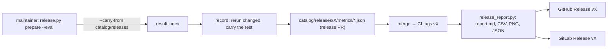

# Release metric artifacts and reuse of every committed eval result

Status: draft for review (2026-10-29). Decision record: ADR 0014, amending ADR 0013.

## Problem

- **Nobody sees how the metrics moved.** `scripts/release.py prepare --eval`
  records one metrics file per target under `catalog/releases/<version>/metrics/`,
  and CI tags the release commit. Nothing is published: no release page, no
  report of what changed since the previous release, no charts, no trend.
- **Reuse looks one release back only.** ADR 0013 carries a sample when its
  inputs digest and the setup digest match the *previous release's* file of the
  *same target*. A result measured earlier with the same task, model, parameters
  and sample is paid for again. That happens when it was measured in an older
  release, after a setup that changed and changed back, or under another target
  name.

## Goals

1. Every release publishes a **metric-change bundle** on both GitHub and GitLab:
   - a change report;
   - charts;
   - trends across all releases;
   - the raw data.
2. A record run **never recomputes a sample already measured** with the same
   inputs and setup in any committed release.
3. The maintainer still runs the paid evals (`prepare --eval`). CI runs no paid
   call and needs no model key or harness CLI.

## Non-goals

- Running evals in CI.
- A result store outside `catalog/releases/`: benchmark and ad-hoc runs do not
  feed the reuse.
- Pinning harness versions. A new harness version is a new setup and still
  reruns every sample.
- A GitLab job that creates the tag. GitLab publishes on any `v*` tag pipeline,
  however the tag arrived (a mirror, or `scripts/release.py tag`).

## Terms

- **Task**: a prompt id with eval samples (`review`, `explain`, ...): the
  `prompt_id` of a metrics entry.
- **Inputs digest, setup digest, carried entry, `measured_in`**: as in ADR 0013.
  The setup digest covers:
  - the harness and its version;
  - the model;
  - the endpoint fingerprint;
  - the judge model, its effort and its sample count;
  - runs and fail-fast;
  - isolation;
  - the scoring code.

  It does not cover the target's name.
- **Result index**: every committed release metrics file, indexed for reuse.

## Decisions

### D1. `--carry-from` takes the releases directory

`playbook eval --run --all --record OUT --carry-from catalog/releases` builds a
**result index** before any paid run:

- It reads every `catalog/releases/*/metrics/*.json`, of any target name.
- It skips a file that fails `validate_release_metrics`, records no setup digest,
  or whose setup parts differ from this run's (`differing_setup_parts`).
  `UNKNOWN_VERSION` never matches, as today.
- From every remaining file it indexes the entries that record an inputs digest,
  by `(sample id, inputs digest)`.
- When several files hold the same key, the **newest release wins** (SemVer
  order of the directory names). Within one release, the target's own file wins,
  then the other names in sorted order.

For each sample of the run:

- **Edition control**: always reruns, as today.
- **Key found**: a *carried entry*, built with `carried_entry`. Its `measured_in`
  is the entry's own when it was already carried, else the source file's release
  and commit. The plan line names the source, for example
  `review/x: carried from 0.3.0 (opencode-qwen)`.
- **Key not found**: reruns. The reason is `new sample` when no indexed file has
  the sample id, else `inputs digest changed`.
- **No usable file at all**: every sample reruns, and the reason lists why each
  file was skipped. The first three are named and the rest counted, for example
  `the setup differs in harness_version`.

`--carry-from FILE` keeps today's meaning (one baseline, same target name), so
nothing that passes a file changes. `reported_model` comes from the
newest source file that a carried entry came from.

### D2. The regression check still compares with the previous release

`check_regressions(new, previous)` keeps the previous release's file for the
same target as its baseline. A carried entry whose source is not that file needs
a new rule:

- It is `carried` (never blocks) only when its inputs digest equals the previous
  file's entry for that sample.
- Otherwise its scores differ from the previous release's, for example after a
  revert to older text. It is compared like a rerun (`regression`,
  `improvement`, `ok`) and noted `measured in <release>`.

This closes the hole where a revert could hide a regression behind `carried`.

### D3. `prepare --eval` passes the releases directory

`scripts/release_eval.py` passes `catalog/releases` instead of the previous
release's file. `--full` still passes nothing.

The release pull request's `Release metrics` section is the change report of D4,
up to `ReleaseReport.markdown(limit=...)` characters with a pointer to the full
bundle. The `N rerun, M carried` line now also says where the carried entries
come from, for example `M carried (K from older releases)`.

### D4. The report data lives in the engine

A new pure module, `coding_agent_playbook.evals.release_report`. It does no
plotting and adds no dependency.

It lives in `evals`, not in `release`, because it reuses `check_regressions` and
the `release` layer sits below `evals` (import-linter `engine-layers`). Like
every top-level `evals` module, it joins `SCORING_EXEMPT` with its reason ("renders
committed metrics; decides no score"), or the setup-digest guard test fails. D1's
index code also goes in `evals`, as `evals.result_index`, and joins the same list.

- `load_history(catalog_root) -> MetricsHistory`: every release's metrics files,
  validated, in SemVer order, per target name.
- `release_report(history, version) -> ReleaseReport`. For each target of
  `version`:
  - **Baseline**: the latest earlier release with a file for that target, or
    `None`.
  - **Per-sample verdicts**: `check_regressions`, so the report and the release
    gate always agree. The accepted reasons are stored.
  - **Per task**:
    - previous and new pass rate (`sum(passes) / sum(runs)`);
    - mean score;
    - delta;
    - counts of `regression`, `improvement`, `ok`, `carried`, `new`,
      `not_comparable`.
  - **Edition controls**: a separate table.
  - **Trend**: per task, the pass rate and mean score in every release that has
    a file for the target.
- `ReleaseReport.markdown() -> str`, which renders:
  1. a headline per target: pass rate and mean score with the delta, then
     `rerun / carried`, the setup line, and any regressions with their accepted
     reasons;
  2. a per-task table;
  3. the samples that changed;
  4. the controls;
  5. a trend table.

  Carried samples are counted, not listed.
- `ReleaseReport.csv_rows()`: one row per release × target × sample over the
  whole history. Columns:
  `release, target, task, sample, passes, runs, pass_rate, mean_score,
  delta_mean, verdict, measured_in_release, inputs_digest, setup_digest`.
  `delta_mean` and `verdict` are empty for a release with no baseline.

### D5. The bundle script adds charts

`scripts/release_report.py --version X --out DIR` (needs matplotlib) writes:

| File | Content |
|---|---|
| `report.md` | `ReleaseReport.markdown()`; also the release description |
| `metrics-history.csv` | `csv_rows()` |
| `metrics/<target>.json` | the release's files, byte copies |
| `task-deltas.png` | per target: previous vs new pass rate per task (paired bars) |
| `sample-deltas.png` | rows are samples that were not carried, columns are targets; cell color is the mean-score delta (diverging blue-red, gray at 0, labelled) |
| `task-trend.png` | per task: pass rate over releases, one line per target |

- A release with no baseline writes no delta charts, and its report says so.
- `--no-charts` skips the PNGs, so the bundle can be built without matplotlib.
- Charts follow the repo's dataviz conventions:
  - status colors are never used for series;
  - every series is labelled;
  - there is no dual axis.

### D6. GitHub publishes in the tagging workflow

A tag pushed with `GITHUB_TOKEN` starts no workflow, so publishing runs in the
same workflow as tagging:

- **`tag-release` outputs the version** it tagged, or that was already tagged at
  that commit (new `--github-output` flag on `scripts/release.py tag`). It
  outputs nothing when there is nothing to tag.
- **New job `publish-release`** has `needs: tag-release`, `if: version output !=
  ''` and `permissions: contents: write`. It:
  1. checks out the tag;
  2. runs `pip install -e . matplotlib`, then `python scripts/release_report.py
     --version X --out release-report`;
  3. runs `gh release create vX --title vX --notes-file release-report/report.md
     release-report/*`.

  When the release already exists, it runs `gh release upload --clobber` and
  `gh release edit --notes-file` instead, so a rerun is safe. The notes stay
  under GitHub's 125,000-character body limit through `markdown(limit=...)`.
- **Backfill:** `workflow_dispatch` with a `version` input runs `publish-release`
  alone for an existing tag. It is used once for v0.2.0, v0.3.0 and v0.4.0.

### D7. GitLab publishes on tag pipelines

New jobs in `.gitlab-ci.yml`, both with rules `if: $CI_COMMIT_TAG =~
/^v\d+\.\d+\.\d+$/`:

- **`release-report`** (stage `build`, image `$PYTHON_IMAGE`) builds the bundle
  into `release-report/` as artifacts that never expire.
- **`release`** (stage `deploy`, image `$RELEASE_CLI_IMAGE`, a variable so a
  company registry can supply it) uses `needs: [release-report]`. It creates the
  GitLab Release for `$CI_COMMIT_TAG`:
  - its description is `release-report/report.md`;
  - its asset links point to the job artifacts
    (`$CI_PROJECT_URL/-/jobs/<id>/artifacts/file/release-report/<file>`).

  On a rerun, it updates the existing release through the Releases API instead
  of failing.

`PIP_INDEX_URL` and the image variables keep working behind the company proxy,
as for the docs jobs. A tag pipeline started by hand from the GitLab UI (*Run
pipeline* on the tag) backfills older tags.

## Data flow

## Errors

- An unreadable or invalid metrics file in the index is skipped, and the plan
  names it. `--carry-from FILE` still refuses a bad file, as today.
- `release_report` raises `ReleaseReportError(ExitTwoError)` when `version` has
  no metrics directory. The message names the path and the versions that have
  one.
- A publish job that fails leaves the tag in place. Rerunning the job is safe:
  it creates the release, or updates it when it exists.

## Testing

All engine tests run headless with `pytest`, using small fixture metrics files
under `tests/fixtures/release_metrics_history/`.

- **Result index:**
  - setup match and mismatch;
  - the newest release wins;
  - target-name order within a release;
  - a file without setup or inputs digests is skipped;
  - `UNKNOWN_VERSION` never matches;
  - edition controls always rerun;
  - `measured_in` is kept through a second carry;
  - `--carry-from FILE` behaves as before;
  - the plan lines name the source.
- **D2**: a carried entry from an older release whose digest differs from the
  previous file's entry is compared, so a regression blocks. One equal to it
  stays `carried`.
- **Report:**
  - per-task aggregates and deltas;
  - agreement with `check_regressions`;
  - a release without a baseline;
  - controls;
  - the trend table;
  - CSV columns and row count;
  - the Markdown limit truncates with a pointer;
  - a golden Markdown file for one fixture history.
- **Script:** the bundle file list with `--no-charts`. The chart tests use
  `pytest.importorskip("matplotlib")`, since the CI test job installs no
  matplotlib.
- **`release.py tag --github-output`** writes `version=<v>` for a new tag and an
  existing tag at the commit, and nothing when there is nothing to tag.
- CI YAML is checked by running the jobs on a throwaway tag in a fork, or with
  `workflow_dispatch` on v0.4.0. It is not unit tested.

## Rollout

1. ADR 0014, D1, D2 and D3: the engine and `prepare`. The next release's evals
   reuse every committed result.
2. D4: the report module, and the release PR body uses it.
3. D5: the bundle script.
4. D6: GitHub publishing, then backfill v0.2.0, v0.3.0 and v0.4.0.
5. D7: GitLab publishing, verified on the internal GitLab.

## Open questions

None at the time of writing.
